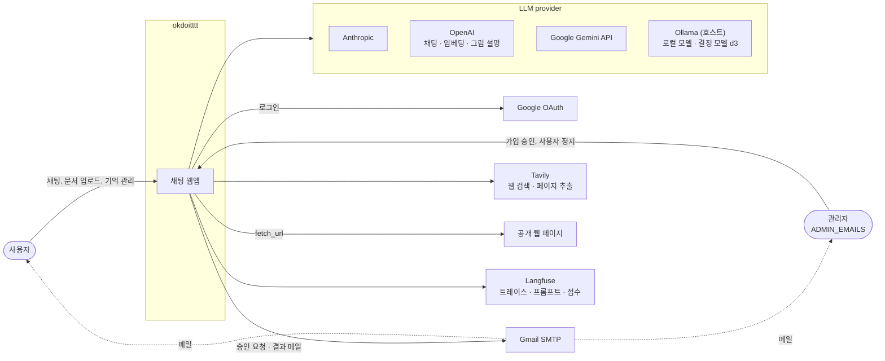
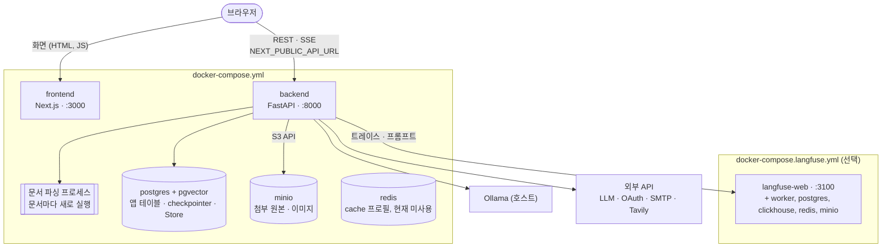
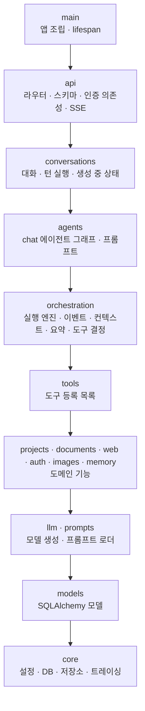
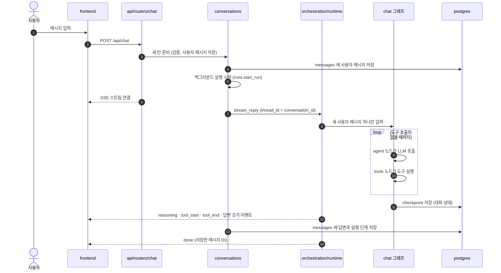
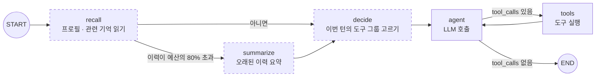

# 전체 아키텍처

> 브라우저의 채팅 화면이 FastAPI 백엔드를 부르고, 백엔드가 LangGraph 에이전트로 LLM 과 도구를 실행합니다.
> 관련 코드: `docker-compose.yml`, `docker-compose.langfuse.yml`, `backend/app/main.py`, `backend/app/agents/chat/graph.py`

이 문서는 큰 그림만 다룹니다. 각 부분의 자세한 동작은 [목차](../README.md)의 기능 문서에 있습니다.

## 1. 시스템 컨텍스트

시스템 밖에서 누가, 무엇이 이 앱과 연결되는지 보여 줍니다.

- LLM provider 는 사용자가 화면에서 고른 모델에 따라 정해집니다. 쓸 수 있는 provider 만 목록에 나옵니다.
- OpenAI 는 채팅 모델 외에도 프로젝트 문서의 임베딩과 그림 설명에 쓰입니다. 그래서 다른 provider 로 채팅해도 OpenAI 키가 필요할 수 있습니다.
- Ollama 는 Docker 가 아니라 호스트에서 실행합니다. macOS 의 Docker 안에서는 Metal GPU 를 쓸 수 없기 때문입니다.
- Langfuse 는 선택 사항입니다. 없어도 앱은 동작합니다.

## 2. 컨테이너

Docker Compose 로 띄우는 서비스와 그 사이의 연결입니다.

- 브라우저는 frontend 에서 화면만 받고, API 는 backend 를 직접 부릅니다. frontend 가 API 를 중계하지 않습니다.
- Postgres 하나에 세 가지 데이터가 있습니다. 앱 테이블(SQLAlchemy), 대화 상태(LangGraph checkpointer), 장기 기억(LangGraph Store)입니다.
  어떤 데이터가 어디에 있는지는 [데이터 저장 위치](../data/storage-map.md)에 정리했습니다.
- 앱 MinIO 와 Langfuse MinIO 는 계정과 볼륨이 다릅니다. Langfuse 를 초기화해도 첨부 원본은 남습니다.
- 문서 파싱은 문서마다 새 프로세스에서 시간 제한을 걸고 실행합니다. 파서가 멈추거나 죽어도 backend 는 영향을 받지 않습니다.
- 모든 포트는 기본적으로 `127.0.0.1` 에만 열립니다.

## 3. 백엔드 구성

백엔드는 계층으로 나뉘고, 위 계층만 아래 계층을 import 할 수 있습니다. 규칙과 모듈별 책임은 [계층 규칙](layers.md)에 있습니다.

## 4. 한 턴의 큰 흐름

사용자가 메시지를 보내고 답을 받기까지의 순서입니다. 재연결, 중지, 동시 요청은 [streaming-runs.md](../features/streaming-runs.md)에서 다룹니다.

- 모델에 넣는 이력은 checkpointer 가 관리합니다. 요청마다 새 사용자 메시지만 그래프에 넣습니다.
- `messages` 테이블은 화면 표시용입니다. 모델 입력과 화면 표시를 나눈 이유는 [ADR 0001](../decisions/0001-history-in-checkpointer.md)에 있습니다.
- 응답은 HTTP 요청이 아니라 백그라운드 작업에서 만듭니다. 연결이 끊겨도 응답은 계속 만들어지고, 다시 붙을 수 있습니다.

## 5. 에이전트 그래프

chat 에이전트의 LangGraph 그래프입니다. 점선 노드는 설정에 따라 그래프에 들어가지 않을 수 있습니다.

| 노드 | 그래프에 들어가는 조건 |
|---|---|
| `recall` | 장기 기억(`ENABLE_MEMORY`)이 켜져 있을 때 |
| `summarize` | 대화 이력 예산이 있을 때 (Ollama, Google, OpenAI, Anthropic 기본값, 또는 `CONTEXT_MAX_TOKENS` 지정) |
| `decide` | 도구 결정(`ENABLE_TOOL_DECISION`)이 켜져 있을 때 |
| `tools` | 도구 사용(`ENABLE_TOOLS`)이 켜져 있을 때. 꺼지면 `agent → END` 만 남음 |

빠진 노드는 건너뛰고 다음 노드로 바로 이어집니다. 그래프는 모델마다 만들어 캐시합니다(`runtime.get_graph`). provider 마다 컨텍스트 예산이 다르기 때문입니다.

## 관련 결정

- [0001. 모델 입력 이력은 checkpointer 에, 화면 이력은 messages 테이블에](../decisions/0001-history-in-checkpointer.md)
- [0002. 응답은 백그라운드 실행에서 만들고, 대화당 실행은 하나만 허용한다](../decisions/0002-background-runs.md)
- [0003. 모델마다 그래프를 따로 컴파일해 캐시하고, checkpointer 와 Store 는 공유한다](../decisions/0003-graph-per-model.md)
- [0004. 도구 결정으로 켠 그룹은 대화 동안 누적하고, 이전에 부른 도구의 그룹도 켠다](../decisions/0004-accumulate-tool-groups.md)
- [0005. 검색된 기억은 마지막 사용자 메시지 앞에 모델 호출 때만 붙이고, 프로필만 system 프롬프트에 둔다](../decisions/0005-recalled-memories-before-user-message.md)
- [0006. 문서 파싱은 문서마다 새 spawn 프로세스에서 시간 제한과 함께 실행한다](../decisions/0006-parse-in-subprocess.md)
- [0007. 채팅 이미지 원본은 첨부 저장소에, checkpoint 에는 이미지 ID 참조만](../decisions/0007-chat-images-in-object-storage.md)
- [0008. 프로젝트 문서 검색은 벡터 + 키워드 하이브리드로 하고 RRF 로 합친다](../decisions/0008-hybrid-search-rrf.md)
- [0009. 프롬프트 원본은 git, Langfuse 는 동기화 사본](../decisions/0009-prompts-git-source-langfuse-copy.md)
- [0010. 웹 페이지 읽기의 SSRF 방어는 접속하는 순간에 IP 를 검사한다](../decisions/0010-ssrf-check-at-connect.md)
- [0011. 보조 단계는 실패해도 경고만 남기고 답을 막지 않는다](../decisions/0011-auxiliary-steps-fail-open.md)
