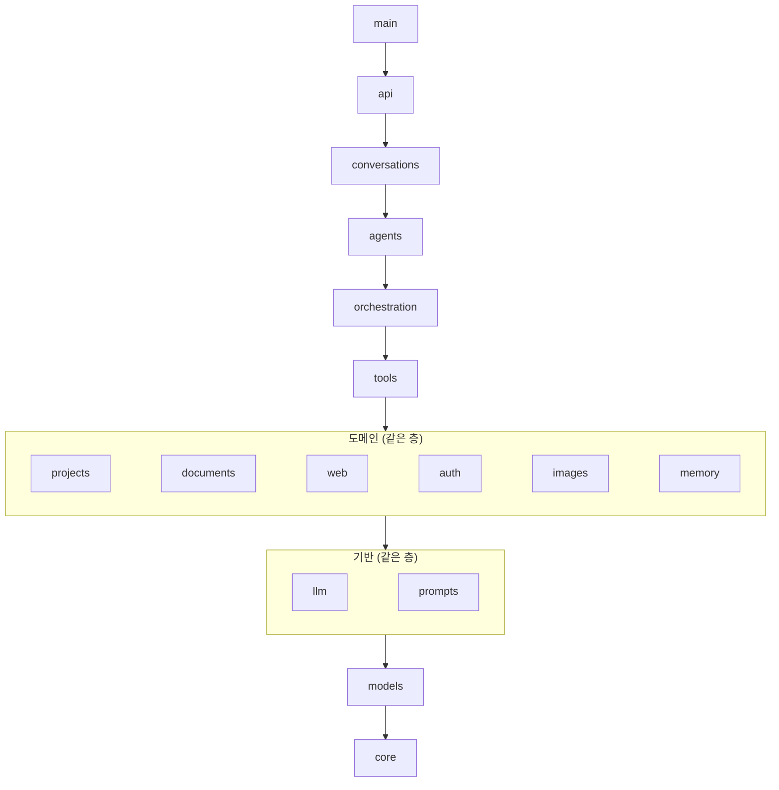

# 계층 규칙

> 백엔드 모듈은 위에서 아래로만 import 합니다. `make lint` 가 `lint-imports` 로 검사합니다.
> 관련 코드: `backend/pyproject.toml` 의 `[tool.importlinter]`, `backend/app/`

## 계층

- 화살표 방향으로만 import 할 수 있습니다. 위 계층은 그보다 아래에 있는 모든 계층을 import 할 수 있습니다(바로 아래 층만이 아님).
- 아래 계층은 위 계층을 import 할 수 없습니다. 예를 들어 `orchestration` 은 `agents` 를 모르고, `tools` 는 `orchestration` 을 모릅니다.
- 같은 층에 묶인 모듈(설정에서 `:` 로 구분)은 서로 import 할 수 있습니다. 지금은 `projects → documents`, `documents → web` 이 있습니다.

## 모듈별 책임

| 계층 | 모듈 | 책임 | 하지 않는 것 |
|---|---|---|---|
| 1 | `main` | FastAPI 앱 조립, CORS, lifespan (DB 초기화, 에이전트 등록, 실행 엔진 시작·종료) | 요청 처리 |
| 2 | `api` | 라우터, 요청·응답 스키마, 현재 사용자 의존성, SSE 변환 | 비즈니스 규칙. 검증 뒤에는 아래 계층에 넘김 |
| 3 | `conversations` | 대화 조회·삭제, 새 턴 준비, 턴 실행과 답변 저장, 대화별 "생성 중" 상태 | 그래프 구성 |
| 4 | `agents` | 에이전트별 그래프(`graph.py`), 프롬프트, 도구 표시 문구, 등록 목록(`AGENTS`) | 실행·스트리밍 방식 |
| 5 | `orchestration` | 에이전트 실행 엔진: checkpointer·Store, 스트리밍, 이벤트, 이력 자르기, 요약, 도구 결정 | 어떤 에이전트가 있는지 알기 |
| 6 | `tools` | 공용 도구 등록 목록(`registry.py`). 에이전트가 이름으로 골라 씀 | 도구가 쓰는 기능 자체의 구현 |
| 7 | `projects` | 프로젝트 만들기·조회, 프로젝트 문서, 에이전트에 넘길 프로젝트 정보, 문서 검색 | |
| 7 | `documents` | 첨부·프로젝트 문서의 형식 확인, 파싱, 요소·청크, 정리 | |
| 7 | `web` | 웹 검색(Tavily), 페이지 읽기, SSRF 방어 | |
| 7 | `auth` | Google OAuth, 세션, 사용자 상태(승인제), 알림 메일 | |
| 7 | `images` | 채팅 이미지 저장, checkpoint 참조 ↔ 원본 변환 | |
| 7 | `memory` | LangGraph Store 생명주기, 프로필·기억 읽기·쓰기 규칙 | |
| 8 | `llm` | provider 별 채팅 모델 생성, 모델 목록, fake 모델, 그림 설명, 임베딩 | |
| 8 | `prompts` | 프롬프트 로더·검증, 공용 조각, Langfuse 동기화 | |
| 9 | `models` | SQLAlchemy 모델 | |
| 10 | `core` | 설정, DB 연결, 첨부 저장소(S3 API), Langfuse 트레이싱, 공용 예외 | 위 계층 import |

## 왜 이 순서인가

- **실행 엔진은 에이전트를 모릅니다.** `orchestration` 이 `agents` 보다 아래에 있어서, 에이전트를 추가해도 실행 엔진을 고치지 않습니다.
  에이전트는 `app/agents/__init__.py` 의 `AGENTS` 에 `AgentSpec` 으로 등록하고, `main` 이 시작할 때 실행 엔진에 넘깁니다.
- **도구는 도메인 기능을 감싸기만 합니다.** 문서 읽기, 웹 검색, 기억 저장의 실제 동작은 도메인 모듈에 있고, `tools` 는 LLM 이 부를 수 있는 형태로 노출합니다.
  그래서 같은 기능을 API 라우터와 도구가 함께 씁니다.
- **HTTP 는 `api` 에서 끝납니다.** 그 아래 계층은 FastAPI 를 몰라서, 테스트에서 HTTP 없이 부를 수 있습니다.

## 규칙을 어기면

`make lint` 의 `lint-imports` 가 실패하고, 어떤 import 가 규칙을 어겼는지 경로를 보여 줍니다.
아래 계층에서 위 계층의 기능이 필요하면 import 하지 말고, 위 계층이 값이나 함수를 인자로 넘겨 주게 바꿉니다.
예를 들어 `orchestration` 은 에이전트를 import 하지 않고, `main` 이 등록한 `AgentSpec` 을 받아 씁니다.
