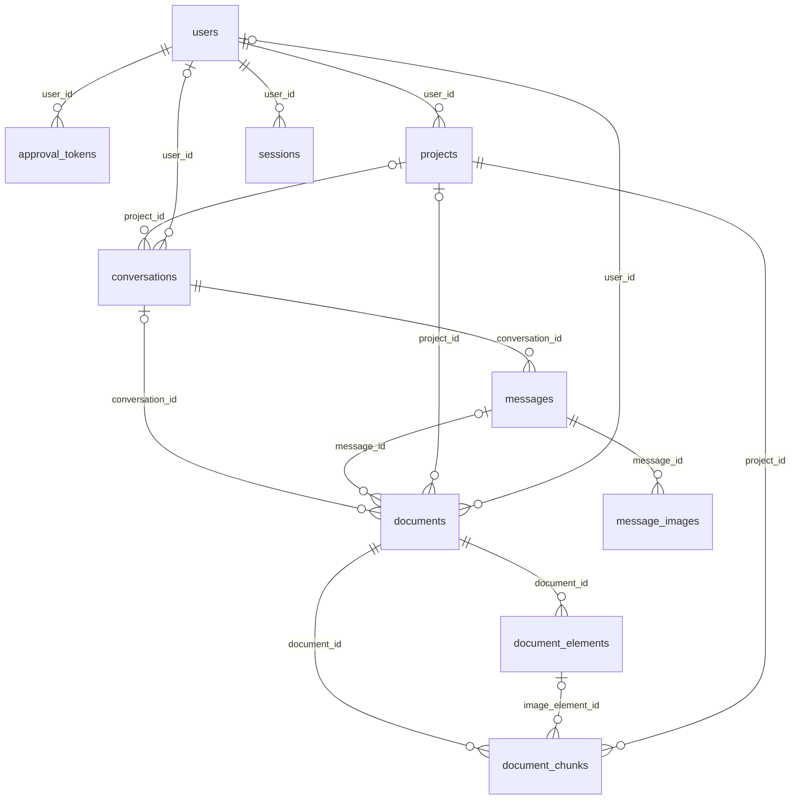
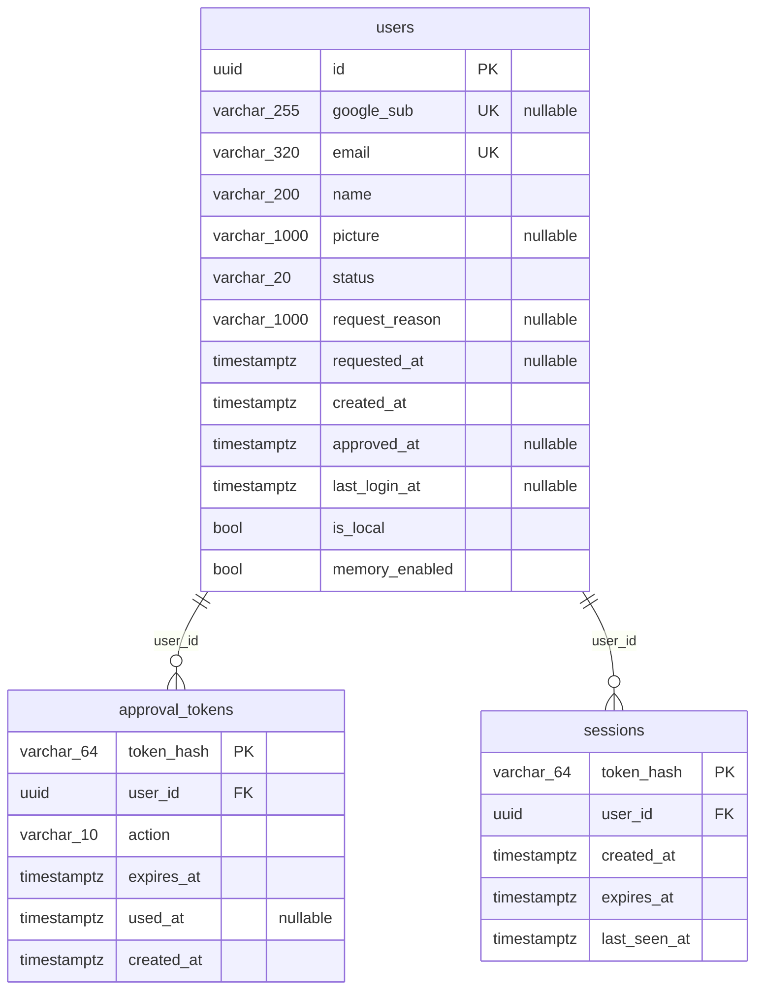
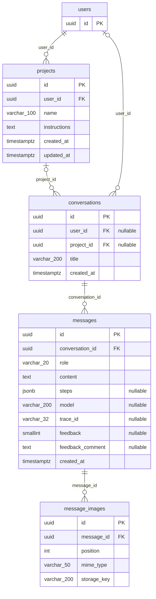
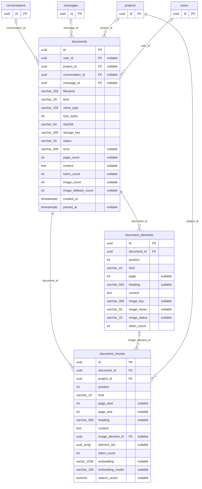
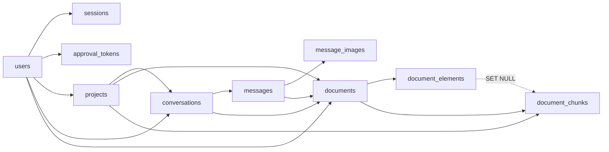

# DB 테이블 관계 (ERD)

> 앱이 SQLAlchemy 로 관리하는 테이블 10개의 관계와 컬럼입니다.
> 관련 코드: `backend/app/models.py`, `backend/migrations/`

LangGraph 가 만드는 checkpointer 테이블과 Store 테이블은 같은 DB 에 있지만 여기서는 다루지 않습니다.
그 테이블과 MinIO 의 객체는 [데이터 저장 위치](storage-map.md)에 정리했습니다.

ERD 그림은 `app/models.py` 의 SQLAlchemy 메타데이터에서 생성합니다(`backend/scripts/gen_erd.py`). 손으로 고치지 말고,
모델을 바꾸면 `make docs-erd` 로 다시 만드세요. `make docs-check` 가 그림과 모델이 다르면 실패합니다.

## 표기

| 표기 | 의미 |
|---|---|
| `\|\|--o{` | 부모 하나에 자식 0개 이상. 자식의 FK 는 비어 있을 수 없음 |
| `o\|--o{` | 부모 0개 또는 하나에 자식 0개 이상. 자식의 FK 가 비어 있을 수 있음 |
| `PK` / `FK` / `UK` | 기본 키 / 외래 키 / 유일 값 |
| `"nullable"` | 비어 있을 수 있는 컬럼 |

컬럼 타입의 `varchar_255` 는 `VARCHAR(255)` 입니다. mermaid 가 타입에 괄호를 허용하지 않아서 이렇게 씁니다.

## 전체 관계

<!-- erd:overview -->

<!-- /erd:overview -->
세 영역으로 나눠 볼 수 있습니다.

| 영역 | 테이블 | 설명 |
|---|---|---|
| 사용자·인증 | `users`, `sessions`, `approval_tokens` | 로그인, 세션, 가입 승인 |
| 대화 | `projects`, `conversations`, `messages`, `message_images` | 화면에 보이는 대화와 메시지 |
| 문서 | `documents`, `document_elements`, `document_chunks` | 첨부·프로젝트 문서, 검색용 요소와 청크 |

## 1. 사용자·인증

<!-- erd:auth -->

<!-- /erd:auth -->
| 테이블 | 한 행 | 알아 둘 점 |
|---|---|---|
| `users` | 사용자 한 명 | `google_sub` 로 사용자를 찾습니다(이메일은 바뀔 수 있음). `status` 는 `pending` · `approved` · `rejected` · `suspended`. `is_local` 은 `AUTH_REQUIRED=false` 일 때 쓰는 로컬 사용자 |
| `sessions` | 로그인 세션 하나 | 쿠키에는 무작위 토큰, DB 에는 SHA-256 해시만 저장. DB 가 유출돼도 세션을 쓸 수 없음 |
| `approval_tokens` | 관리자 메일의 승인 또는 거절 링크 하나 | 해시만 저장, 48시간 유효. 하나를 쓰면 같은 신청의 토큰이 모두 무효 |

## 2. 대화

<!-- erd:conversation -->

<!-- /erd:conversation -->
| 테이블 | 한 행 | 알아 둘 점 |
|---|---|---|
| `projects` | 프로젝트 하나 | `instructions` 는 이 프로젝트 대화의 system 프롬프트 끝에 붙는 지시문 |
| `conversations` | 대화 하나 | **`id` 가 checkpointer 의 `thread_id` 입니다.** 이 값으로 모델 입력 이력과 연결됩니다. `project_id` 가 없으면 프로젝트 밖의 대화. `user_id` 가 비어 있는 것은 로그인 기능 전에 만든 대화 |
| `messages` | 화면에 보이는 메시지 하나 | 화면 표시용입니다. 모델 입력은 checkpointer 에 있습니다([ADR 0001](../decisions/0001-history-in-checkpointer.md)). `steps` 는 추론·도구 실행 단계, `trace_id` 는 피드백을 남길 Langfuse 트레이스, `feedback` 은 1(👍) / -1(👎) |
| `message_images` | 사용자가 첨부한 이미지 하나 | 원본은 MinIO(`images/<ID>`)에 있고 여기에는 객체 키만 둡니다. checkpoint 의 이미지 참조도 이 `id` 를 씁니다 |

## 3. 문서

<!-- erd:document -->

<!-- /erd:document -->
`documents` 한 테이블에 두 종류의 문서가 있습니다. 어느 FK 가 채워졌는지로 구분합니다.

| 종류 | `project_id` | `conversation_id`, `message_id` | 요소·청크 | 보관 |
|---|---|---|---|---|
| 대화 첨부 (보내기 전) | 없음 | 없음 | 만들지 않음 | 하루 안에 보내지 않으면 지움 |
| 대화 첨부 (보낸 뒤) | 없음 | 있음 | 만들지 않음 | 올린 뒤 30일 지나면 지움 |
| 프로젝트 문서 | 있음 | 없음 | 만듦 | 사용자가 지울 때까지 |

| 테이블 | 한 행 | 알아 둘 점 |
|---|---|---|
| `documents` | 올린 파일 하나 | `kind` 는 확장자가 아니라 내용으로 확인한 형식. `content` 는 파싱한 본문(Markdown). `status` 는 `processing` → (`analyzing` → `indexing`, 프로젝트 문서만) → `ready` 또는 `failed` |
| `document_elements` | 프로젝트 문서의 본문·표·그림 하나 | `position` 순서가 문서 안 순서. `heading` 은 제목 경로(`1장 > 1.1 결과`). 그림 요소는 `content` 에 그림 설명이 들어가고 원본은 `image_key` 에 있음 |
| `document_chunks` | 검색 단위 하나 | 요소를 묶거나 나눠 만듭니다. `project_id` 를 중복 저장해서 검색할 때 프로젝트로 바로 거릅니다. `embedding` 과 `search_vector` 가 비어 있으면 검색할 때 만듭니다 |

## 인덱스

FK 컬럼에는 모두 B-tree 인덱스가 있습니다. 그 밖의 인덱스입니다.

| 테이블 | 컬럼 | 종류 | 용도 |
|---|---|---|---|
| `users` | `email`, `google_sub` | 유일 | 로그인할 때 사용자 찾기 |
| `users` | `status` | B-tree | 관리 화면의 승인 대기 목록 |
| `sessions` | `expires_at` | B-tree | 만료 세션 찾기 |
| `documents` | `status`, `created_at` | B-tree | 파싱 상태 조회, 보관 기간 정리 |
| `document_chunks` | `embedding` | HNSW (`vector_cosine_ops`) | 벡터 검색 (코사인 거리) |
| `document_chunks` | `search_vector` | GIN | 키워드 검색 (전문 검색) |

## 삭제 규칙

FK 는 모두 `ON DELETE CASCADE` 입니다. 부모를 지우면 자식 행도 지워집니다. 예외는 하나입니다.
`document_chunks.image_element_id` 는 `SET NULL` 이라서, 그림 요소를 지워도 청크는 남습니다.

CASCADE 는 DB 행만 지웁니다. MinIO 의 원본과 checkpoint 는 앱 코드가 따로 지웁니다.
무엇을 언제 지우는지는 [데이터 저장 위치](storage-map.md#삭제할-때-함께-지워지는-것)에 있습니다.
