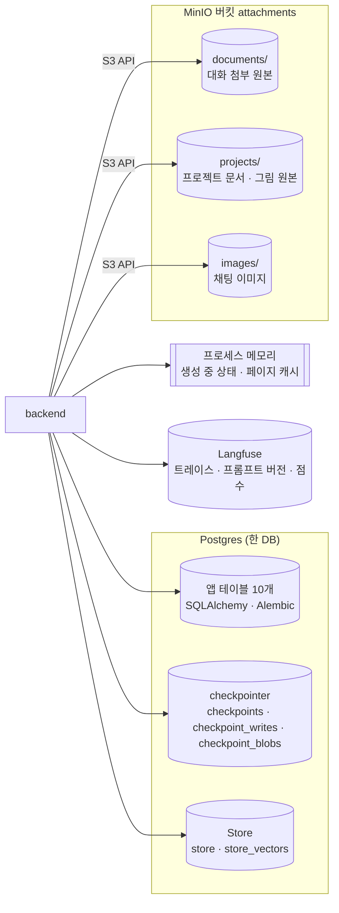
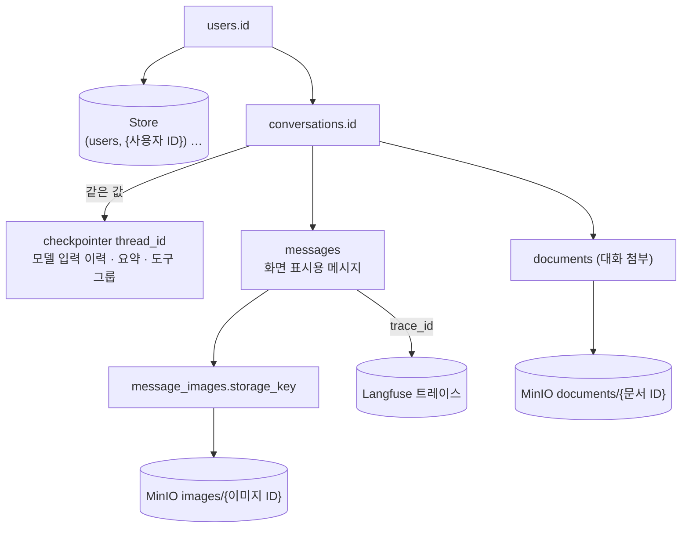
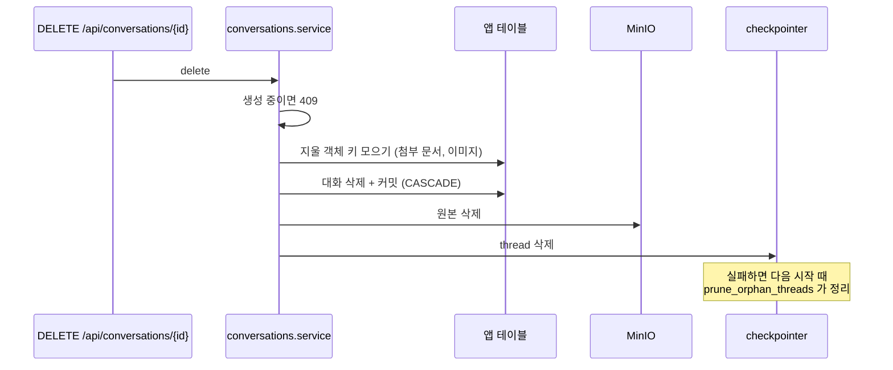

# 데이터 저장 위치

> 같은 대화의 데이터가 여러 저장소에 나뉘어 있습니다. 무엇이 어디에 있고, 언제 지워지는지 정리합니다.
> 관련 코드: `backend/app/models.py`, `backend/app/orchestration/runtime.py`, `backend/app/memory/store.py`,
> `backend/app/core/storage.py`, `backend/app/conversations/service.py`, `backend/app/documents/service.py`

## 한눈에 보기

| 저장소 | 담는 것 | 관리 주체 | 스키마 변경 |
|---|---|---|---|
| 앱 테이블 | 사용자, 세션, 프로젝트, 대화, 화면용 메시지, 문서 본문·요소·청크 | 앱 (SQLAlchemy) | Alembic (`make db-revision`) |
| checkpointer | 모델 입력 이력과 그래프 상태 | LangGraph `AsyncPostgresSaver` | LangGraph 가 `setup()` 에서 직접 |
| Store | 사용자별 프로필과 기억, 기억 임베딩 | LangGraph `AsyncPostgresStore` | LangGraph 가 `setup()` 에서 직접 |
| MinIO | 첨부 원본, 프로젝트 문서 원본과 그림, 채팅 이미지 | 앱 (boto3, S3 API) | 없음. 객체 키 규칙만 있음 |
| 프로세스 메모리 | 대화별 "생성 중" 상태와 이벤트, 웹 페이지 캐시 | 앱 | 없음. 재시작하면 사라짐 |
| Langfuse | 트레이스(모델 입력·출력 포함), 프롬프트 버전, 피드백 점수 | Langfuse | 별도 서비스 |

Alembic 은 앱 테이블만 다룹니다. `migrations/env.py` 가 checkpointer 와 Store 테이블을 비교 대상에서 빼서,
마이그레이션이 그 테이블을 지우자고 제안하지 않습니다.

## 대화 하나는 어디에 있나

대화 ID 하나로 네 저장소가 이어집니다.

기억(Store)은 대화가 아니라 사용자에 붙어 있습니다. 대화를 지워도 기억은 남습니다.

## checkpointer 에 있는 것

`thread_id` 는 `conversations.id` 입니다. chat 그래프의 상태(`ChatState`, `app/agents/chat/graph.py`)를 턴마다 저장합니다.

| 필드 | 내용 |
|---|---|
| `messages` | 모델에 넣는 전체 이력. 사용자 메시지(첨부 목록, 짧은 문서 본문 포함), 답변, 추론 블록, 도구 호출과 결과, 이미지 참조 블록 |
| `summary` | 오래된 이력의 요약. 요약한 적이 없으면 없음 |
| `summarized_until` | 요약에 포함된 마지막 메시지 ID |
| `tool_groups` | 도구 결정으로 이 대화에서 지금까지 켜진 도구 그룹 (누적). 도구 결정을 쓰지 않으면 없음 |
| `active_groups` | 이번 턴에 모델에게 줄 도구 그룹. `decide` 노드가 매 턴 정하고, `None` 이면 도구를 모두 줌 |
| `profile` | 이번 턴에 `recall` 노드가 읽은 사용자 프로필. 장기 기억을 쓰지 않으면 없음 |
| `recalled` | 이번 턴의 사용자 메시지와 관련 있는 기억 줄 목록. 없으면 빈 문자열 |

`profile` 과 `recalled` 는 턴마다 새로 덮어쓰는 값입니다. 원본은 Store 에 있고, 여기에는 그 턴에 읽은 사본이 남습니다.

이미지는 원본 대신 `message_images.id` 를 담은 참조 블록으로 저장합니다. 모델을 부르기 직전에 MinIO 에서 원본을 읽어 바꿉니다.

## Store 에 있는 것

| namespace | key | 내용 |
|---|---|---|
| `("users", <사용자 ID>)` | `profile` | 프로필 (최대 800자). 매 턴 system 프롬프트에 넣음 |
| `("users", <사용자 ID>, "memories")` | 8자리 ID | 기억 하나 (내용, 카테고리). 임베딩은 `store_vectors` 에 1536차원으로 저장 |

`store_vectors` 의 차원은 처음 만들 때 정해집니다. 임베딩 모델의 차원을 바꾸면 기억을 다시 인덱싱해야 합니다.

## MinIO 객체 키

버킷은 하나(`S3_BUCKET`, 기본 `attachments`)이고, 접두어로 종류와 보관 규칙을 나눕니다.

| 키 | 내용 | 보관 |
|---|---|---|
| `documents/<문서 ID>` | 대화 첨부 원본, 에이전트가 만든 수정본·새 문서 | **lifecycle 규칙으로 30일 뒤 자동 삭제** (`ATTACHMENT_RETENTION_DAYS`) |
| `projects/<프로젝트 ID>/documents/<문서 ID>` | 프로젝트 문서 원본 | 지울 때까지 |
| `projects/<프로젝트 ID>/images/<문서 ID>/<순서>` | 프로젝트 문서에서 뽑은 그림 | 지울 때까지 |
| `images/<이미지 ID>` | 채팅에 첨부한 이미지 | 대화를 지울 때까지 |

lifecycle 규칙은 `documents/` 접두어에만 걸립니다. 프로젝트 문서와 채팅 이미지가 다른 접두어를 쓰는 이유가 이것입니다.

## 프로세스 메모리에 있는 것

백엔드가 하나라고 가정하고 메모리에 둡니다. 재시작하면 사라집니다.

| 데이터 | 위치 | 유지 시간 |
|---|---|---|
| 대화별 "생성 중" 상태와 이벤트 기록 | `conversations/runs.py` | 실행이 끝난 뒤 60초 |
| 웹 페이지 캐시 | `web/fetch.py` | 10분 |
| 모델별 컴파일된 그래프 | `orchestration/runtime.py` | 프로세스가 떠 있는 동안 |

백엔드를 여러 개 띄우려면 "생성 중" 상태를 Redis 같은 공유 저장소로 옮겨야 합니다(`runs.py` 가 같은 인터페이스로 바꿀 수 있게 되어 있음).

## 삭제할 때 함께 지워지는 것

DB 행은 FK 의 CASCADE 로 지워집니다([ERD](erd.md#삭제-규칙)). 나머지 저장소는 앱 코드가 따로 지웁니다.

| 동작 | 앱 테이블 | checkpointer | MinIO | Store | Langfuse |
|---|---|---|---|---|---|
| 대화 삭제 | 대화, 메시지, 이미지 행, 첨부 문서 | 그 thread | 첨부 원본, 채팅 이미지 | 남음 | 남음 |
| 프로젝트 삭제 | 프로젝트와 그 안의 대화·문서·요소·청크 | 안의 대화 thread 전부 | 프로젝트 문서 원본과 그림, 대화 첨부, 채팅 이미지 | 남음 | 남음 |
| 프로젝트 문서 삭제 | 문서, 요소, 청크 | 그대로 | 원본과 그림 | 남음 | 남음 |
| 대화 첨부 정리 (하루 1번) | 보내지 않고 24시간 지난 문서, 올린 지 30일 지난 문서 | **그대로** | 원본 | 남음 | 남음 |
| 기억 전체 삭제 (`DELETE /api/memory`) | 그대로 | 그대로 | 그대로 | 프로필과 기억 | 남음 |
| 로그아웃 | 그 세션 | | | | |

삭제는 DB 를 먼저 커밋하고 원본과 checkpoint 를 지웁니다. 응답 생성 중인 대화나, 그런 대화가 있는 프로젝트는 지울 수 없습니다(409).
checkpoint 삭제가 실패해 남은 thread 는 백엔드가 시작할 때 `runtime.prune_orphan_threads` 가 정리합니다.

## 저장소끼리 어긋나는 곳

지금 코드에서 알려진, 저장소 사이의 차이입니다. 고칠지는 기능 문서나 ADR 에서 정합니다.

- **보관 기간이 지난 첨부 문서의 본문이 checkpoint 에 남습니다.** 짧은 문서는 본문을 사용자 메시지에 넣고, 긴 문서도
  `read_document` 결과로 이력에 들어갑니다. 30일 정리는 `documents` 행과 원본만 지우고 checkpoint 는 건드리지 않습니다.
- **Langfuse 트레이스는 지우지 않습니다.** 트레이스에는 모델 입력과 출력이 들어 있어서, 대화를 지워도 내용이 Langfuse 에 남습니다.
- **돌아오지 않는 세션 행은 남습니다.** 만료된 세션은 그 쿠키로 다시 요청이 올 때(`sessions.user_for_token`), 로그아웃할 때,
  사용자별 세션을 지울 때 지워집니다. 만료된 뒤 쿠키가 다시 오지 않으면 행이 그대로 남고, 따로 정리하는 작업은 없습니다.
- **기억을 지워도 checkpoint 에 사본이 남습니다.** `profile` 과 `recalled` 는 턴마다 checkpoint 에 저장되므로,
  Store 에서 기억을 지워도 그 전 턴의 checkpoint 에는 읽었던 내용이 남습니다. 다음 턴부터 모델에게 주지는 않습니다.
- **기억은 대화와 따로 남습니다.** 설계상 의도된 동작입니다. 대화를 지워도 그 대화에서 저장한 기억은 남습니다.
