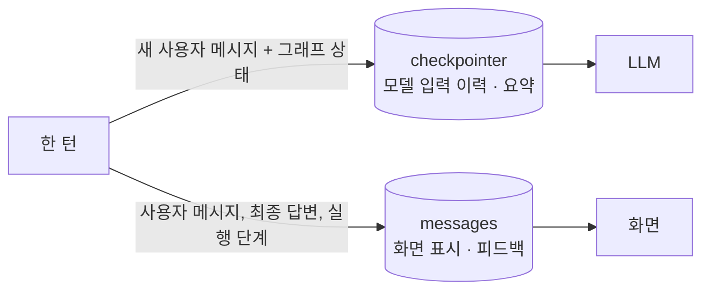

# 0001. 모델 입력 이력은 checkpointer 에, 화면 이력은 messages 테이블에

- 상태: 채택
- 날짜: 2026-11-19 (첫 커밋)
- 관련 코드: `backend/app/orchestration/runtime.py`, `backend/app/conversations/turns.py`, `backend/app/models.py` 의 `Message`

> 결정 당시에는 "A안" 이라는 이름과 내용만 남았고 이유는 기록되지 않았습니다. 아래 배경과 결과는 지금 코드에서 드러나는 이유로 정리한 것입니다.

## 배경

한 대화의 이력을 두 곳에서 씁니다.

- **모델 입력**: 도구 호출과 결과, 추론 블록, 요약, 이미지 참조처럼 provider 와 LangGraph 가 쓰는 형식의 메시지가 필요합니다.
- **화면 표시**: 사용자 메시지와 최종 답변, 실행 단계(`steps`), 응답한 모델, 피드백, 트레이스 ID 가 필요합니다.

두 쪽이 필요한 내용이 다릅니다. 하나로 합치면 한쪽에 맞춰 다른 쪽을 변환해야 합니다.

## 결정

- 모델에 넣는 이력은 LangGraph checkpointer 가 `thread_id = conversation_id` 단위로 관리합니다. 요청마다 새 사용자 메시지 하나만 그래프에 넣습니다.
- `messages` 테이블은 화면에 대화를 보여주는 용도로만 씁니다. 모델 입력을 이 테이블에서 다시 만들지 않습니다.

## 검토한 대안

- **messages 테이블을 원본으로 두고 요청마다 모델 입력을 다시 만들기.** 도구 호출, 추론 블록, 요약 상태를 모두 테이블에 저장하고
  provider 형식으로 되돌리는 코드가 필요합니다. LangGraph 가 이미 하는 일을 다시 만드는 셈이라 고르지 않았습니다.

## 결과

좋아진 점:

- 모델 입력은 LangGraph 가 저장한 그대로 이어지므로, 변환 코드가 없습니다.
- 화면용 정보(실행 단계, 피드백, 트레이스 ID)를 모델 입력과 상관없이 추가할 수 있습니다.
- 요약해도 checkpointer 의 원본 메시지를 지우지 않고, 화면 이력은 요약의 영향을 받지 않습니다.

감수한 점과 지켜야 하는 것:

- **두 저장소를 함께 지워야 합니다.** 대화를 지우면 `messages` 와 checkpoint(`runtime.delete_thread`)를 모두 지웁니다.
- **두 저장소가 어긋날 수 있습니다.** 응답이 중간에 끊기면 LangGraph 는 노드가 끝나야 checkpoint 를 쓰므로, 화면에는 있는 답이
  모델 기억에는 없을 수 있습니다. 그래서 실행 엔진이 끊긴 답을 `aupdate_state` 로 checkpoint 에 넣습니다.
- **한 대화에서 응답은 하나씩만 만듭니다.** 같은 thread 를 두 실행이 동시에 쓰면 상태가 갈라지므로, 생성 중인 대화에 새 요청이 오면 409 로 거절합니다.
