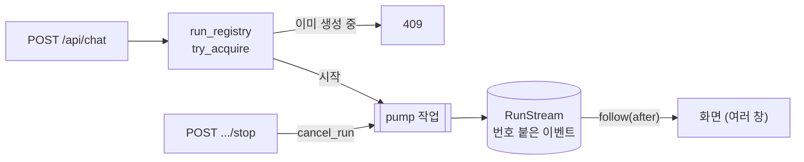

# 0002. 응답은 백그라운드 실행에서 만들고, 대화당 실행은 하나만 허용한다

- 상태: 채택
- 날짜: 2026-11-21 (백그라운드 실행 `9ff8d57`. 대화당 하나 제한은 2026-11-19 `a08d7a9`)
- 관련 코드: `backend/app/conversations/runs.py`, `backend/app/conversations/turns.py`, `backend/app/api/routers/chat.py`

> 이유는 커밋 메시지(`a08d7a9`, `9ff8d57`, `1dd44de`, `5616ba3`)와 `runs.py` 모듈 설명에 적혀 있습니다. 대기열을 1개로 정한 이유는 기록되지 않았습니다.

## 배경

처음에는 응답 생성이 `POST /api/chat` 요청 안에서 돌았습니다. 생성 중에 새로고침하거나 탭을 닫으면 연결이 끊기고 생성도 멈췄습니다.
검색과 문서 읽기를 여러 번 하던 응답도 처음부터 다시 물어야 했습니다(커밋 `9ff8d57`).

또 같은 대화에 응답 두 개가 동시에 생성되면 checkpointer 상태가 갈라집니다. 그러면 한쪽 대화가 모델의 기억에서 사라집니다(`runs.py` 모듈 설명).

## 결정

- 응답은 `runs.start_run` 이 띄운 asyncio 작업에서 만듭니다. 작업은 이벤트에 1부터 번호를 붙여 `RunStream` 에 쌓습니다.
- 화면은 그 기록을 구독합니다. 구독을 끊어도 실행은 끝까지 돌고 저장됩니다. 끊긴 화면은 받은 번호 다음부터 다시 붙습니다.
- 대화당 실행은 하나입니다. 생성 중인 대화에 새 요청이 오면 메시지를 저장하기 전에 409 로 거절합니다.
- 같은 창의 추가 질문은 서버가 아니라 화면이 대기열에 1개까지 들고 있다가, 앞 응답이 끝나면 보냅니다.
- 중지는 연결 끊기가 아니라 `POST /api/conversations/{id}/stop` 입니다. 부분 응답을 저장한 뒤 돌려줍니다.

## 검토한 대안

- **요청 안에서 생성하고, 연결이 끊기면 멈추기.** 첫 구현이 이 방식이었습니다. 새로고침이나 탭 닫기로 생성이 멈춰서 바꿨습니다(커밋 `9ff8d57`).
- **연결 끊기를 중지로 쓰기.** 실행이 요청과 떨어지면 연결을 끊어도 멈추지 않습니다. 새로고침해도 이어지게 한 것이 목적이라 명시적인 API 를 만들었습니다(커밋 `1dd44de`, `5616ba3`).
- **서버가 같은 대화의 요청을 줄 세우기.** 서버는 거절만 하고 대기열은 화면이 맡기로 했습니다(커밋 `a08d7a9`). 서버 대기열을 고르지 않은 이유는 기록되지 않았습니다.

## 결과

좋아진 점:

- 새로고침, 탭 닫기, 다른 창이나 기기에서 열어도 응답이 끝까지 만들어지고, 진행 중인 응답을 처음부터 이어서 볼 수 있습니다.
- 응답 중에 다른 대화로 옮길 수 있습니다.
- 끊긴 답은 `aupdate_state` 로 checkpoint 에 넣어서, 다음 턴에 모델이 자기가 한 말을 압니다(커밋 `fbbed0c`).

감수한 점:

- 실행 상태와 이벤트 기록은 프로세스 메모리에만 있습니다. 재시작하면 사라지고, 화면은 저장된 메시지를 다시 읽습니다.
- 아무도 보지 않는 실행도 비용을 씁니다. 그래서 `RUN_MAX_SECONDS`(기본 600초)를 넘으면 멈추고 중단으로 저장합니다.
- 끝난 실행의 기록은 60초(`RETAIN_SECONDS`)만 남깁니다. 60이라는 값의 근거는 기록되지 않았습니다.

지켜야 하는 것:

- **백엔드 프로세스는 하나여야 합니다.** 늘리려면 `RunRegistry` Protocol 뒤에 Redis 구현(`SET NX` + TTL)을 만들어 바꿉니다(`runs.py` 모듈 설명).
  `_streams` 와 `RunStream` 은 Protocol 뒤에 있지 않아서, 함께 옮기는 방법은 아직 정해지지 않았습니다.
- **`RUN_MAX_SECONDS` 는 `RUN_STALE_SECONDS`(기본 600초)보다 크게 잡지 않습니다.** `touch` 는 그래프 이벤트가 올 때만 불립니다.
  이벤트 없이 stale 시간이 지나면 `run_registry` 는 생성 중이 아니라고 답하고, 두 번째 턴이 시작될 수 있습니다. 상한이 stale 시간 이하면 그 전에 실행이 끊깁니다.
- 생성 중 표시는 `done` 이벤트를 기록하기 **전에** 해제합니다. 화면이 바로 보낸 대기 메시지가 409 를 받지 않게 하기 위해서입니다.
- 앱 종료 때는 `shutdown_runs` 를 `runtime.shutdown` 보다 먼저 부릅니다. checkpointer 연결이 열려 있을 때 끊긴 답을 넣어야 하기 때문입니다.

자세한 동작은 [streaming-runs.md](../features/streaming-runs.md) 에 있습니다.
