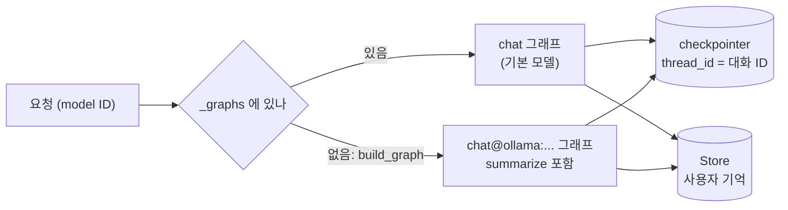

# 0003. 모델마다 그래프를 따로 컴파일해 캐시하고, checkpointer 와 Store 는 공유한다

- 상태: 채택
- 날짜: 2026-11-20 (`fc02f28`)
- 관련 코드: `backend/app/orchestration/runtime.py` 의 `get_graph`, `startup`, `backend/app/agents/chat/graph.py` 의 `build_graph`

> 이유는 커밋 `fc02f28` 메시지와 `get_graph` docstring 에 적혀 있습니다. 다른 구조와 비교한 기록은 없습니다.

## 배경

전에는 `.env` 의 `LLM_PROVIDER` 로만 모델을 정했고, 에이전트마다 그래프가 하나였습니다.
여러 provider 를 번갈아 쓰고 비교하려고, 화면에서 메시지마다 모델을 고르게 했습니다(커밋 `fc02f28`).

그래프 모양은 모델 설정에 따라 다릅니다.

- provider 마다 chat model 클래스와 요약 모델이 다릅니다.
- `history_token_budget` 이 있으면 `summarize` 노드가 그래프에 들어가고, 없으면 빠집니다.
- 프로젝트 문서를 system 프롬프트에 모두 넣는 기준(`project_inline_limit`)과 Anthropic 프롬프트 캐시 설정도 모델마다 다릅니다.

한편 사용자는 같은 대화에서 모델을 바꿔도 이력이 이어지길 기대합니다.

## 결정

- `runtime.get_graph(agent, model)` 은 모델마다 그래프를 따로 컴파일해 `_graphs` 에 둡니다.
  캐시 키는 기본 모델이면 에이전트 이름, 아니면 `"<에이전트>@<모델 ID>"` 입니다.
- 기본 모델 그래프는 앱 시작 때 만들고, 다른 모델은 처음 요청될 때 만듭니다.
- 모든 그래프가 같은 checkpointer 와 같은 Store 를 받습니다. 그래서 대화 도중 모델을 바꿔도 이력과 기억이 이어집니다.

## 검토한 대안

- **그래프 하나에서 실행할 때 모델을 바꾸기.** 기록된 비교는 없습니다. 코드에서 드러나는 이유는, `summarize` 노드의 유무가 모델 예산에 달려 있어서
  그래프 하나로는 노드 구성이 달라지는 것을 표현하기 어렵다는 점입니다(`get_graph` docstring). 실행 중 분기로 같은 효과를 낼 수 있었는지는 검토한 흔적이 없습니다.

## 결과

좋아진 점:

- 모델마다 필요한 노드만 그래프에 들어갑니다. 예산이 없는 모델은 요약 노드를 거치지 않습니다.
- 모델을 바꿔도 대화 이력, 요약 상태, 장기 기억이 그대로 이어집니다.

감수한 점:

- 그래프 캐시는 프로세스가 떠 있는 동안 지우지 않습니다. `POST /api/chat` 이 모델 목록에 없는 ID 를 400 으로 거절하므로, 캐시에는 목록에 있었던 모델만 쌓입니다.
- 처음 쓰는 모델은 첫 요청에서 그래프를 컴파일합니다.

지켜야 하는 것:

- **checkpoint 의 상태는 모든 모델의 그래프가 읽을 수 있어야 합니다.** 모든 그래프가 같은 `ChatState` 를 씁니다. 요약 노드가 없는 그래프도
  `summary` 키가 있는 상태를 이어받습니다. 이 항목은 기록이 아니라 코드에서 추론한 것입니다.
- **다른 provider 가 만든 추론 블록은 보내지 않습니다.** 추론 블록에는 만든 provider 의 서명이 있어서 다른 provider 에 보내면 거절될 수 있습니다.
  응답에 모델 ID 를 적고(`tag_model`) 다른 모델의 추론만 뺍니다(`drop_foreign_reasoning`, 커밋 `fc02f28`).
- 새 그래프 설정을 추가할 때는 그것이 모델마다 달라지는지 확인하고, 달라지면 `settings_for` 로 모델별 설정에 넣습니다.

자세한 동작은 [llm-providers.md](../features/llm-providers.md) 에 있습니다.
