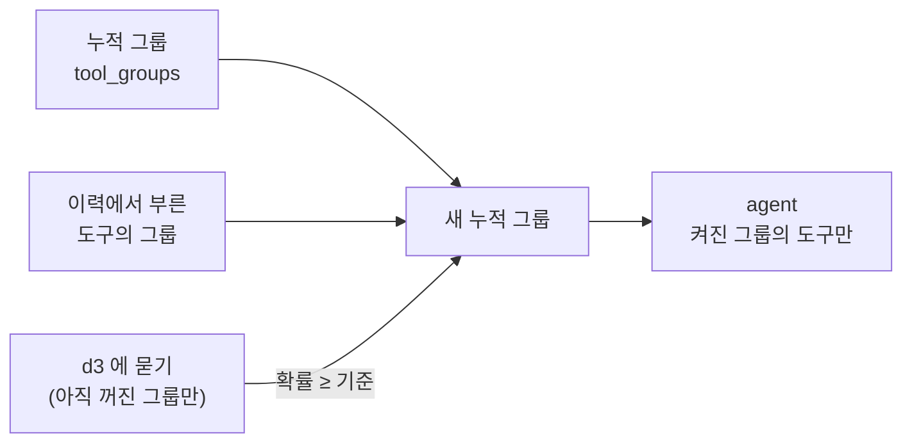

# 0004. 도구 결정으로 켠 그룹은 대화 동안 누적하고, 이전에 부른 도구의 그룹도 켠다

- 상태: 채택
- 날짜: 2026-11-22 (`c546e89`)
- 관련 코드: `backend/app/orchestration/decision.py`, `backend/app/agents/chat/graph.py` 의 `decide`, `agent`

> 이유는 커밋 `c546e89` 메시지와 `decision.py` 모듈 설명에 적혀 있습니다. 토큰과 캐시 효과를 잰 기록은 없습니다.

## 배경

도구 정의는 매 요청 프롬프트에 들어갑니다. 도구가 늘수록 쓰지 않을 도구 정의까지 보냅니다.
그래서 턴마다 결정 모델(d3)에게 그룹별(time, web, documents, memory) 예/아니오 확률을 묻고, 기준 이상인 그룹의 도구만 모델에게 줍니다(커밋 `c546e89`).

이때 두 가지가 부딪힙니다.

- **도구 토큰 절약:** 매 턴 필요한 그룹만 주면 도구 정의가 가장 적습니다.
- **프롬프트 캐시:** 도구 정의는 프롬프트 맨 앞에 있습니다. 목록이 바뀌면 그 뒤의 대화 이력 전체가 캐시에서 빠집니다(`decision.py` 모듈 설명).

## 결정

- 켜진 그룹은 대화가 이어지는 동안 누적해서 상태(`tool_groups`)에 저장합니다. 이미 켜진 그룹은 다시 묻지 않습니다.
- 이력에서 모델이 실제로 부른 도구의 그룹은 켜진 것으로 봅니다.
- 첨부가 있으면 documents 그룹을 결정 없이 켭니다.
- 결정에 실패하면 이번 턴만 도구를 모두 주고, 누적 목록은 바꾸지 않습니다.

## 검토한 대안

- **매 턴 그 턴에 필요한 그룹만 주기.** 도구 정의는 가장 적지만, 목록이 턴마다 바뀌어 캐시가 매번 깨집니다. 캐시 유지를 도구 토큰 절약보다 앞에 두어 고르지 않았습니다(커밋 `c546e89`).
- **이력에 도구 호출이 있어도 그 도구를 빼기.** 이력에 도구 호출이 있는데 정의가 없으면 모델이 이력을 이해하지 못하거나 provider 가 요청을 거절할 수 있어서
  고르지 않았습니다(`decision.py` 모듈 설명).

## 결과

좋아진 점:

- 도구 목록은 대화마다 몇 번만 바뀝니다. 그 사이 턴은 프롬프트 캐시를 그대로 씁니다.
- 이미 켜진 그룹은 묻지 않아서, 대화가 길어질수록 결정 질문이 줄어듭니다.
- 결정이 실패해도 결정을 끈 상태와 같게 동작하고, 다음 턴은 실패 전 상태에서 다시 시작합니다.

감수한 점:

- 한 번 켜진 도구는 필요 없는 턴에도 들어갑니다. 대화가 길어지면 결국 대부분의 그룹이 켜질 수 있습니다.
- 그룹이 새로 켜지는 턴에는 캐시가 깨집니다.

지켜야 하는 것:

- **누적 목록은 줄이지 않습니다.** 줄이는 규칙을 넣으면 캐시가 깨지고, 이력의 도구 호출과 정의가 어긋날 수 있습니다.
- **도구 목록은 고정된 전체 목록에서 빼는 방식으로 만듭니다.** `agent` 는 켜지지 않은 그룹의 도구를 숨길 뿐 순서를 바꾸지 않습니다.
  같은 그룹이 켜져 있으면 같은 목록이 나와야 캐시가 유지됩니다. 이 항목은 기록이 아니라 코드에서 추론한 것입니다.
- 새 도구는 그룹 하나에 속해야 합니다(`tool_group`).
- 결정 기능은 기본으로 꺼져 있습니다(`ENABLE_TOOL_DECISION`). 켜면 로컬 Ollama 와 d3 모델이 필요합니다.

자세한 동작은 [tool-decision.md](../features/tool-decision.md) 에 있습니다.
