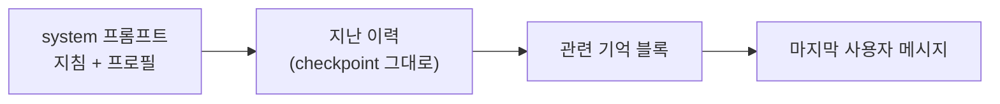

# 0005. 검색된 기억은 마지막 사용자 메시지 앞에 모델 호출 때만 붙이고, 프로필만 system 프롬프트에 둔다

- 상태: 채택
- 날짜: 2026-11-22 (`6c67e60`)
- 관련 코드: `backend/app/agents/chat/graph.py` 의 `recall`, `agent`, `with_recalled`, `backend/app/memory/`

> 이유는 커밋 `6c67e60` 메시지와 `graph.py` 모듈 설명에 적혀 있습니다. 프로필과 기억을 나눈 이유(대안 비교)는 기록되지 않았습니다.

## 배경

장기 기억은 사용자별로 프로필 하나와 카테고리가 붙은 낱개 기억으로 나뉩니다(LangGraph Store).
턴마다 이번 메시지와 관련 있는 기억을 찾아 모델에게 보여 줘야 합니다.

제약은 프롬프트 캐시입니다. 매 턴 달라지는 내용을 system 프롬프트에 넣으면, 그 뒤의 대화 이력 전체가 프롬프트 캐시에서 빠집니다(`graph.py` 모듈 설명).
검색된 기억은 메시지마다 달라지는 내용입니다.

## 결정

- 그래프 맨 앞 `recall` 노드가 턴마다 한 번 프로필과 관련 기억을 읽어 상태(`profile`, `recalled`)에 둡니다.
- 프로필은 system 프롬프트 끝에 넣습니다. 잘 바뀌지 않기 때문입니다.
- 기억은 관련 있는 것만(최대 5개, 유사도 0.15 이상) 모델에 보내는 메시지의 **마지막 사용자 메시지 앞**에 붙입니다.
- 붙이는 것은 복사본입니다(`with_recalled`). checkpoint 의 메시지는 바꾸지 않습니다.

캐시되는 앞부분(system, 지난 이력)은 턴이 바뀌어도 같고, 달라지는 기억은 맨 끝에만 있습니다.

## 검토한 대안

- **기억을 system 프롬프트에 넣기.** 매 턴 달라져서 그 뒤 이력 전체가 캐시에서 빠지므로 고르지 않았습니다(커밋 `6c67e60`).
- **기억 전체를 넣기.** 프롬프트가 커지므로 관련 있는 것만 넣습니다(커밋 `6c67e60`).
- **붙인 기억을 checkpoint 에 저장하기.** 기록된 이유는 "체크포인트에는 남기지 않아 프롬프트 캐시를 지킨다" 입니다(커밋 `6c67e60`).
  저장하면 지난 턴의 기억 블록이 이력에 쌓이고 오래된 기억이 계속 남는다는 설명은 [memory.md](../features/memory.md) 에 있습니다.

## 결과

좋아진 점:

- system 프롬프트와 지난 이력이 턴마다 같아서 프롬프트 캐시가 유지됩니다.
- `recall` 은 턴마다 한 번만 검색합니다. 한 턴 안에서 도구를 여러 번 불러도 임베딩 호출이 늘지 않고, 모델에 보내는 앞부분도 같습니다(`recall` docstring).
- checkpoint 에 기억 블록이 쌓이지 않아서, 지운 기억이 이력에 남지 않습니다.

감수한 점:

- 모델은 지난 턴에 어떤 기억을 봤는지 이력에서 볼 수 없습니다. 이번 턴에 다시 검색된 것만 봅니다.
- 프로필을 바꾸면(`update_profile`, 기억 화면) system 프롬프트가 바뀌어 그때 캐시가 깨집니다. 프로필은 자주 바뀌지 않는다는 가정입니다.
- 짧은 한국어 문장은 관련 있어도 유사도가 0.17~0.32 로 낮게 나와서, 기준을 0.15 로 낮게 잡았습니다(커밋 `6c67e60` 에 적힌 측정값).

지켜야 하는 것:

- **매 턴 달라지는 내용은 system 프롬프트에 넣지 않습니다.** 넣을 곳은 마지막 사용자 메시지 앞입니다.
- **`with_recalled` 는 원본 메시지를 바꾸지 않습니다.** 상태에 기억 블록을 쓰는 코드를 넣지 않습니다.
- 기억 검색이 실패하면 경고만 남기고 기억 없이 답합니다. 기억은 응답을 막지 않습니다.

자세한 동작은 [memory.md](../features/memory.md) 에 있습니다.
