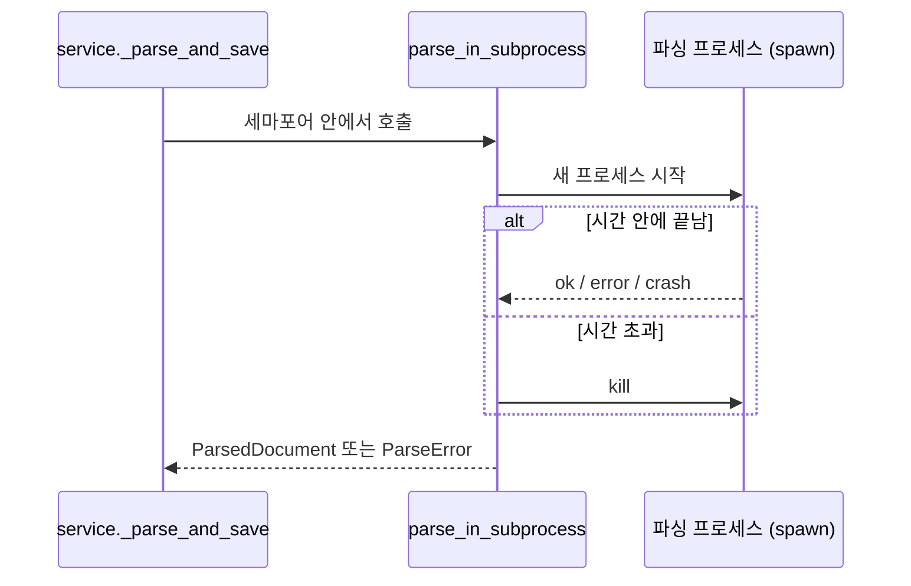

# 0006. 문서 파싱은 문서마다 새 spawn 프로세스에서 시간 제한과 함께 실행한다

- 상태: 채택
- 날짜: 2026-11-20 (`a48bd94`)
- 관련 코드: `backend/app/documents/worker.py` 의 `parse_in_subprocess`, `backend/app/documents/service.py` 의 `_parse_and_save`

> 이유는 `worker.py` 모듈 설명과 커밋 `a48bd94` 메시지에 적혀 있습니다. 시작 비용 1~2초는 모듈 설명에 적힌 값이고, 측정 기록은 남아 있지 않습니다.

## 배경

사용자는 PDF, DOCX, XLSX, PPTX, HWP, HWPX, 텍스트 문서를 올립니다. 스캔본과 문서 속 그림은 PaddleOCR 로 읽습니다.

- OCR 은 CPU 를 오래 씁니다. 백엔드 프로세스 안에서 돌리면 이벤트 루프가 다른 요청을 처리하지 못합니다.
- 네이티브 파서는 멈추거나 비정상 종료할 수 있습니다. 같은 프로세스에서 죽으면 백엔드도 함께 죽습니다(`worker.py` 모듈 설명).

## 결정

- 문서마다 `multiprocessing` 의 `spawn` 컨텍스트로 새 프로세스를 띄워 파싱합니다. 결과는 파이프로 받습니다.
- 시간 제한(`DOCUMENT_PARSE_TIMEOUT_SECONDS`, 기본 180초)을 넘기면 프로세스를 강제로 끝내고 실패(시간 초과)로 표시합니다.
- 자식이 결과 없이 죽으면 파이프의 EOF 로 알아채고, 파싱 오류와 구분해서 "비정상 종료" 로 기록합니다.
- 동시에 파싱하는 문서 수는 세마포어로 제한합니다(`DOCUMENT_PARSE_WORKERS`, 기본 1).

## 검토한 대안

- **프로세스를 재사용하기 (풀).** 모듈 설명이 이 비교를 적어 두었습니다. 새로 띄우면 모듈과 OCR 모델 로드에 1~2초가 들지만, 끝날 때 메모리가 모두 돌아오고
  멈춘 파서를 확실히 끝낼 수 있어서 문서마다 새 프로세스를 골랐습니다.
- **`fork` 로 띄우기.** 스레드가 있는 프로세스에서 `fork` 는 안전하지 않아서 `spawn` 을 씁니다(`worker.py` 주석).
- **스레드에서 파싱하기.** 기록된 비교는 없습니다. 코드에서 드러나는 이유는, 파이썬 스레드는 밖에서 강제로 끝낼 수 없어 멈춘 파서를 처리하지 못하고,
  네이티브 파서가 죽으면 백엔드 프로세스도 함께 죽는다는 점입니다.

## 결과

좋아진 점:

- OCR 이 오래 걸려도 백엔드의 이벤트 루프는 계속 요청을 처리합니다.
- 멈춘 파서는 시간 제한에서 끝나고, 죽은 파서는 그 문서 하나의 실패로 끝납니다.
- 파싱이 끝나면 OCR 모델이 쓰던 메모리가 모두 돌아옵니다.

감수한 점:

- 문서마다 프로세스 시작과 OCR 모델 로드 비용이 듭니다.
- 파일 내용과 결과를 프로세스 사이로 복사합니다.
- 기본 동시 파싱이 1개라서, 여러 문서를 올리면 차례로 처리됩니다.

지켜야 하는 것:

- **`_child` 는 모든 예외를 잡아 부모에게 보냅니다.** 그래야 파싱 오류와 비정상 종료가 구분됩니다.
- **자식에게 넘기는 인자와 결과는 피클할 수 있어야 합니다.** `spawn` 은 부모의 메모리를 물려주지 않습니다.
- **부모는 파이프의 보내는 쪽을 바로 닫습니다.** 닫지 않으면 자식이 죽어도 EOF 가 오지 않아 시간 제한까지 기다립니다.
- 이미지 빌드 때 OCR 모델을 미리 받아 둡니다(`backend/Dockerfile`, 커밋 `a48bd94`). 프로세스마다 모델을 로드하므로, 내려받기까지 매번 하지 않게 합니다.

자세한 동작은 [documents.md](../features/documents.md) 에 있습니다.
