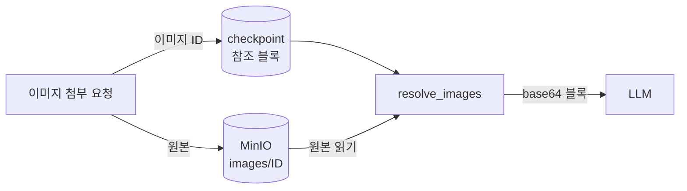

# 0007. 채팅 이미지 원본은 첨부 저장소에, checkpoint 에는 이미지 ID 참조만

- 상태: 채택
- 날짜: 2026-11-20 (89f05b2)
- 관련 코드: `backend/app/images.py`, `backend/app/conversations/service.py` 의 `start_turn`·`delete`, `backend/app/agents/chat/graph.py` 의 `agent` 노드

## 배경

채팅에 첨부한 이미지는 모델 입력의 일부라 LangGraph checkpoint 에 들어갑니다([0001](0001-history-in-checkpointer.md)).
이 결정 전에는 이미지를 base64 블록 그대로 사용자 메시지에 넣었습니다.

- checkpoint 는 턴마다 대화 상태를 새로 저장합니다. 그래서 같은 이미지가 턴마다 다시 쌓였습니다.
- 대화는 자동으로 지우지 않습니다. DB 가 대화 길이에 비례해 끝없이 커질 수 있었습니다.
- 이미지 원본은 `message_images.data` 열에도 따로 저장했습니다.

(89f05b2 커밋 메시지, `images.py` 모듈 설명)

## 결정

- 원본은 첨부 저장소(MinIO) `images/<이미지 ID>` 에 둡니다. `message_images` 에는 객체 키(`storage_key`)만 둡니다.
- checkpoint 의 사용자 메시지에는 이미지 ID 만 담은 참조 블록(`image_ref_block`)을 넣습니다.
- 모델을 부르기 직전에 `resolve_images` 가 보낼 메시지의 참조만 base64 블록으로 바꿉니다. checkpoint 의 원본 메시지는 바꾸지 않고 복사본을 만듭니다.
- 원본을 먼저 올리고 메시지를 저장합니다. 중간에 실패하면 올린 원본을 지웁니다. 저장소가 없으면 이미지 전송은 503 입니다.
- 이미지는 보관 기간으로 지우지 않고 대화를 지울 때 함께 지웁니다. 버킷 lifecycle 규칙은 `documents/` 접두어에만 겁니다.

## 검토한 대안

- **base64 를 checkpoint 에 그대로 두기.** 이 결정 전의 방식입니다. 턴마다 같은 이미지가 쌓여서 고르지 않았습니다(89f05b2).
- **원본을 Postgres `message_images.data` 에 두고 checkpoint 에만 참조를 넣기.** 이 결정 전에 원본이 이미 이 열에 있었습니다.
  MinIO 로 옮긴 이유는 기록되지 않았습니다. 코드에서 드러나는 이유는 문서 원본이 이미 같은 버킷(`documents/`)에 있고(a48bd94),
  저장소 코드가 S3 API 만 써서 다른 S3 호환 저장소로 옮기기 쉽다는 점입니다.

## 결과

좋아진 점:

- checkpoint 크기가 이미지 수와 턴 수의 곱으로 늘지 않습니다.
- 이전 방식의 대화도 읽습니다. `base64`·`url`·`data` 가 이미 있는 블록은 `resolve_images` 가 그대로 둡니다.
- 원본이 없어도 대화가 실패하지 않습니다. 찾지 못한 이미지는 `MISSING_IMAGE_TEXT` 안내 글로 바뀝니다.

감수한 점:

- 모델을 부를 때마다 저장소에서 원본을 읽습니다. 이미지가 든 대화는 MinIO 없이는 이미지를 볼 수 없습니다.
- 마이그레이션 0007 은 원본을 옮기지 않습니다. 저장된 이미지가 있으면 멈추고 안내합니다. 변경 시점에는 저장된 이미지가 없었습니다.

지켜야 하는 것:

- **참조 블록을 모델에 그대로 보내지 않습니다.** 모델을 부르는 새 경로를 만들면 `resolve_images` 를 거쳐야 합니다.
- **대화를 지우면 이미지 원본도 지웁니다.** `conversations/service.py` 의 `delete`·`delete_project` 가 `delete_images` 를 부릅니다.
- **`images/` 접두어에 보관 기간 규칙을 걸지 않습니다.** 걸면 오래된 대화의 이미지가 안내 글로 바뀝니다.

자세한 흐름은 [채팅 이미지](../features/images.md)에 있습니다.
