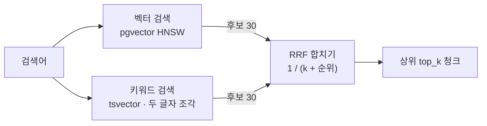

# 0008. 프로젝트 문서 검색은 벡터 + 키워드 하이브리드로 하고 RRF 로 합친다

- 상태: 채택
- 날짜: 2026-11-20 (cb183e1)
- 관련 코드: `backend/app/projects/search.py`, `backend/app/documents/keywords.py`, `document_chunks.search_vector` (마이그레이션 0011)

## 배경

처음 프로젝트 문서 검색은 벡터 검색(pgvector HNSW, 코사인 거리)만 썼습니다(1d68149).

- 벡터 검색은 뜻이 비슷한 글을 잘 찾습니다.
- 코드명·숫자·고유명사처럼 글자가 같아야 하는 것은 놓치기 쉽습니다.
- 비슷한 글이 많으면 정답이 뒤로 밀립니다.
- Postgres 기본 전문 검색(`simple`)은 띄어쓰기로만 나눕니다. "부산의" 와 "부산" 을 다른 단어로 봅니다.

(cb183e1 커밋 메시지, `search.py`·`keywords.py` 모듈 설명)

## 결정

- 벡터 검색과 키워드 검색을 함께 돌립니다. 각각 후보를 `PROJECT_SEARCH_CANDIDATES`(기본 30)개 뽑습니다.
- 키워드 검색은 Postgres 전문 검색(GIN)입니다. 한글·한자 낱말은 낱말 자체와 두 글자 조각으로 나눕니다
  ("부산의" → `부산의`, `부산`, `산의`). 영문·숫자는 소문자 낱말 그대로 씁니다.
- 두 순위를 RRF 로 합칩니다. 청크마다 `1 / (k + 순위)` 를 더합니다. `k` 는 `PROJECT_SEARCH_RRF_K`(기본 60)입니다.
- 임베딩을 쓸 수 없거나(키 없음) 실패하면 키워드 검색만 씁니다.

## 검토한 대안

- **벡터 검색만 쓰기.** 이 결정 전의 방식입니다. 거의 같은 회의록 1,300줄 속에서 정답을 찾는 E2E 시험에서
  정답 순위가 벡터만 썼을 때 2·4·2·30위 밖, 하이브리드로 1·1·1·2위였습니다(cb183e1 커밋 메시지에 기록된 측정).
- **`pg_trgm` 으로 키워드 검색하기.** 짧은 낱말의 순위가 약해서 쓰지 않았습니다(cb183e1).
- **한국어 형태소 분석기 쓰기.** 커밋에는 "형태소 분석기도 확장도 필요 없다" 는 장점만 적혀 있습니다. 분석기를 따로 시험한 기록은 없습니다.
- **점수를 가중합으로 합치기.** 기록된 비교는 없습니다. 코드에서 드러나는 이유는 `search.py` 모듈 설명의
  "점수 단위가 다른 두 검색을 순위만으로 공평하게 합칠 수 있다" 입니다.

## 결과

좋아진 점:

- 이름·코드·숫자처럼 글자가 정확히 같아야 하는 질문을 찾습니다.
- 조사가 붙은 한국어 낱말도 확장이나 분석기 없이 찾습니다.
- 임베딩 키가 없어도 검색이 됩니다. 그래서 키가 없을 때 `search_project` 를 빼던 처리를 없앴습니다.

감수한 점:

- 청크마다 `search_vector` 를 저장하고 GIN 인덱스를 둡니다. 두 글자 조각 때문에 토큰 수가 낱말 수보다 많습니다.
- 두 글자 조각은 뜻과 상관없이 겹치는 조각도 맞춥니다. 키워드 순위에는 잡음이 섞일 수 있습니다.
  이 점은 기록되지 않았고 토큰 규칙에서 추론한 것입니다.
- 검색 한 번에 질의가 두 번 나갑니다.

지켜야 하는 것:

- **적재와 검색이 같은 토큰 함수를 씁니다.** `keywords.py` 의 규칙을 바꾸면 기존 청크의 `search_vector` 를 다시 만들어야 합니다.
- **빠진 `search_vector` 는 검색할 때 채웁니다.** 이 기능 전에 만든 청크는 그 프로젝트를 처음 검색할 때 채워집니다.
- **토큰에는 한글·한자·영문·숫자만 남깁니다.** tsquery 문법 글자가 섞이지 않게 하기 위해서입니다.

자세한 흐름은 [프로젝트 문서와 검색](../features/projects-rag.md)에 있습니다.
