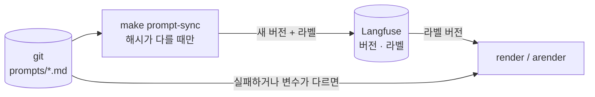

# 0009. 프롬프트 원본은 git, Langfuse 는 동기화 사본

- 상태: 채택
- 날짜: 2026-11-19 (첫 커밋 6b1e614)
- 관련 코드: `backend/app/prompts/__init__.py`, `backend/app/prompts/loader.py`, `backend/app/prompts/remote.py`, `backend/app/prompts/sync.py`

> 첫 커밋에 "File-based prompts with shared fragments, synced to Langfuse" 라는 한 줄과 코드만 남았습니다.
> 아래 이유는 모듈 설명과 주석에 적힌 것이고, 따로 표시한 부분은 코드에서 추론한 것입니다.

## 배경

Langfuse 는 선택 구성요소입니다(README). Langfuse 는 프롬프트 버전과 라벨을 관리하고, 트레이스에 어떤 버전을 썼는지 연결합니다.
하지만 프롬프트는 코드와 함께 바뀌는 계약이기도 합니다. 템플릿 변수가 코드와 어긋나면 렌더링이 깨집니다.
Langfuse 가 꺼져 있거나 닿지 않아도 앱은 답해야 합니다.

## 결정

- **원본은 git 의 로컬 파일입니다.** `app/agents/<에이전트>/prompts/*.md` 와 `app/prompts/shared/` 에 둡니다. 코드는 경로가 아니라 이름으로 부릅니다.
- **Langfuse 는 사본입니다.** `make prompt-sync` 가 include 를 합친 텍스트를 올립니다. 최신 버전과 내용 해시가 같으면 새 버전을 만들지 않고 라벨도 건드리지 않습니다.
- **실행 중에는 라벨 버전을 씁니다.** `PROMPT_SOURCE=langfuse` 이면 `PROMPT_LABEL` 이 붙은 버전을 가져옵니다.
  가져오지 못하거나 변수 구성이 로컬과 다르면 로컬 파일로 렌더링합니다. 실패 뒤 30초는 Langfuse 를 부르지 않습니다.
- **Jinja 는 변수 치환과 정적 include 만 허용합니다.** `if`, `for`, 필터, 동적 include 는 검증에서 거절합니다.
- **롤백은 Langfuse 에서 라벨을 이전 버전으로 옮겨서 합니다.** 정식 변경은 파일 수정 뒤 sync 입니다. Langfuse 화면에서의 수정은 실험용입니다.

## 검토한 대안

- **Langfuse 를 원본으로 두고 화면에서 고치기.** `remote.py` 모듈 설명이 "Langfuse 화면에서의 수정은 실험용으로만" 이라고 정합니다.
  고르지 않은 이유는 기록되지 않았습니다. 코드에서 드러나는 이유는 변수 계약 검증(`validate_all`)과 기동 시점 검사가 로컬 파일을 기준으로 한다는 점입니다.
- **Jinja 전체 문법 쓰기.** Langfuse 템플릿은 `{{var}}` 치환만 있어서 `if`, `for`, 필터를 옮길 수 없습니다(`loader._ALLOWED_NODES` 주석).
- **롤백을 git revert 와 재배포로 하기.** 기록된 비교는 없습니다. 라벨 이동은 재배포 없이 캐시(`PROMPT_CACHE_TTL_SECONDS`, 기본 60초)가 만료되면 반영됩니다.

## 결과

좋아진 점:

- 프롬프트 변경이 코드 리뷰와 git 이력에 남습니다. 변수 불일치는 기동 시점에 잡힙니다.
- Langfuse 가 없어도 앱이 답합니다. 트레이스에는 어느 버전을 썼는지 남습니다.
- 롤백이 재배포 없이 반영됩니다.

감수한 점:

- 프롬프트 안에서 조건문이나 반복을 쓸 수 없습니다. 조건에 따른 내용은 코드가 프롬프트를 골라 붙입니다(예: `agent` 노드가 프로젝트 지시문과 기억 지침을 붙임).
- Langfuse 가 닿지 않으면 로컬 파일로 답하므로, 라벨 버전과 다른 내용이 나갈 수 있습니다. 경고 로그로만 알 수 있습니다.

지켜야 하는 것:

- **라벨 롤백은 다음 파일 변경까지만 유지됩니다.** sync 는 라벨 버전이 아니라 최신 버전과 해시를 비교합니다.
  파일을 고치고 sync 하면 새 버전에 라벨이 붙어 롤백이 풀립니다. 롤백한 이유가 된 문제를 파일에서 먼저 고칩니다(`sync_one` 동작).
- **비동기 코드에서는 `arender` 를 씁니다.** Langfuse 조회는 동기 HTTP 라서 이벤트 루프를 막습니다(f89cb7a).
- **변수는 frontmatter `variables` 와 정확히 맞춥니다.** Langfuse 버전의 변수가 다르면 그 버전은 쓰이지 않습니다.

자세한 흐름은 [프롬프트 관리](../features/prompts.md)에 있습니다.
