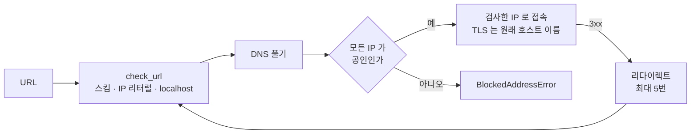

# 0010. 웹 페이지 읽기의 SSRF 방어는 접속하는 순간에 IP 를 검사한다

- 상태: 채택
- 날짜: 2026-11-19 (1362f7c)
- 관련 코드: `backend/app/web/safe_http.py` 의 `GuardedBackend`·`is_public_ip`·`check_url`, `backend/app/web/fetch.py`

## 배경

웹 페이지 읽기 도구는 모델이 정한 URL 에 백엔드가 직접 접속합니다.
막지 않으면 같은 Docker 네트워크의 postgres, Langfuse, 호스트, 클라우드 메타데이터 주소(169.254.169.254)를 읽을 수 있습니다.
검색 결과 페이지에 숨긴 지시로 모델을 속여 내부 주소를 읽게 하는 공격도 가능합니다.

(1362f7c 커밋 메시지, `safe_http.py` 모듈 설명)

## 결정

- **접속하는 순간에 검사합니다.** httpcore 의 연결 계층(`GuardedBackend`)을 감쌉니다. 호스트를 DNS 로 풀고,
  모든 IP 가 공인 주소일 때만 그 검사한 IP 로 바로 접속합니다. 공인과 사설 IP 를 섞어 돌려주는 DNS 도 거절합니다.
- **TLS 인증서는 원래 호스트 이름으로 확인합니다.**
- **리다이렉트는 직접 따라갑니다.** 단계마다 URL 을 다시 검사하고, 최대 5번까지 따라갑니다(`MAX_REDIRECTS`).
- **프록시 환경 변수를 쓰지 않습니다.** 클라이언트를 `trust_env=False` 로 만듭니다.
- 요청 전에 `check_url` 이 http(s) 가 아닌 스킴, IP 리터럴, `localhost` 를 먼저 거릅니다. 응답은 스트리밍으로 받다가 크기 제한을 넘으면 중단합니다.

## 검토한 대안

기록된 대안 비교는 없습니다. 아래는 모듈 설명이 각 규칙에 붙인 이유입니다.

- **요청 전에 한 번 DNS 를 풀어 검사하고 httpx 에 URL 을 넘기기.** 검사한 IP 와 실제 접속하는 IP 가 달라질 수 있습니다.
  검사한 IP 로 접속해야 DNS rebinding 이 통하지 않는다고 적혀 있습니다.
- **httpx 의 `follow_redirects=True` 에 맡기기.** 외부 주소가 내부 주소로 리다이렉트하면 검사 없이 따라갑니다. 그래서 단계마다 다시 검사합니다.
- **환경 변수의 프록시 쓰기.** 프록시를 거치면 접속 대상이 프록시가 되어 IP 검사를 우회합니다.

## 결과

좋아진 점:

- DNS rebinding, 내부 주소로의 리다이렉트, 10진수 IP 표기가 막힙니다. 커밋에 따르면 실제 백엔드 컨테이너에서
  내부 서비스 이름, 10진수 IP 표기, 외부 서비스의 내부 주소 리다이렉트가 막히는 것을 확인했습니다.
- 테스트는 가짜 DNS 를 끼워(`resolver`) 실제 네트워크 없이 확인합니다.

감수한 점:

- 프록시가 필요한 네트워크에서는 웹 페이지 읽기를 쓸 수 없습니다(추론).
- httpcore 의 연결 계층 API 에 기대므로 httpx·httpcore 를 올릴 때 다시 확인해야 합니다(추론).

알려진 한계:

- **NAT64 주소는 공인으로 봅니다.** `is_public_ip("64:ff9b::a9fe:a9fe")` 는 `True` 입니다(169.254.169.254 를 담은 NAT64 주소, 직접 실행해 확인).
  `is_public_ip` 는 `::ffff:` 와 6to4 만 안의 IPv4 로 풀고, `64:ff9b::/96` 은 `is_global` 이 참이기 때문입니다.
  NAT64 가 있는 네트워크에서만 의미가 있습니다([웹 검색과 페이지 읽기](../features/web-fetch.md)의 "막는 주소").

지켜야 하는 것:

- **모델이 정한 URL 에 접속하는 코드는 `safe_http` 클라이언트만 씁니다.** 다른 httpx 클라이언트를 쓰면 이 검사가 모두 빠집니다.
- **막힌 URL 은 Tavily 같은 외부 서비스로도 넘기지 않습니다**(ff3148a).
- **차단 대역을 바꾸면 `is_public_ip` 와 문서의 표를 함께 고칩니다.**

자세한 흐름은 [웹 검색과 페이지 읽기](../features/web-fetch.md)에 있습니다.
