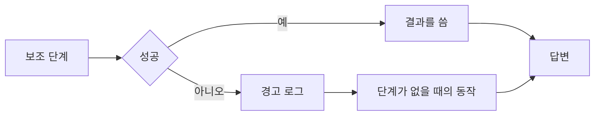

# 0011. 보조 단계는 실패해도 경고만 남기고 답을 막지 않는다

- 상태: 채택
- 날짜: 2026-11-19 (923ddb4, 대화 요약에서 처음 적용)
- 관련 코드: `backend/app/agents/chat/graph.py` 의 `summarize`·`recall`·`decide` 노드, `backend/app/orchestration/decision.py`,
  `backend/app/documents/service.py` 의 `_describe_images`·청크 임베딩, `backend/app/projects/search.py` 의 `search`, `backend/app/llm/embeddings.py`

> 한 번에 정한 규칙이 아닙니다. 기능마다 커밋에서 같은 처리를 골랐고, 이 문서는 그 공통 규칙을 모은 것입니다.

## 배경

한 턴이나 한 번의 적재에는 답 자체가 아닌 보조 단계가 여럿 붙습니다. 대화 요약, 도구 결정(d3), 기억 불러오기, 그림 설명, 임베딩입니다.
이 단계들은 각각 다른 모델이나 외부 서비스를 부릅니다. 로컬 Ollama 모델이 없거나 느릴 수 있고, API 키가 없을 수 있습니다.
보조 단계 하나가 실패해서 사용자가 답을 못 받으면, 그 단계가 주는 이득보다 손해가 큽니다.

## 결정

보조 단계는 실패하면 경고 로그를 남기고, 그 단계가 없었을 때의 동작으로 물러납니다.

| 단계 | 실패하면 | 처음 넣은 커밋 |
|---|---|---|
| 대화 요약 | 상태를 바꾸지 않고 기존 요약과 잘라내기로 답함 (120초 제한) | 923ddb4 |
| 임베딩 (적재) | 청크를 임베딩 없이 저장, 검색할 때 다시 만듦 | 1d68149 |
| 임베딩 (검색) | 키워드 검색만 씀 | cb183e1 |
| 그림 설명 | 그 그림은 `image_status=fallback` (지금은 본문에 OCR 글자를 넣음, 9499f31) | b49eb2d |
| 도구 결정 | 이번 턴만 도구를 모두 주고 누적 목록은 그대로 둠 | c546e89 |
| 기억 불러오기 | 기억 없이 답함 | 6c67e60 |

## 검토한 대안

- **실패를 그대로 올려 턴이나 적재를 실패시키기.** 기록된 이유는 두 곳에 있습니다.
  요약은 "요약 때문에 답변이 실패하면 안 되기 때문" 입니다(`summarize` 노드 설명). 도구 결정은 "결정은 최적화일 뿐이라,
  실패해도 기능은 결정을 끈 상태와 같아야 한다" 입니다([도구 결정](../features/tool-decision.md)). 나머지 단계는 이유가 적혀 있지 않고, 같은 처리를 따랐습니다.

## 결과

좋아진 점:

- 결정 모델이나 vision 모델, 임베딩 키가 없어도 채팅과 문서 적재가 됩니다.
- 빠진 임베딩은 다음 검색에서 채우므로 문서를 다시 올리지 않아도 됩니다.

감수한 점:

- 실패가 로그에만 남습니다. 사용자는 요약이나 기억이 빠진 답, 모든 도구를 받은 턴을 구분하지 못합니다.
- 도구 결정이 실패한 턴은 도구 정의가 모두 들어가 프롬프트 토큰이 늘어납니다.

알려진 빈틈 (코드를 실행해 확인):

- **도구 결정은 잡는 예외가 좁습니다.** `decide` 는 `DecisionUnavailableError` 와 `TimeoutError` 만 잡고, `ask_d3` 는 `httpx.HTTPError` 만
  `DecisionUnavailableError` 로 바꿉니다. `httpx.InvalidURL` 은 `httpx.HTTPError` 의 하위 클래스가 아닙니다.
  그래서 `TOOL_DECISION_URL=http://[::1` 처럼 형식이 잘못된 주소면 `InvalidURL` 이 `decide` 노드 밖으로 나가 턴이 실패합니다.
  호스트 이름만 틀린 주소(`http://exa mple:11434`)는 `ConnectError` 라서 정상적으로 물러납니다.
  요약·기억·임베딩(검색)은 `Exception` 을 잡아서 이 빈틈이 없습니다.

지켜야 하는 것:

- **새 보조 단계는 실패 시 동작을 먼저 정합니다.** 경고 로그와 "단계가 없을 때의 동작" 을 함께 둡니다.
- **물러날 때 상태를 반쯤 바꾸지 않습니다.** 요약은 빈 딕셔너리를, 도구 결정은 이전 누적 목록을 돌려줍니다.
- **답 자체를 만드는 주 모델 호출에는 이 규칙을 쓰지 않습니다.** 기록된 규칙은 아니고, 보조 단계만 물러나는 코드에서 드러나는 경계입니다.

관련 문서: [컨텍스트 관리](../features/context-management.md), [도구 결정](../features/tool-decision.md), [장기 기억](../features/memory.md), [프로젝트 문서와 검색](../features/projects-rag.md).
