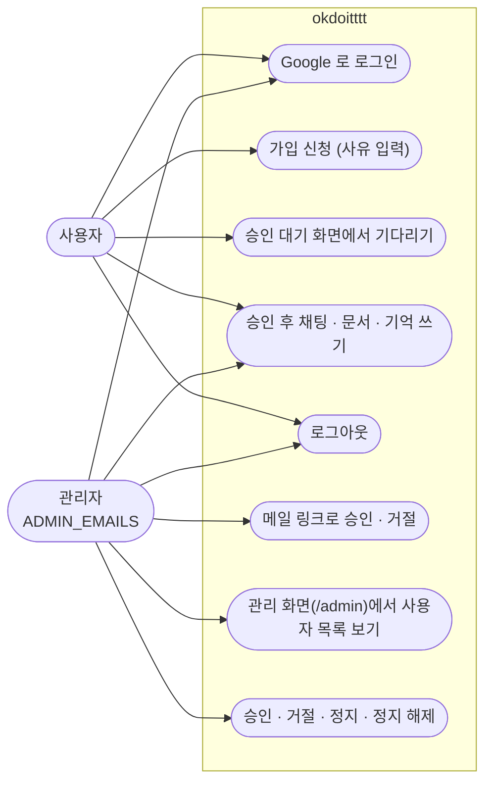
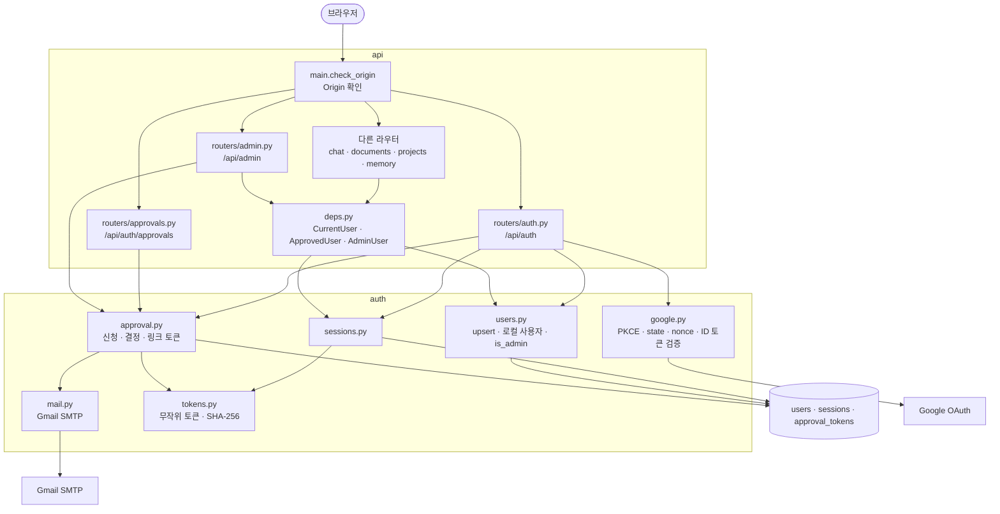
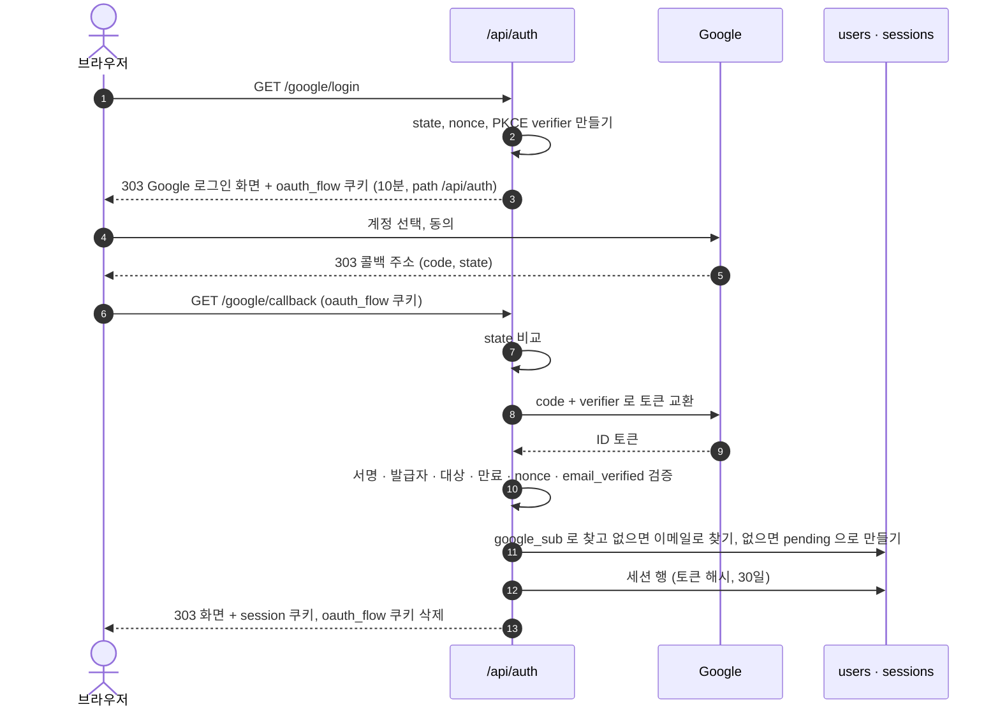
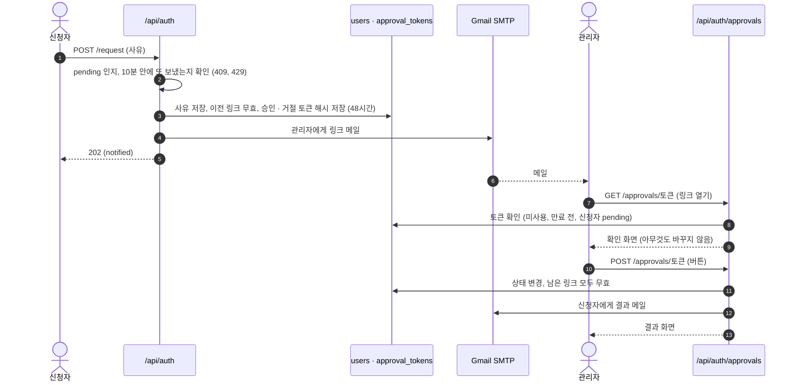
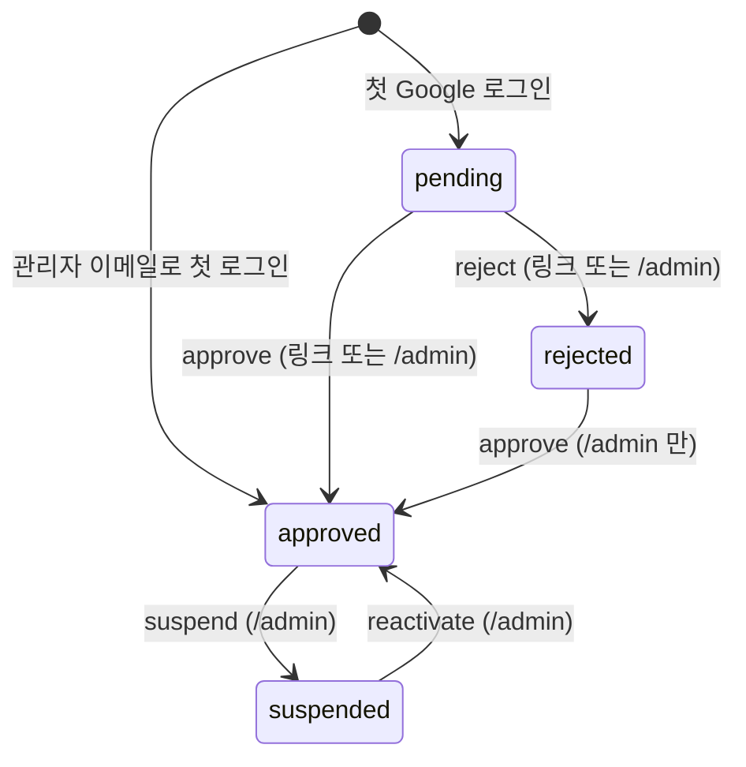

# 로그인과 가입 승인

> Google 계정으로 로그인하고, 관리자가 승인한 사람만 앱을 씁니다.
> 관련 코드: `backend/app/auth/`, `backend/app/api/deps.py`, `backend/app/api/routers/auth.py`,
> `backend/app/api/routers/approvals.py`, `backend/app/api/routers/admin.py`, `backend/app/main.py`,
> `frontend/src/components/Auth.tsx`, `frontend/src/app/admin/page.tsx`

## 사용자 관점

일반 사용자와 관리자가 하는 일이 다릅니다. 관리자는 `ADMIN_EMAILS` 에 있는 이메일입니다.

1. 사용자가 "Google 로 로그인" 을 누릅니다. 처음이면 `pending` 상태로 계정이 생기고 "가입 신청" 화면이 나옵니다.
2. 신청 사유를 적어 보내면 관리자에게 승인·거절 링크가 담긴 메일이 갑니다. 같은 사람은 10분에 한 번만 보낼 수 있습니다.
3. 대기 화면은 15초마다 내 정보를 다시 읽습니다. 승인되면 바로 채팅 화면으로 바뀝니다.
4. 거절되거나 정지되면 안내 화면만 보입니다.

관리자 이메일로 처음 로그인하면 신청 없이 바로 승인됩니다.

## 구조

### 접근 단계

| 의존성 | 통과 조건 | 실패 |
|---|---|---|
| `CurrentUser` | 유효한 세션 쿠키 | 401 |
| `ApprovedUser` | 위 + `status == "approved"` | 403, `detail.code` 에 상태 |
| `AdminUser` | 위 + 관리자 (`ADMIN_EMAILS` 또는 로컬 사용자) | 403 |

가입 신청(`POST /api/auth/request`)은 `CurrentUser` 만 요구합니다. 승인 대기 상태에서 불러야 하기 때문입니다.
화면은 401 이나 승인 상태 403 을 받으면 `/api/auth/me` 를 다시 읽습니다. 세션 만료와 정지가 바로 반영됩니다.

## 흐름

### Google 로그인

- 실패하면 화면 주소에 `?login_error=` 를 붙여 돌려보냅니다. 화면은 사유를 보여 주고 주소에서 지웁니다.
- Google 로그인이 설정되지 않았으면 오류 JSON 대신 화면으로 돌려보냅니다. 브라우저가 직접 여는 주소이기 때문입니다.
- 관리자 이메일이면 이때 승인하고, 주인이 없는 대화·문서(로그인 기능 전 데이터)와 로컬 사용자의 데이터를 넘겨받습니다.

### 가입 신청과 메일 승인

- 메일 설정이 없거나 보내기에 실패해도 신청은 저장됩니다. 응답의 `notified` 가 `false` 가 됩니다.
- 쓸 수 없는 링크(없음, 사용함, 만료, 신청자가 이미 처리됨)는 410 안내 화면을 보여 줍니다.
- 관리 화면의 결정(`POST /api/admin/users/{id}/{decision}`)도 같은 `approval.decide` 를 씁니다.

## 상태

`users.status` 는 네 가지입니다. 바꿀 수 있는 경로는 `approval.ALLOWED_FROM` 표 하나로 정합니다.

| 결정 | 허용되는 현재 상태 | 부수 효과 | 신청자 메일 |
|---|---|---|---|
| `approve` | `pending`, `rejected` | `approved_at` 기록 | 보냄 |
| `reject` | `pending` | 세션 모두 삭제 | 보냄 |
| `suspend` | `approved` | 세션 모두 삭제 | 보내지 않음 |
| `reactivate` | `suspended` | `approved_at` 기록 | 보냄 |

- 허용되지 않는 결정은 409 입니다. 관리자 계정이나 자기 자신을 거절·정지하려 하면 400 입니다.
- 모든 결정은 그 사용자의 남은 승인 링크를 무효로 합니다(`used_at` 기록).
- `rejected` 를 `approved` 로 바꾸는 것은 관리 화면에서만 됩니다. 메일 링크는 신청자가 `pending` 일 때만 쓸 수 있습니다.
- 거절된 사용자는 다시 신청할 수 없습니다. 신청은 `pending` 일 때만 받습니다.

## 보안 장치

| 대상 | 장치 |
|---|---|
| 세션 | 쿠키에는 256비트 무작위 토큰, DB 에는 SHA-256 해시만. 유효 30일(`SESSION_TTL_DAYS`). 마지막 사용 시각은 5분 넘게 지났을 때만 갱신 |
| 쿠키 | `HttpOnly`, `SameSite=Lax`. `Secure` 는 `COOKIE_SECURE` 를 따르고, 비어 있으면 화면 주소가 https 일 때만 |
| CSRF | `check_origin` 미들웨어가 POST·PUT·PATCH·DELETE 의 `Origin` 을 CORS 허용 목록과 백엔드 주소와 비교해 403. `Origin` 이 없는 요청은 통과 |
| OAuth | PKCE(S256), `state`(CSRF), `nonce`(ID 토큰 재사용 방지), 이메일 확인된 계정만 |
| 승인 링크 | 토큰 해시만 저장, 48시간(`APPROVAL_LINK_TTL_HOURS`), 한 번만. GET 은 확인 화면만, 처리는 POST |
| 승인 화면 | 사용자 글 HTML 이스케이프, CSP(스크립트 금지), `no-store`, `X-Frame-Options: DENY`, `Referrer-Policy: same-origin` |
| 로그 | uvicorn 접근 로그에서 `/api/auth/approvals/` 뒤의 토큰을 가림 |
| 소유권 | 대화·메시지·이미지·문서·기억은 주인만. 남의 ID 는 404 로 존재 여부도 숨김 |

## 로컬 개발 모드

`AUTH_REQUIRED=false` 면 로그인 없이 모든 요청을 로컬 사용자 한 명으로 처리합니다.

- 로컬 사용자는 처음 요청할 때 `is_local=true`, `status=approved` 로 만들어집니다. 주인 없는 예전 데이터도 이때 넘겨받습니다.
- 로컬 사용자는 관리자로 취급됩니다(`is_admin`). 관리 화면 목록에는 나오지 않고, 관리 API 로 상태를 바꿀 수도 없습니다(404).
- 다른 사람이 접속하는 환경에서는 반드시 `AUTH_REQUIRED=true` 로 둡니다.

## 데이터

`users`, `sessions`, `approval_tokens` 의 컬럼과 관계는 [ERD](../data/erd.md#1-사용자인증)에 있습니다.
로그아웃과 정지·거절 때 지워지는 것은 [데이터 저장 위치](../data/storage-map.md#삭제할-때-함께-지워지는-것)에 있습니다.

- 사용자는 `google_sub` 로 찾습니다. 이메일은 바뀔 수 있어서 보조로만 씁니다.
- 만료된 세션은 그 쿠키로 요청이 올 때 지웁니다. 다시 오지 않는 세션의 행은 남습니다.

## 설계 결정

**로그인과 소유권을 기능이 늘기 전에 넣었습니다.** 지인에게 공개하기 전이었고, 사용자 ID 는 모든 테이블과 조회에 들어가므로
기능이 더 늘기 전에 하는 편이 싸다고 봤습니다(커밋 `9a371a0`).

**남의 리소스는 403 이 아니라 404 입니다.** 다른 사람의 ID 로 요청해도 그 대상이 있는지조차 알 수 없게 합니다.

**DB 에는 토큰 해시만 둡니다.** DB 가 유출돼도 세션이나 승인 링크를 쓸 수 없습니다. 토큰이 충분히 길고 무작위라서
bcrypt 같은 느린 해시는 쓰지 않습니다(`tokens.py`).

**메일 링크는 열기만 해서는 처리되지 않습니다.** 메일 보안 검사기나 미리보기가 링크를 자동으로 열어도 승인되지 않게
확인 버튼(POST)을 눌러야 처리합니다(`approvals.py` 모듈 docstring, 커밋 `ed6b895`).

**승인 화면의 `Referrer-Policy` 는 `same-origin` 입니다.** 링크 주소에 토큰이 있어서 다른 사이트로 새지 않게 합니다.
`no-referrer` 는 브라우저가 확인 버튼의 POST 에 `Origin: null` 을 붙여서 출처 확인에 막혔습니다(커밋 `ed6b895`).

**`SameSite=Lax` 와 Origin 확인을 함께 씁니다.** Lax 만으로도 다른 사이트의 POST 에는 쿠키가 붙지 않지만 한 번 더 막습니다.
`Origin` 이 없는 요청(curl 등)은 쿠키를 자동으로 붙이지 않으므로 통과시킵니다(`main.check_origin` docstring).

**거절·정지하면 세션을 바로 지웁니다.** 다음 요청부터 401 이 되어 바로 끊깁니다(`approval.decide`).

**신청 메일 본문은 일반 텍스트입니다.** 사용자가 쓴 신청 사유가 들어가기 때문이고, 제목의 줄바꿈도 지워 헤더 조작을 막습니다(커밋 `ed6b895`).
