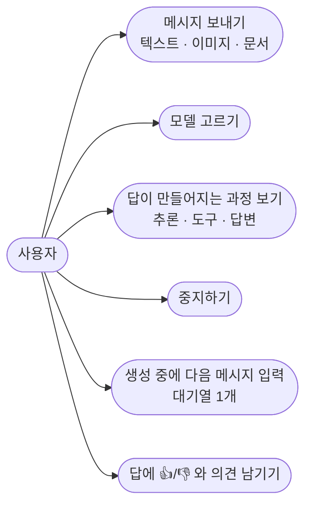
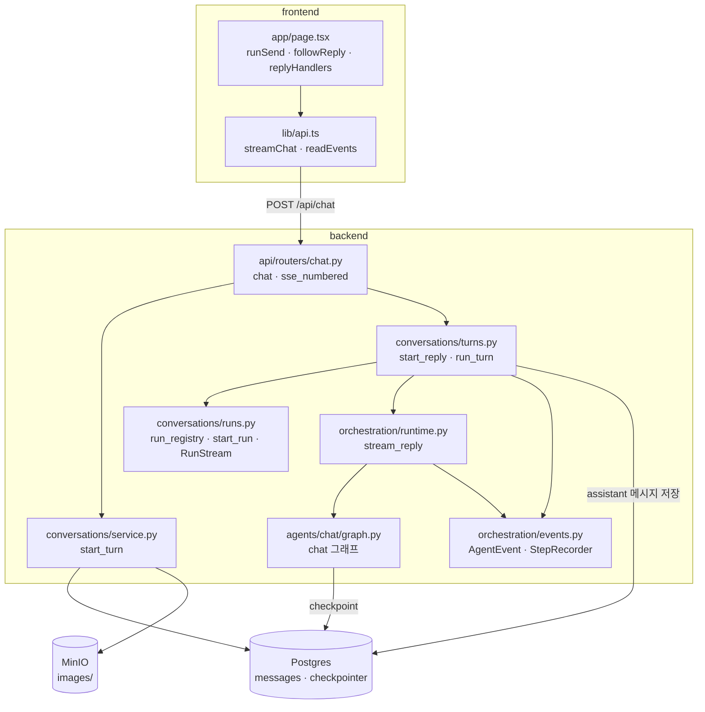
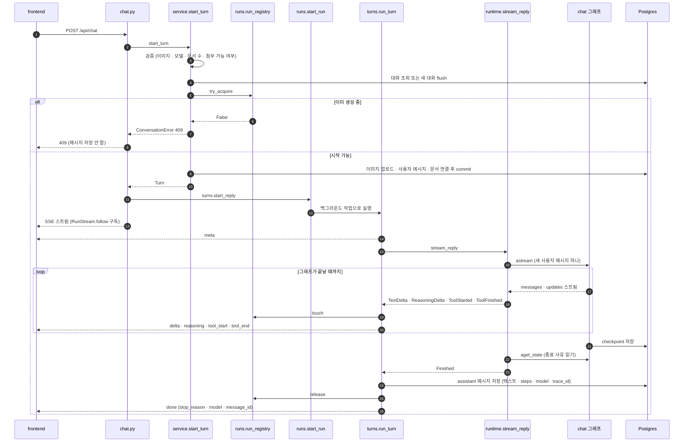
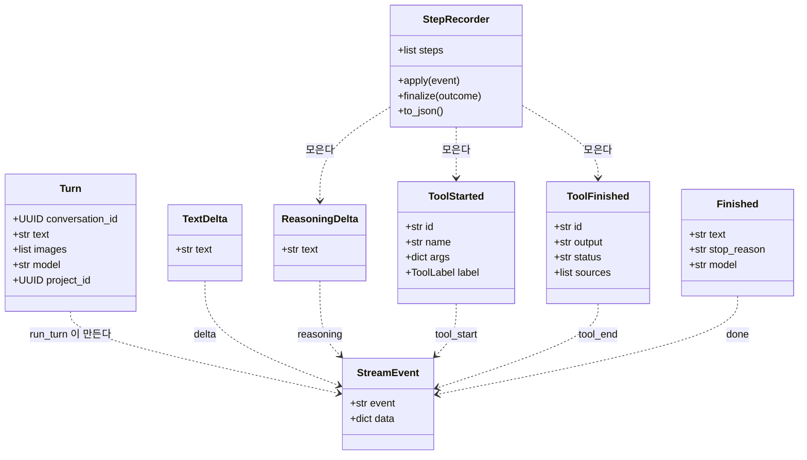

# 한 턴의 흐름

> 사용자 메시지 하나가 저장되고, 백그라운드 실행이 그래프를 돌려 답을 만들고, SSE 이벤트로 화면에 전달되고, 답이 저장되기까지의 순서입니다.
> 관련 코드: `backend/app/api/routers/chat.py`, `backend/app/conversations/service.py`, `backend/app/conversations/turns.py`,
> `backend/app/orchestration/runtime.py`, `backend/app/orchestration/events.py`, `frontend/src/lib/api.ts`, `frontend/src/app/page.tsx`

큰 그림은 [전체 아키텍처의 4절](../architecture/00-overview.md#4-한-턴의-큰-흐름)에 있습니다. 이 문서는 그 흐름을 함수 단위로 내려가서 봅니다.
재연결, 중지의 내부 동작, 동시 요청 거절은 [streaming-runs.md](streaming-runs.md)에서 다룹니다.

## 사용자 관점

| 유스케이스 | 화면 동작 | 서버 API |
|---|---|---|
| 메시지 보내기 | `runSend` 가 사용자 메시지와 빈 답 자리를 먼저 그린다 | `POST /api/chat` |
| 모델 고르기 | 드롭다운에서 고른 모델 ID 를 요청의 `model` 로 보낸다. 다음 메시지부터 적용된다 | `GET /api/models`, `POST /api/chat` 의 `model` |
| 과정 보기 | `reasoning`, `tool_start`, `tool_end`, `delta` 이벤트를 받아 그린다 | 같은 SSE 스트림 |
| 중지하기 | 중지 API 를 부른다. 연결을 끊는 것으로는 멈추지 않는다 | `POST /api/conversations/{id}/stop` |
| 대기열 | 생성 중에 보낸 메시지 1개를 화면에 들고 있다가 답이 끝나면 보낸다 | 서버는 관여하지 않음 |
| 피드백 | `done` 이벤트의 `message_id` 로 보낸다 | `PUT /api/conversations/{id}/messages/{message_id}/feedback` |

- 대화 도중에 모델을 바꿔도 이력은 이어집니다. 대화 상태가 모델과 관계없이 같은 checkpointer 에 있기 때문입니다.
- 고른 모델이 지금 목록에 없으면 서버가 400 으로 거절합니다(`available_models` 로 확인).
- 피드백은 DB 에 저장한 뒤 응답 뒤에 Langfuse 점수로 보냅니다. 자세한 내용은 [feedback-tracing.md](feedback-tracing.md)에서 다룹니다.

## 구조

| 모듈 | 하는 일 | 모르는 것 |
|---|---|---|
| `chat.py` | 인증, `ConversationError` 를 HTTP 오류로 바꾸기, `StreamEvent` 를 SSE 문자열로 바꾸기 | 저장 규칙 |
| `service.start_turn` | 검증, 생성 중 표시, 사용자 메시지 저장, 모델에 보낼 텍스트 만들기 | HTTP, SSE |
| `turns.run_turn` | 그래프 이벤트를 `StreamEvent` 로 바꾸기, 답과 실행 단계 저장, 생성 중 표시 해제 | 전송 방식 |
| `runtime.stream_reply` | 그래프 실행, LangGraph 스트림을 `AgentEvent` 로 바꾸기, 끊긴 답을 checkpoint 에 넣기 | `messages` 테이블 |

## 흐름

1. **검증.** `start_turn` 은 저장 전에 거절할 것을 먼저 거절합니다. 이미지 입력이 꺼져 있으면 400, 저장소가 없으면 503, 쓸 수 없는 모델이면 400,
   문서가 너무 많으면 400, 붙일 수 없는 문서면 `AttachError` 입니다.
2. **생성 중 표시.** 대화를 찾거나 새로 만든 뒤 `run_registry.try_acquire` 를 부릅니다. 실패하면 409 이고, 아무것도 commit 하지 않습니다.
3. **저장.** 이미지 업로드, 사용자 메시지, 문서 연결을 한 번에 commit 합니다. 실패하면 올린 이미지를 지우고 생성 중 표시를 해제합니다.
4. **실행 시작.** `turns.start_reply` 가 `run_turn` 을 `runs.start_run` 에 넘깁니다. 응답 HTTP 연결은 그 실행을 구독할 뿐입니다.
5. **그래프 실행.** `stream_reply` 는 새 사용자 메시지 하나만 그래프에 넣습니다. 이전 이력은 checkpointer 에 있습니다([ADR 0001](../decisions/0001-history-in-checkpointer.md)).
   그래프의 노드 구성은 [전체 아키텍처의 5절](../architecture/00-overview.md#5-에이전트-그래프)에 있습니다.
6. **이벤트 변환.** `messages` 스트림에서 `agent` 노드(`STREAM_NODES`)의 토큰만 답변과 추론으로 내보냅니다.
   `updates` 스트림에서는 `AIMessage.tool_calls` 를 `ToolStarted` 로, `ToolMessage` 를 `ToolFinished` 로 바꿉니다.
   도구 호출 뒤 새 답 메시지가 시작되면 답변 앞에 빈 줄을 넣습니다.
7. **저장과 해제.** `Finished` 를 받으면 답 텍스트나 실행 단계가 있을 때만 assistant 메시지를 저장합니다. 그 뒤 생성 중 표시를 해제하고 `done` 을 보냅니다.
   저장과 해제는 `anyio.CancelScope(shield=True)` 안에서 돌아서 도중에 취소되어도 끝까지 실행됩니다.

### 끝나는 방식

| 끝 | 보내는 이벤트 | 저장하는 답 텍스트 | 실행 중이던 도구 |
|---|---|---|---|
| 정상 | `done` | 보여준 전체 텍스트 | 없음 |
| 예외 | `error` | 보여준 텍스트 + `ERROR_SUFFIX` | `error` |
| 중지 | `stopped` | 보여준 텍스트 + `INTERRUPTED_SUFFIX` | `interrupted` |
| 시간 초과 | `error` (시간 초과 문구) | 보여준 텍스트 + `INTERRUPTED_SUFFIX` | `interrupted` |
| 앱 종료 | 없음 | 보여준 텍스트 + `INTERRUPTED_SUFFIX` | `interrupted` |

보여준 것이 없으면 중단·오류 경로에서는 저장하지 않습니다(`_save_partial`). 정상 종료에서도 텍스트와 실행 단계가 모두 비면 저장하지 않고 `message_id` 가 `null` 입니다.
중지, 시간 초과, 앱 종료는 [streaming-runs.md](streaming-runs.md)에서 자세히 다룹니다.

### 첨부가 끼어드는 곳

첨부는 이 흐름의 두 곳에만 끼어듭니다. 저장 형식과 파싱은 각 기능 문서에서 다룹니다.

| 첨부 | `start_turn` 에서 | 그래프에서 |
|---|---|---|
| 이미지 | MinIO `images/` 에 올리고 `message_images` 행을 만든다. `Turn.images` 는 원본이 아니라 참조 블록(`image_ref_block`)이다 | `build_user_message` 가 참조 블록을 텍스트 앞에 넣는다. `agent` 노드가 모델을 부르기 직전에 `resolve_images` 로 원본으로 바꾼다 |
| 문서 | 사용자 메시지에 연결하고(`attach_to_message`), 첨부 목록을 모델에 보낼 텍스트 뒤에 붙인다(`reading.with_attachments`). 짧은 문서는 본문까지 붙인다 | 긴 문서는 모델이 `read_document` 도구로 읽는다 |

화면용 `messages.content` 에는 사용자가 쓴 텍스트만 저장합니다. 첨부 목록은 모델 입력(checkpoint)에만 들어갑니다.
자세한 내용은 [images.md](images.md), [documents.md](documents.md)에 있습니다.

## SSE 이벤트

`POST /api/chat` 과 `GET /api/conversations/{id}/stream` 은 같은 이벤트를 보냅니다. 모든 이벤트에 `id:` 줄로 1부터 번호가 붙습니다.

| 이벤트 | `data` | 보내는 곳 | 화면 처리 (`replyHandlers`) |
|---|---|---|---|
| `meta` | `conversation_id` | `run_turn` 첫 이벤트 | 새 대화면 주소를 `/c/{id}` 로 바꾼다. 대화 ID 전에 중지를 눌렀으면 이때 중지한다 |
| `reasoning` | `text` | `ReasoningDelta` | 연속된 조각은 마지막 추론 단계에 이어 붙인다 |
| `tool_start` | `id`, `name`, `label`, `done_label`, `args` | `ToolStarted` | 실행 중 도구 단계를 더한다 |
| `tool_end` | `id`, `output`, `status`, `sources`, `documents` | `ToolFinished` | 같은 `id` 의 도구 단계를 바꾼다. `output` 은 최대 2,000자. `documents` 는 답변 아래 파일 칩 ([문서 수정과 생성](document-editing.md)) |
| `delta` | `text` | `TextDelta` | 답 자리에 이어 붙인다 |
| `done` | `stop_reason`, `model`, `message_id` | `Finished` 처리 뒤 | `message_id` 를 피드백용으로 기억한다. `max_tokens`, `refusal` 이면 안내 문구를 붙인다 |
| `error` | `message`, `error_id`, `transient` | 예외 처리 | `transient` 면 알림, 아니면 오류 상자 |
| `error` (시간 초과) | `message`, `transient` | `runs.start_run` | 위와 같음. `error_id` 가 없다 |
| `stopped` | 없음 | `runs.start_run` (중지 시) | 답을 중단됨으로 표시한다 |

- `stop_reason` 은 provider 마다 다른 값을 `end_turn`, `max_tokens` 같은 공통 이름으로 맞춥니다(`runtime._STOP_REASON_MAP`).
- `error.message` 에는 예외 원문 대신 일반 문구와 오류 ID 를 넣습니다. 원문은 같은 오류 ID 로 서버 로그에 남습니다.
- 이벤트 번호 규칙과 다시 붙기는 [streaming-runs.md](streaming-runs.md#이벤트-번호와-다시-붙기)에 있습니다.

## 주요 타입

- `AgentEvent` 다섯 종류는 그래프와 전송 방식을 모두 모릅니다. `run_turn` 이 이것을 `StreamEvent` 로 바꾸고, `chat.py` 가 SSE 로 바꿉니다.
- `StepRecorder` 는 실행 단계를 일어난 순서대로 모아 `messages.steps` 에 저장합니다. 끝날 때 실행 중으로 남은 도구를 `error` 또는 `interrupted` 로 바꿉니다.

## 데이터

| 저장소 | 쓰는 것 | 시점 |
|---|---|---|
| `messages` (role `user`) | 사용자가 쓴 텍스트, `message_images` 행 | `start_turn` commit |
| `documents` | `conversation_id`, `message_id` 연결 | `start_turn` commit |
| MinIO `images/` | 이미지 원본 | `start_turn`, commit 전 |
| checkpointer | 사용자 메시지(첨부 목록 포함), 답, 도구 호출과 결과 | 그래프 노드가 끝날 때 |
| `messages` (role `assistant`) | 보여준 답 텍스트, `steps`, `model`, `trace_id` | `run_turn` 끝 |
| 프로세스 메모리 | 생성 중 표시, 이벤트 기록 | 실행 중과 끝난 뒤 60초 |

테이블 구조는 [ERD의 대화 영역](../data/erd.md#2-대화), 저장소별 내용은 [데이터 저장 위치](../data/storage-map.md)에 있습니다.

## 설계 결정

- **답은 HTTP 요청이 아니라 백그라운드 작업에서 만든다.** 요청 안에서 돌던 시절에는 새로고침이나 탭 닫기로 생성이 멈췄고, 검색과 문서 읽기를 여러 번 한 응답도 처음부터 다시 물어야 했습니다(커밋 `9ff8d57`).
- **이벤트는 전송 방식을 모르는 `StreamEvent` 로 만든다.** `turns.py` 모듈 설명에 따르면 SSE 변환은 API 계층의 일입니다. 같은 이벤트를 `POST /api/chat` 과 재연결 API 가 함께 씁니다.
- **생성 중 표시는 `done`/`error` 를 보내기 직전에 해제한다.** 이벤트를 받은 화면이 대기 메시지를 바로 보내도 409 로 거절되지 않게 하기 위해서입니다(`run_turn` docstring, 커밋 `a08d7a9`).
- **저장과 해제는 취소에서 보호한다.** 보호하지 않으면 저장 직후 취소되어 해제가 빠지고 대화가 "생성 중" 으로 남습니다(`run_turn` 의 주석).
- **오류 원문은 화면에 보내지 않는다.** 화면에는 오류 ID 만 보내고 원문은 로그에서 찾습니다. 원문을 숨기는 구체적인 이유(정보 노출 등)는 코드와 커밋에 적혀 있지 않습니다.
- **화면용 텍스트와 모델 입력을 나눈다.** 첨부 목록은 모델에게만 보내고 `messages` 에는 저장하지 않습니다. 이유는 [ADR 0001](../decisions/0001-history-in-checkpointer.md)에 있습니다.
