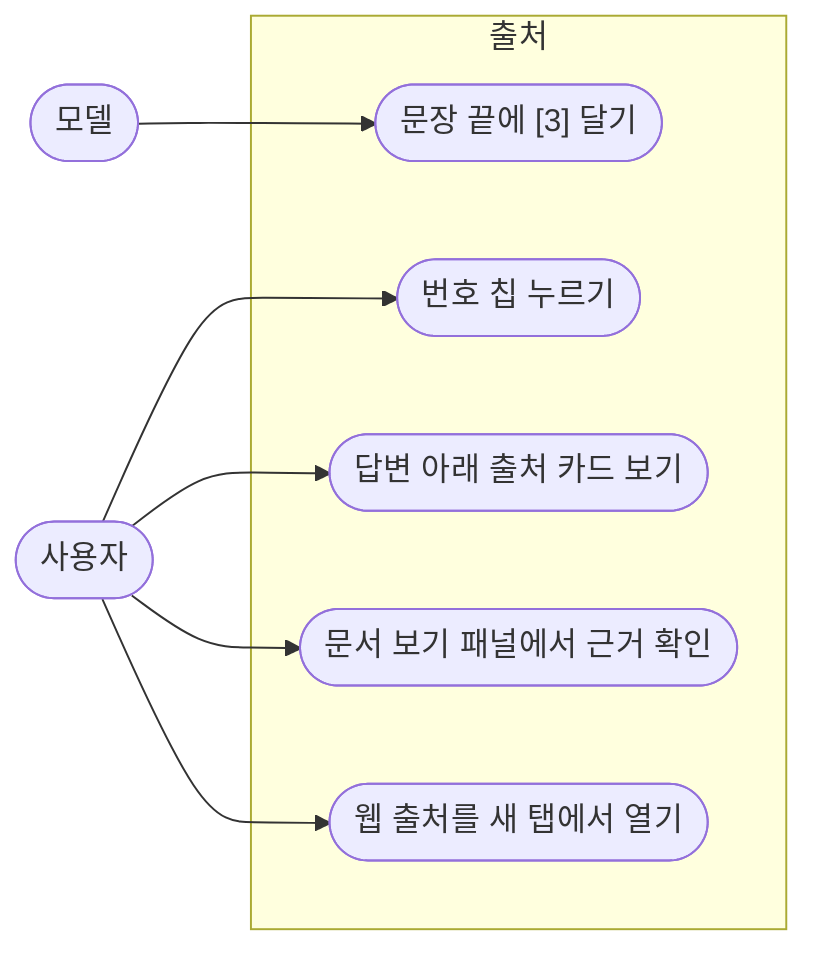
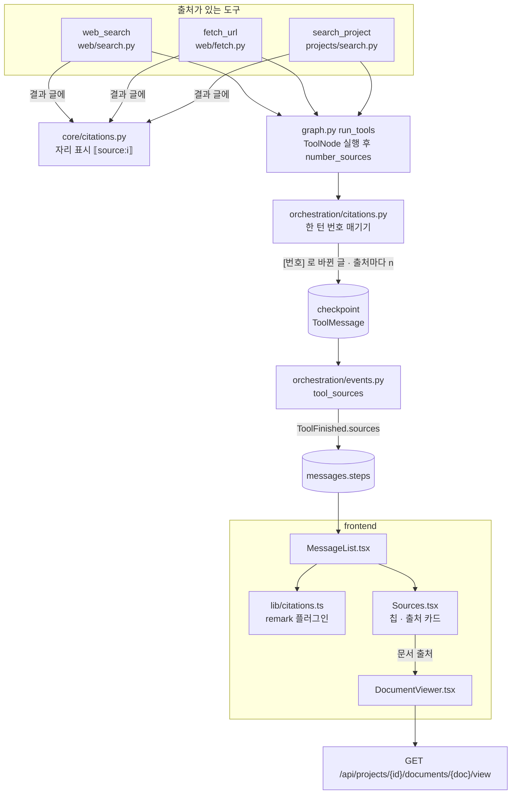
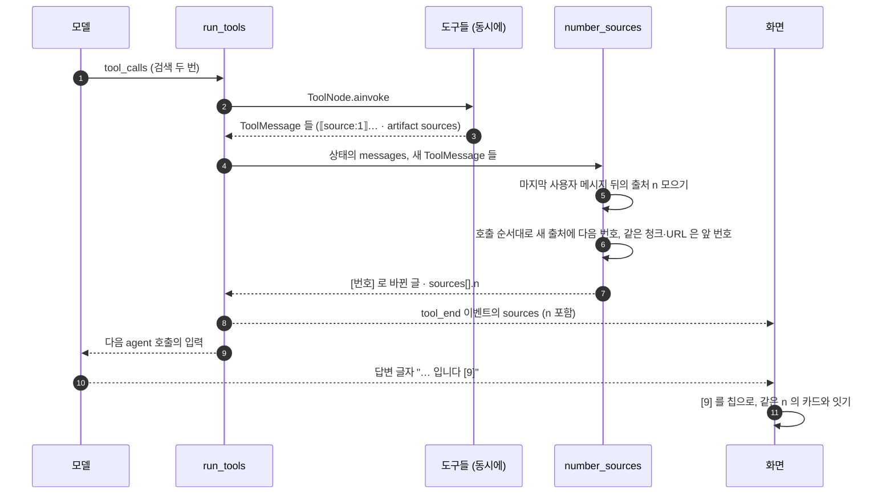
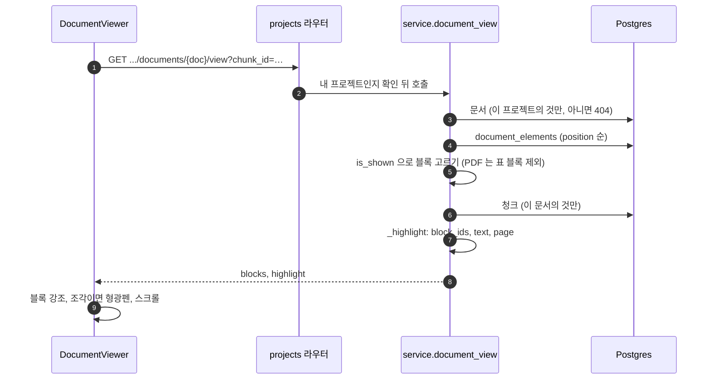

# 출처와 출처 번호

> 출처가 있는 도구의 결과에 한 턴 안에서 이어지는 번호를 매기고, 답변 속 `[3]` 을 출처 카드와 문서 보기 패널로 잇습니다.
> 관련 코드: `backend/app/core/citations.py`, `backend/app/orchestration/{citations,events}.py`, `backend/app/agents/chat/graph.py`,
> `backend/app/projects/{search,service}.py`, `backend/app/api/routers/projects.py`,
> `frontend/src/lib/citations.ts`, `frontend/src/components/{Sources,DocumentViewer,MessageList}.tsx`

출처가 있는 도구는 웹 검색(`web_search`), 페이지 읽기(`fetch_url`), 프로젝트 문서 검색(`search_project`) 셋입니다.
각 도구의 동작은 [웹 검색과 페이지 읽기](web-fetch.md)와 [프로젝트 문서와 검색](projects-rag.md#검색)에 있습니다.
이 문서는 세 도구가 함께 쓰는 번호 매기기와 화면 쪽을 다룹니다.

## 사용자 관점

- 모델은 번호가 붙은 출처를 쓴 문장 끝에 `[3]` 이나 `[1][4]` 를 답니다. 출처 목록은 직접 쓰지 않습니다(`chat/system` 프롬프트).
- 화면은 답변 속 번호를 작은 칩으로 그립니다. 마우스를 올리면 제목과 위치가 보입니다.
- 칩이나 카드를 누르면 웹 출처는 새 탭에서 열립니다. 프로젝트 문서 출처는 오른쪽 문서 보기 패널에서 근거 위치를 보여 줍니다.
- 답변이 끝나면 인용한 출처를 번호 순서로 먼저 보여 줍니다. 인용하지 않은 출처는 "답변에 쓰지 않은 출처 N개 보기" 로 접습니다.
- 번호가 없는 본문은 문서 이름과 쪽으로 적습니다. `read_document` 로 읽은 본문과 system 프롬프트에 통째로 넣은 프로젝트 문서가 그렇습니다(`chat/project` 프롬프트).

## 구조

- 도구는 `response_format="content_and_artifact"` 로 선언합니다. 모델에게 줄 글과 화면에 줄 출처(`{"sources": [...]}`)를 따로 돌려줍니다.
- artifact 는 모델 입력에 들어가지 않습니다. 화면의 출처 카드만 이 값을 씁니다.
- `tool_sources` 는 artifact 를 화면에 줄 값으로 거릅니다. 웹은 `http`/`https` 주소만, 문서는 UUID 형식의 ID 만 남기고 `n` 을 함께 넘깁니다.

## 흐름

### 자리 표시

- 도구는 결과 글에 출처마다 `source_marker(i)` 로 `⟦source:i⟧` 를 넣습니다. `i` 는 그 결과의 artifact `sources` 안의 순서(1부터)입니다.
- 도구는 번호를 정하지 않습니다. 도구가 동시에 실행되면 서로가 쓴 번호를 모르기 때문입니다.
- 프로젝트 검색은 검색 결과 하나를 출처 하나로 만듭니다. 같은 위치의 결과를 합치면 모델에게 준 번호와 카드 순서가 어긋납니다.

### 번호 매기기

`graph.py` 의 `run_tools` 노드가 `ToolNode` 를 실행한 뒤 `number_sources(state["messages"], result["messages"])` 를 부릅니다.

- **이어받기.** 마지막 `HumanMessage` 뒤의 `ToolMessage` 에서 이미 매긴 `n` 을 모읍니다. 새 번호는 그중 가장 큰 값 다음부터입니다.
  그래서 한 답변 안에서 검색을 두 번 해도 번호가 겹치지 않습니다. 다음 턴은 1부터 다시 셉니다.
- **같은 출처.** 출처 키는 프로젝트 문서면 `chunk:{chunk_id}`, 웹이면 `url:{url}` 입니다. 이번 턴에 나온 키면 앞의 번호를 그대로 씁니다.
  키가 없는 출처는 매번 새 번호를 받습니다.
- **동시에 실행된 도구.** 번호는 도구 노드가 끝난 뒤 한 곳에서 매깁니다. `ToolNode` 가 돌려준 메시지 순서(도구 호출 순서)대로 매기므로 겹치지 않습니다.
- **바꾸기.** 글의 `⟦source:i⟧` 를 `[n]` 으로 바꾸고 artifact 의 출처마다 `n` 을 넣습니다. 없는 출처를 가리키는 자리 표시는 지웁니다.
  원본 메시지는 바꾸지 않고 `model_copy` 로 새 메시지를 만듭니다.
- 결과 글 끝에는 "번호로만 인용하고 출처 목록을 쓰지 말라" 는 안내가 붙습니다. 프로젝트 검색은 문서 이름·쪽이나 `【…】` 를 함께 쓰지 말라고도 적습니다.
- 지난 도구 결과를 줄일 때도 같은 `n` 으로 출처 목록을 남깁니다([컨텍스트 관리](context-management.md#지난-도구-결과-줄이기)).

### 화면의 번호 칩

`MessageList.tsx` 가 답변을 `react-markdown` 으로 그리고, `remarkCitations` 플러그인이 번호를 `#cite-3` 링크로 바꿉니다.
`a` 렌더러가 이 링크를 `Citation` 칩으로 그립니다.

- 찾는 모양은 `[3]` 과 `[1, 4]` 입니다. `[1][4]` 는 둘로 나뉘어 각각 칩이 됩니다. 숫자는 세 자리까지입니다.
- 글자(text) 노드만 바꿉니다. 코드 블록, 인라인 코드, 수식은 글자 노드가 아니라서 그대로입니다. 링크 안도 건드리지 않습니다.
- 바로 앞이 영문·숫자·`_` 이면 첨자로 보고 그대로 둡니다(`a[1]`). `[0]` 도 그대로입니다. 한글 바로 뒤(`입니다[2]`)는 번호로 봅니다.
- 번호 앞 공백은 줄바꿈하지 않는 공백으로 바꿉니다. 칩만 다음 줄로 떨어지지 않게 하기 위해서입니다.
- 맞는 출처가 없는 번호(모델이 지어낸 번호)는 `[n]` 글자 그대로 둡니다.

### 출처 카드

- `collectSources` 가 응답의 도구 단계에서 출처를 모읍니다. 같은 `n` 은 한 번만 넣고 `n` 순서로 정렬합니다.
- `n` 이 없는 예전 출처는 나온 순서대로 번호를 매기고, 문서 ID·위치나 URL 로 중복을 거릅니다.
- 답변을 만드는 중에는 카드를 순서대로 모두 보여 줍니다. 끝나면 `citedNumbers` 로 본문에서 인용한 번호를 찾아 앞으로 정리합니다.
  칩과 같은 규칙이고, 코드 블록과 인라인 코드 안의 번호는 뺍니다. 인용한 번호가 없으면 앞의 4개만 보이고 나머지는 "더 보기" 로 접습니다.
- 문서 카드는 문서 이름, "본문" 또는 "그림", 위치(`p.3 · 제목`)를 보여 줍니다. 그림 결과는 미리보기를 붙입니다.
- 출처는 실행 단계(`messages.steps`)에 저장됩니다. 새로고침해도 칩과 카드가 그대로 이어집니다.

## 문서 보기 패널

문서 출처의 칩이나 카드를 누르면 오른쪽에 패널이 열립니다. 프로젝트 화면의 문서 칩을 눌러도 같은 패널이 열립니다(강조 없음).
넓은 화면은 대화 옆에 붙고 좁은 화면은 전체를 덮습니다. Esc 로 닫고, 다른 화면으로 옮기면 닫힙니다.

- **보이는 내용.** 원본 모양이 아니라 모델이 읽은 추출 내용입니다. 문서 본문, 청크와 같은 `is_shown` 규칙으로 요소를 고릅니다.
  그림은 미리보기와 설명(설명이 없으면 그림 속 OCR 글자)을 보여 줍니다. 형식과 관계없이 같은 화면이고, 원본은 패널 위 "원본 받기" 로 받습니다.
- **블록 강조.** 청크의 `element_ids` 중 화면에 보이는 블록을 배경색으로 강조합니다. 이어진 강조 블록은 상자 하나처럼 그립니다.
  쪽 구분선이나 제목 표시가 끼면 상자를 나눕니다.
- **조각 형광펜.** 긴 본문을 나눈 텍스트 청크가 블록 하나를 가리키고 내용이 블록과 다르면 `highlight.text` 로 청크 본문을 줍니다.
  화면은 공백과 Markdown 기호를 무시하고 블록 안에서 그 글자를 찾아 CSS Custom Highlight API 로 표시합니다. DOM 은 바꾸지 않습니다.
  이 API 가 없는 브라우저는 형광펜만 건너뜁니다.
- **스크롤.** 형광펜 범위가 있으면 그 위치로, 없으면 첫 강조 블록으로, 그것도 없으면 쪽 구분선으로 갑니다. 같은 카드를 다시 눌러도 다시 스크롤합니다.

### 근거를 찾지 못할 때

| 경우 | 동작 |
|---|---|
| `element_ids` 가 없는 예전 청크 | 같은 종류이고 같은 쪽 범위에서 공백을 뺀 내용이 겹치는 블록을 찾음 |
| 그림 청크 (`element_ids` 없음) | `image_element_id` 블록 |
| PDF 표 청크 (표 블록이 보이지 않음) | 블록 없이 청크의 첫 쪽으로 이동, "근거가 이 화면에 따로 보이지 않는 표에 있습니다" 안내 |
| `chunk_id` 가 없는 예전 출처 카드 | 카드 위치(`p.3 · …`)의 쪽으로 이동 |
| 청크가 사라짐 (다시 처리 등) | `highlight` 가 없음. 카드 위치의 쪽으로 이동 |

지금은 PDF 표 청크를 만들지 않습니다. 표 항목은 그 전에 만든 청크를 위한 것입니다([청크 규칙](projects-rag.md#청크-규칙)).

## 데이터

- 번호가 바뀐 결과 글과 `n` 이 들어간 artifact 는 checkpoint 의 `ToolMessage` 로 남습니다. 다음 도구 노드가 이 값으로 번호를 이어받습니다.
- 화면용 출처는 실행 단계로 `messages.steps` 에 저장됩니다([데이터 저장 위치](../data/storage-map.md)).
- 문서 보기는 `document_elements` 와 `document_chunks.element_ids` 를 읽기만 합니다([프로젝트 문서와 검색](projects-rag.md#데이터)).

## 설계 결정

- **번호는 도구가 아니라 도구 노드 뒤 한 곳에서 매긴다.** 도구마다 1부터 세면 한 답변에서 두 번 검색했을 때 번호가 겹치고 카드 번호와도 맞지 않았습니다.
  모델은 `【문서명, 쪽】` 처럼 따로 적기도 했습니다(92bc7ed).
- **같은 청크·URL 은 앞의 번호를 쓴다.** 두 번째 검색에서 이미 나온 결과에 새 번호를 주면 같은 출처가 카드 두 장이 됩니다(92bc7ed).
- **출처 목록은 artifact 로 화면에만 준다.** 모델이 출처를 빠뜨리거나 지어내도 카드는 실제 검색 결과라 정확합니다. 모델 입력 토큰도 늘지 않습니다.
- **칩은 remark 단계에서 만든다.** Markdown 구조를 알아서 코드·링크 안을 건드리지 않습니다. `a[1]` 같은 첨자는 앞 글자로 거릅니다(78fae23).
- **인용한 출처를 앞에 둔다.** 검색 결과 순서대로 두면 쓰지 않은 출처가 앞을 차지했습니다. LLM 호출 없이 답변 글자와 저장된 번호로만 정합니다(6b0e291).
- **패널은 모델이 읽은 내용을 보여 준다.** 답이 정말 그 부분에서 나왔는지 바로 확인하기 위해서입니다. 원본 렌더링이 필요 없어 형식마다 따로 만들지 않습니다(545843e).
