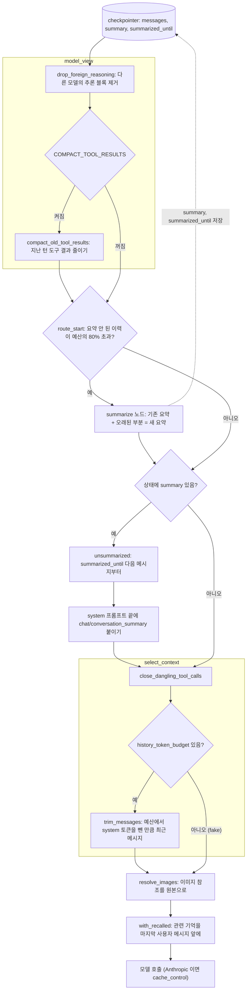
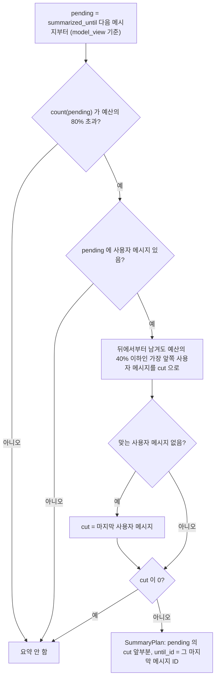
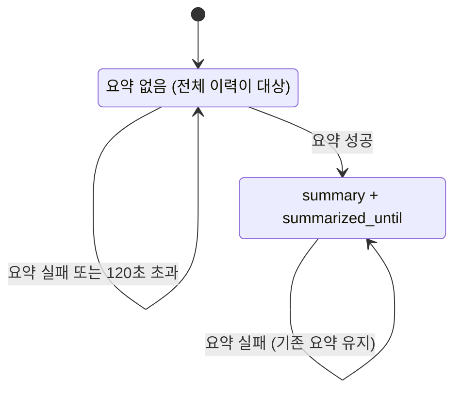

# 컨텍스트 관리

> 모델을 부를 때마다 저장된 대화 이력을 고쳐서 토큰 예산 안에 맞춥니다. 저장된 원본은 바꾸지 않습니다.
> 관련 코드: `backend/app/orchestration/context.py`, `backend/app/orchestration/summary.py`, `backend/app/llm/tokens.py`, `backend/app/agents/chat/graph.py`, `backend/app/core/config.py`, `backend/app/llm/__init__.py`

한 턴의 전체 흐름(API, 백그라운드 실행, SSE)은 [한 턴의 흐름](chat-turn.md)에 있습니다. 이 문서는 그 안에서 모델 입력을
만드는 부분만 다룹니다.

checkpointer 는 대화의 모든 메시지를 그대로 저장합니다([데이터 저장 위치](../data/storage-map.md#checkpointer-에-있는-것)).
그대로 보내면 대화가 길어질수록 입력이 커지고, 결국 모델의 컨텍스트를 넘습니다. 그래서 모델에 보낼 때만 이력을 다섯 단계로
고칩니다.

| 단계 | 함수 | 하는 일 |
|---|---|---|
| 1 | `drop_foreign_reasoning` | 다른 모델이 만든 답변의 추론 블록을 뺀다 |
| 2 | `compact_old_tool_results` | 지난 턴의 도구 결과를 줄인다 (`COMPACT_TOOL_RESULTS`) |
| 3 | `summary.unsummarized` | 요약이 있으면 요약 이후의 메시지만 남긴다 |
| 4 | `close_dangling_tool_calls` | 결과 없이 끊긴 도구 호출에 "중단됨" 결과를 채운다 |
| 5 | `trim_messages` | 예산을 넘으면 앞부분을 잘라 최근 메시지만 남긴다 |

1, 2 단계를 묶은 것이 `graph.py` 의 `model_view` 입니다. 요약이 필요한지 판단할 때도 같은 `model_view` 를 씁니다.

## 구조

모델을 부르기 직전에 이력이 지나가는 순서입니다. 점선 화살표는 상태에 저장되는 값입니다.

- `route_start` 와 `summarize` 노드는 턴 시작에 한 번만 지나갑니다. 도구를 부른 뒤 agent 로 돌아올 때는 `model_view` 부터
  `select_context` 까지만 다시 거칩니다.
- 예산이 없으면(`fake`) `summarize` 노드가 그래프에 없고, 3, 5 단계도 건너뜁니다.
- `resolve_images` 는 자르기 뒤에 실행됩니다. 토큰을 셀 때 이미지는 원본 크기가 아니라 장당 `IMAGE_TOKEN_ESTIMATE`(기본 1500)로 셉니다.

## 토큰 예산

예산은 provider 마다 다릅니다(`Settings.history_token_budget`). `CONTEXT_MAX_TOKENS` 를 지정하면 provider 와 상관없이 그 값을 씁니다.

| provider | 기본 예산 | 이유 (코드 주석과 커밋 메시지) |
|---|---|---|
| `ollama` | `OLLAMA_NUM_CTX - OLLAMA_NUM_PREDICT - 256` (기본 28,416) | Ollama 는 `num_ctx` 를 넘는 입력의 앞부분을 오류 없이 잘라낸다 |
| `google` | 32,000 | 컨텍스트는 크지만 무료 티어의 분당 토큰 한도에 걸리지 않게 |
| `openai` | 32,000 | 매 턴 보내는 입력이 곧 비용 |
| `anthropic` | 150,000 | 이력을 바꾸면 프롬프트 캐시가 깨지므로 요약을 드물게 |
| `fake` | 없음 | 자르지도 요약하지도 않음 |

예산은 대화 이력과 system 프롬프트에만 씁니다. 도구 정의는 예산에 넣지 않습니다.

## 토큰 세기

`make_token_counter` 는 실제 토크나이저 없이 글자 수로 토큰을 어림합니다.

- 기본값은 LangChain 의 `count_tokens_approximately` 입니다. 4자당 1토큰, 메시지마다 3토큰을 더합니다.
- ASCII 가 아닌 글자(한글 등)는 1.5자당 1토큰이 되도록 차이만큼 더합니다(`llm/tokens.py`).
  qwen3.5 로 재 보니 한국어는 글자당 약 0.61 토큰이었습니다. 넘치지 않게 조금 크게 잡은 값입니다.
- 본문 텍스트 블록과 도구 호출 인자를 셉니다. 추론 블록과 이미지 데이터는 글자로 세지 않습니다.
- 이미지는 장당 `IMAGE_TOKEN_ESTIMATE` 토큰입니다. checkpoint 의 이미지 참조 블록도 `type: "image"` 라서 이미지로 셉니다.

같은 기준(`ASCII_CHARS_PER_TOKEN`, `NON_ASCII_CHARS_PER_TOKEN`)을 첨부 문서 길이 계산(`documents/reading.py`)도 씁니다.

## 지난 도구 결과 줄이기

`compact_old_tool_results` 는 **마지막 사용자 메시지보다 앞에 있는** 도구 결과만 줄입니다. 이번 턴의 결과는 도구를
여러 번 부르는 중이라도 그대로 둡니다.

| 결과 | 줄인 모양 |
|---|---|
| 오류 결과 (`status="error"`) | 그대로 |
| `compactors` 에 그 도구의 함수가 있음 | 그 함수의 결과 (`None` 이면 아래 기본 규칙) |
| artifact 에 `sources` 가 있음 (웹 검색, 문서 검색) | 안내 한 줄 + 호출 인자 + 출처 목록 |
| 500자(`COMPACT_THRESHOLD_CHARS`) 초과 | 안내 한 줄 + 호출 인자 + 앞 300자(`COMPACT_KEEP_CHARS`) |
| 그 밖의 짧은 결과 | 그대로 |

- 줄인 메시지는 같은 ID 를 가진 복사본입니다. 요약 경계(`summarized_until`)를 ID 로 찾기 때문입니다.
- 안내 문구는 모델이 읽으므로 영어입니다. 예: `[Earlier web_search result, shortened. Call it again if you need the details.]`
- 지금 chat 그래프는 `compactors` 를 넘기지 않습니다. 모든 도구가 기본 규칙을 씁니다.

## 다른 모델의 추론 빼기

`agent` 노드는 응답에 모델 ID 를 적습니다(`tag_model`, `response_metadata["app_model"]`). `drop_foreign_reasoning` 은
지금 부르는 모델과 ID 가 다른 AI 메시지에서 추론을 뺍니다.

- 빼는 것: content 의 `thinking`, `redacted_thinking`, `reasoning` 블록과 `additional_kwargs` 의 `reasoning_content`,
  `__gemini_function_call_thought_signatures__`.
- 남기는 것: 답변 텍스트와 도구 호출.
- 모델 ID 가 없는 메시지(기록하기 전의 메시지, 중단되어 저장된 답변)도 다른 모델의 것으로 보고 추론을 뺍니다.

## 대화 요약

예산이 있으면 그래프에 `summarize` 노드가 들어갑니다. 상수는 `orchestration/summary.py` 에 있습니다.

| 상수 | 값 | 뜻 |
|---|---|---|
| `TRIGGER_RATIO` | 0.8 | 요약하지 않은 이력이 예산의 80% 를 넘으면 요약 |
| `KEEP_RATIO` | 0.4 | 최근 이력을 예산의 40% 안에서 원문으로 남김 |
| `CHUNK_RATIO` | 0.5 | 요약 호출 한 번의 입력 최대 크기 (예산 대비). 넘으면 나눠서 이어 요약 |
| `MAX_MESSAGE_CHARS` | 4000 | 요약 입력에서 메시지 하나의 최대 글자 수 |
| `SUMMARY_TIMEOUT_SECONDS` | 120 | 넘으면 포기 (`graph.py`) |

`plan_summary` 가 어디까지 요약할지 정합니다.

- 원문으로 남기는 부분은 항상 사용자 메시지로 시작합니다. 도구 호출과 그 결과가 요약과 원문으로 갈라지지 않습니다.
- 요약 입력은 `User: …`, `Assistant: …`, `Tool result (name): …` 형식의 텍스트입니다. 추론은 빼고, 이미지는 장 수만 적습니다.
- 요약 프롬프트는 `chat/summary`, system 프롬프트에 붙이는 틀은 `chat/conversation_summary` 입니다.
- 요약 토큰은 화면에 나가지 않습니다. 스트리밍은 `agent` 노드의 토큰만 보냅니다(`STREAM_NODES`).

### 요약 상태

`summary` 와 `summarized_until` 은 그래프 상태로 checkpoint 에 저장됩니다. 원본 메시지는 지우지 않습니다.

### 실패하면

요약 노드는 예외와 시간 초과를 잡아 경고 로그만 남기고 빈 업데이트를 돌려줍니다. 상태는 그대로이고, `agent` 노드는 기존
요약과 잘라내기만으로 답합니다. 요약 때문에 답변이 실패하지 않게 하기 위해서입니다.

`summarized_until` 의 ID 를 이력에서 찾지 못하면 경고를 남기고 전체 이력을 요약되지 않은 것으로 봅니다.

### 요약 모델

`build_summary_model` 은 같은 provider 와 모델을 쓰되 provider 마다 설정을 바꿉니다.

| provider | 바꾸는 것 |
|---|---|
| `ollama` | 추론 끔, 출력 1024 토큰 |
| `google` | 추론 요약 안 받음, 출력 4096 토큰 (추론을 끌 수 없는 모델도 이 한도를 씀) |
| `openai` | 추론 요약 안 받음, 추론 강도가 설정되어 있으면 `low` |
| `anthropic` | 바꾸지 않음 (본 모델과 같은 설정) |

## 자르기

`make_context_selector` 가 만든 `select_context` 가 마지막 단계입니다.

- `trim_messages` 를 `strategy="last"`, `start_on="human"`, `end_on=("human", "tool")`, `allow_partial=False` 로 부릅니다.
  잘린 뒤에도 사용자 메시지로 시작해서, 도구 결과가 짝 없이 남지 않습니다.
- 예산에서 system 프롬프트 토큰을 먼저 뺍니다. 요약과 프로젝트 문서가 붙은 system 프롬프트가 크면 남는 이력이 줄어듭니다.
- 마지막 메시지 하나가 예산보다 커도 그 메시지는 보냅니다(`trimmed or messages[-1:]`).
- 요약이 정상이면 자르기는 거의 일어나지 않습니다. 요약이 실패했을 때의 안전장치입니다.

## 끊긴 도구 호출 메우기

도구 실행 중에 응답이 중지되면 checkpoint 에 도구 호출만 있고 결과가 없을 수 있습니다. Claude 는 이런 요청을 400 으로
거부합니다. `close_dangling_tool_calls` 는 결과가 없는 호출 바로 뒤에 `status="error"` 인 고정 문구 결과를 넣습니다.
매번 같은 문구라 프롬프트 캐시가 유지됩니다.

## Anthropic 프롬프트 캐시와의 관계

Claude 요청에는 최상위 `cache_control` 이 붙어서, 도구 정의부터 이력 끝까지 같은 앞부분을 캐시에서 읽습니다
([LLM provider](llm-providers.md#프롬프트-캐시)). 이력의 앞부분이 바뀌면 그 뒤가 모두 캐시에서 빠집니다. 그래서 이력을
고치는 각 단계는 앞부분을 되도록 그대로 두게 만들었습니다.

| 단계 | 캐시에 주는 영향 |
|---|---|
| 지난 도구 결과 줄이기 | 다음 사용자 턴이 시작될 때 한 번만 바뀜. 그 뒤로는 같은 모양 |
| 끊긴 도구 호출 메우기 | 매번 같은 문구 |
| 요약 | 요약할 때 system 프롬프트와 이력 앞부분이 바뀜. 예산을 150,000 으로 크게 잡아 드물게 |
| 오늘 날짜 (`today`) | 날짜 단위로만 바뀜 |
| 관련 기억 | system 프롬프트가 아니라 마지막 사용자 메시지 앞에 붙임 (매 턴 달라지므로) |

## 데이터

| 저장소 | 키 | 내용 |
|---|---|---|
| checkpointer | `messages` | 원본 이력. 이 문서의 어떤 단계도 바꾸지 않음 |
| checkpointer | `summary`, `summarized_until` | 요약과 경계 |
| Langfuse | 트레이스 | 실제로 모델에 들어간 입력 |

자세한 위치는 [데이터 저장 위치](../data/storage-map.md)에 있습니다.

## 설계 결정

- **원본은 두고 모델 입력만 고친다.** 저장된 이력을 바꾸면 되돌릴 수 없고, 화면 이력과 모델 이력이 어긋납니다. 모든 단계가
  복사본을 돌려줍니다. 이력을 checkpointer 에 두는 이유는 [ADR 0001](../decisions/0001-history-in-checkpointer.md)에 있습니다.
- **잘라내기만 하지 않고 요약한다.** 잘라내기만 하던 때는 초반에 말한 이름이나 조건을 모델이 잊었습니다(커밋 `923ddb4`).
  qwen3.5:9b 로 예산 2000, 22턴 대화에서 요약이 두 번 일어난 뒤에도 첫 턴의 이름과 날짜를 맞게 답했습니다.
- **80% 에서 요약하고 40% 를 남긴다.** 요약 한 번으로 여유를 크게 만들어 요약 횟수를 줄입니다. Anthropic 은 그 사이 턴 동안
  캐시가 유지됩니다(커밋 `3285d7f`). 두 비율을 왜 이 값으로 골랐는지는 커밋과 코드에 적혀 있지 않습니다.
- **요약 판단도 줄인 이력으로 센다.** 원본 크기로 세면 지난 검색 결과 때문에 요약이 필요 이상으로 일찍 일어납니다(`model_view` docstring).
  검색을 네 번 한 실제 대화에서 보내는 이력이 8,937 에서 5,087 토큰으로 줄었습니다(커밋 `7b9d9ea`).
- **한국어를 1.5자당 1토큰으로 센다.** 4자당 1토큰으로 세면 한국어 504 토큰을 257 로 셌고, Ollama 가 system 프롬프트까지 조용히
  잘라냈습니다(커밋 `519b078`). 실측 대비 한국어 +8%, 영어 -9% 입니다.
- **Anthropic 에도 예산을 둔다.** 예산이 없을 때는 대화가 아주 길면 컨텍스트를 넘고 입력 비용이 끝없이 커졌습니다. 150,000 은
  Anthropic 서버 압축의 기본 시작점과 같은 값입니다(커밋 `3285d7f`).
- **요약 실패는 답변 실패가 아니다.** 요약은 부가 기능이라, 실패하면 잘라내기로 물러납니다.
