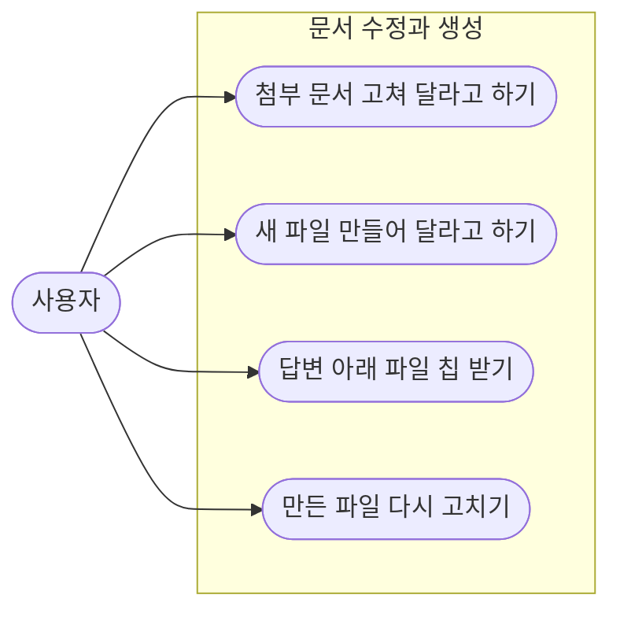
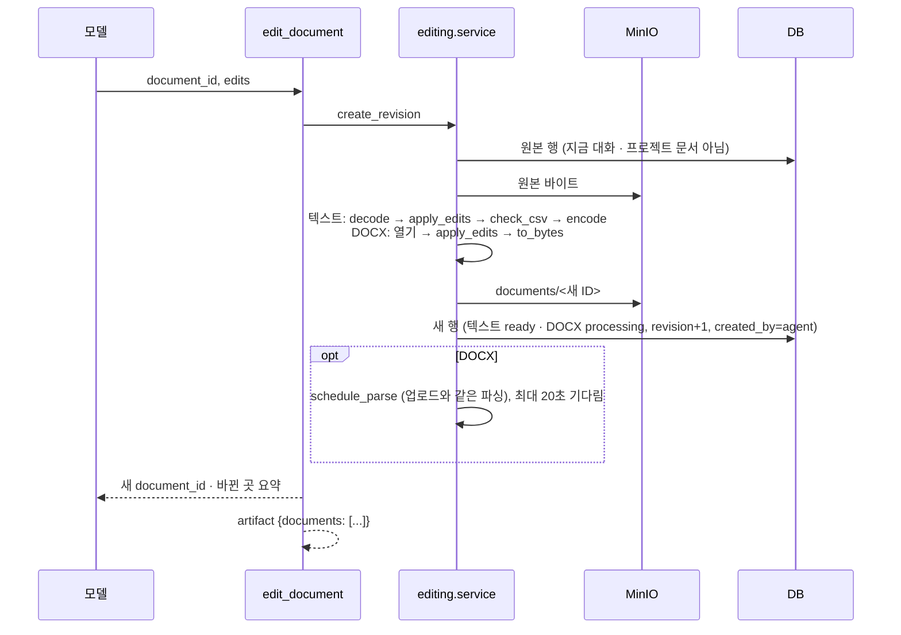

# 문서 수정과 생성

> 에이전트가 대화에 첨부된 TXT·MD·CSV·Word(DOCX) 문서를 고쳐 수정본을 만들거나, 새 TXT·MD·CSV 문서를 만들어 답변 아래 파일 칩으로 돌려줍니다.
> 원본은 바꾸지 않습니다.
> 관련 코드: `backend/app/documents/editing/`, `backend/app/tools/documents.py`, `backend/app/orchestration/events.py`,
> `frontend/src/components/EditedFiles.tsx`
> 설계 기록: [`works/00.document-editing.md`](../../works/00.document-editing.md), [`works/01.text-formats.md`](../../works/01.text-formats.md),
> [`works/02.docx.md`](../../works/02.docx.md)

올리기·파싱·읽기는 [첨부 문서](documents.md)를, 도구가 한 턴 안에서 도는 흐름은 [한 턴의 흐름](chat-turn.md)을 보세요.

## 사용자 관점

- 고칠 수 있는 형식: TXT, MD, CSV, Word(DOCX). 다른 형식(PDF, Excel, PowerPoint, 한글)은 에이전트가 아직 못 고친다고 답합니다.
- Word 문서는 문단·표 칸·머리글·바닥글 안의 **글자만** 바꿉니다. 서식(굵게, 색, 표, 그림, 머리글)은 그대로입니다.
  문단 나누기·추가·삭제, 표 행 추가, 그림·서식 바꾸기는 아직 못 한다고 답합니다.
- 새로 만들 수 있는 형식은 TXT, MD, CSV 입니다.
- 고칠 때마다 새 버전이 생깁니다: `보고서.md` → `보고서 (수정 2).md` → `보고서 (수정 3).md`. 원본은 그대로 남습니다.
- 새로 만든 문서의 칩에는 "새 문서", 수정본의 칩에는 "수정본 v2" 가 붙습니다. 칩을 누르면 파일을 받습니다.
- 칩은 실행 단계(`messages.steps`)에 저장되어 새로고침해도 남습니다.

## 구조

| 도구 | 하는 일 | 화면 문구 |
|---|---|---|
| `view_document_for_edit(document_id, start)` | 원본에 번호를 붙여 보여준다. 텍스트는 줄(`[L12] 내용`), DOCX 는 문단(`[p12] (표1 2행 1열) 내용`). `start` 는 형식에 따라 줄·문단 번호다. 고칠 수 없는 문서는 여기서 미리 알려준다 | 수정할 곳 보는 중 / 봄 |
| `edit_document(document_id, edits)` | `edits` 를 차례로 적용해 수정본을 만든다. 수정 하나는 `{old_text, new_text, replace_all, paragraph}` (`paragraph` 는 DOCX 에서 찾을 문단, 예: `"p12"`. 텍스트 형식에서는 무시) | 문서 수정하는 중 / 수정함 |
| `create_document(filename, content)` | 새 TXT·MD·CSV 문서를 만든다 | 문서 만드는 중 / 만듦 |

세 도구 모두 `documents` 도구 그룹에 속합니다([도구 결정](tool-decision.md)).

## 흐름

### 고치기

- **고칠 수 있는 문서**: 지금 대화에 붙은 문서와 그 수정본입니다. 다른 대화·프로젝트의 문서는 없는 문서와 같은 말로 거절합니다(있는지 숨김).
- **원본 형태 지키기**: 원본 바이트에서 BOM 과 줄바꿈을 기억했다가 저장할 때 되돌립니다. 그래서 고친 곳 말고는 원본과 바이트까지 같습니다.
  줄바꿈이 `\r\n` 과 `\n` 으로 섞인 파일은 고치지 않습니다. 하나로 맞추면 고치지 않은 줄까지 바뀌기 때문입니다.
- **수정 규칙**: `old_text` 는 문서 안에서 정확히 한 번 나와야 합니다(`replace_all` 이면 모두). 수정은 순서대로 적용하고, 하나라도 실패하면 아무것도 저장하지 않습니다.
  바뀌는 게 없는 수정과 빈 문서가 되는 수정도 거절합니다. `old_text` 에 `[L12]` 를 넣은 실수에는 힌트를 줍니다.
- **CSV 검사**: 원본이 엄격한 규칙(`strict`)으로 읽히면 수정본도 그래야 하고(따옴표 짝), 원본의 모든 행이 같은 열 수면 수정본도 같아야 합니다.
- **바로 읽기**: 텍스트 형식은 파싱이 글자 그대로라서 수정본을 바로 `ready` 로 기록합니다. 다음 `read_document` 가 바로 새 내용을 읽습니다.
- **준비 상태**: 업로드한 문서는 파싱이 끝나(`ready`) 있어야 고칠 수 있습니다. 에이전트가 만든 수정본은 원본을 우리가 만들었으므로
  파싱 전이거나 파싱이 실패했어도 다시 고칠 수 있습니다(고칠 때는 파싱 결과가 아니라 원본 파일을 씁니다).

### DOCX 고치기

DOCX 는 ZIP 안의 XML(`word/document.xml`, 머리글·바닥글)을 `lxml` 로 직접 고칩니다. python-docx 는 쓰지 않습니다.

- **보기**: 본문 → 머리글 → 바닥글 순서로 모든 문단에 번호를 매깁니다(표 칸·중첩 표 안 포함, 빈 문단은 번호만 차지).
  위치(`(표1 2행 1열)`, `(머리글 1)`)와 제목 스타일(`(제목 1)`)을 함께 적고, 결과 끝에 범례를 붙입니다.
  고칠 수 없는 자리(그림·도형·수식·각주 번호 등)는 `` 로, 필드(쪽 번호·날짜)는 결과 글자 그대로 보여 줍니다.
- **찾기**: `old_text` 는 문단 하나 안에서 찾습니다. 문단을 넘으면 "문단마다 따로 고치라" 고 거절합니다. `paragraph` 로 한 문단 안에서만 찾게 할 수 있습니다.
- **서식 지키기**: 화면에서는 한 문장이어도 XML 에서는 서식 조각(run) 여러 개입니다. 문단을 글자 목록으로 펼쳐 글자마다 출처(run)를 기억하고,
  원래 글자와 새 글자를 글자 단위로 비교(`difflib.SequenceMatcher`)해 **달라진 글자만** 고칩니다. "매출 **120**억" 에서 "120억 → 135억" 은 "20" 만 "35" 로 바뀌어 굵게가 남습니다.
  - 넣은 글자는 `old_text` 안의 이웃 글자(앞, 없으면 뒤)의 run 서식을 따릅니다. 그래야 링크 글자 맨 앞에 넣은 글자가 링크 밖으로 새지 않습니다.
  - 거의 다 바뀐 문장(비슷한 정도 0.5 미만)은 범위를 통째로 첫 run 에 넣습니다. 글자 단위로 맞추면 우연히 같은 글자만 남아 run 조각이 이상해집니다.
  - 비게 된 run 은 지우고, 앞뒤 공백이 있는 글자에는 `xml:space="preserve"` 를 붙입니다. 책갈피 같은 길이 없는 표시는 건드리지 않아 그대로 남습니다.
- **거절**: 바꾸는 범위가 그림·필드·각주 번호에 걸릴 때, 링크·콘텐츠 컨트롤 경계를 넘을 때, 변경 내용 추적 기록(`w:ins`·`w:del`)이 있는 문단일 때,
  `new_text` 로 줄바꿈이나 `` 를 새로 넣을 때(문단 나누기는 아직 지원하지 않음), 매크로 문서(`.docm`)일 때.
- **저장**: 고친 XML 부분만 다시 쓰고(원래 XML 선언 유지), 나머지 ZIP 항목은 내용 그대로 복사합니다. 항목 순서·이름·압축 방식도 원본을 따릅니다.
- **본문 다시 만들기**: DOCX 의 `content` 는 파싱 결과(Markdown, 그림 OCR)라서 수정본을 `processing` 으로 저장하고 업로드와 같은 파싱(`schedule_parse`)을 돌립니다.
  `DOCUMENT_EDIT_PARSE_WAIT_SECONDS`(20초)까지 기다려 끝나면 바로 `read_document` 로 읽힙니다. 넘기면 수정본은 받을 수 있게 저장해 두고 파싱은 백그라운드에서 이어지며,
  도구 결과에 "본문은 아직 준비 중" 이라고 적습니다.

### 만들기

- 확장자로 형식을 정합니다(`.txt`, `.md`, `.markdown`, `.csv`). 다른 확장자는 거절합니다.
- 줄바꿈은 `\n` 입니다. **CSV 에만 BOM 을 붙입니다**: Excel 은 BOM 이 없는 UTF-8 CSV 의 한글을 깨뜨려 보여줍니다. 수정본은 원본 형태를 따르므로 이 규칙을 쓰지 않습니다.
- CSV 는 엄격한 규칙으로 읽혀야 하고 모든 행의 열 수가 같아야 합니다. 빈 내용과 NUL 글자는 거절합니다.
- 주인은 대화의 주인입니다(`conversations.user_id`). 모델이 넘긴 값이 아니라 서버에서 찾습니다. 원본 받기가 주인인지 확인하기 때문입니다.

### 실패

- 고치거나 만들 수 없으면 `EditError`(`ToolError`)를 올립니다. `ToolNode` 가 그 문구를 도구 결과로 주고 `status="error"` 로 표시해서, 화면에는 도구 단계가 실패로 보입니다.
- 결과 끝에 "No changes were saved." / "No file was created." 를 붙여서 모델이 아무것도 저장되지 않았음을 압니다.

### 화면까지

1. 도구가 `{"documents": [{document_id, filename, revision, source_document_id, kind, size_bytes}]}` 를 artifact 로 돌려줍니다. artifact 는 모델 입력에 들어가지 않습니다.
2. `tool_documents` 가 문서 ID 를 UUID 형식만 남기고 `ToolFinished.documents` 에 넣습니다.
3. SSE `tool_end` 의 `documents` 와 실행 단계(`ToolStep.documents`)로 화면에 갑니다.
4. `EditedFiles` 가 답변 아래에 칩을 그립니다. 받기 주소는 `GET /api/documents/{id}/file` 입니다.

## 데이터

- 수정본과 새 문서도 `documents` 행입니다. `created_by='agent'`, `message_id` 는 비어 있고, 원본과 같은 대화에 속합니다([ERD 3. 문서](../data/erd.md#3-문서)).
  - `source_document_id`: 수정본을 만든 직전 문서. 새 문서와 업로드한 문서는 비어 있습니다. 직전 문서가 지워지면 비웁니다(`ON DELETE SET NULL`).
  - `revision`: 업로드·새 문서는 1, 고칠 때마다 직전 문서보다 1 큽니다.
- 원본 저장 위치와 보관 기간은 대화 첨부와 같습니다: MinIO `documents/<문서 ID>`, 만든 날부터 30일. 대화를 지우면 함께 지워집니다.
  그래서 읽기·받기·삭제·정리 코드는 바꾸지 않았습니다.

| 설정 | 기본값 | 의미 |
|---|---|---|
| `DOCUMENT_MAX_BYTES` | 20MB | 수정본·새 문서의 최대 크기 (업로드와 같은 상한) |
| `DOCUMENT_EDIT_VIEW_MAX_LINES` | 400 | `view_document_for_edit` 한 번의 줄 수 (DOCX 는 문단 수, 빈 문단은 세지 않음) |
| `DOCUMENT_EDIT_PARSE_WAIT_SECONDS` | 20 | DOCX 수정본을 다시 파싱할 때 도구가 기다리는 최대 시간(초) |
| `DOCUMENT_READ_MAX_CHARS` | 8,000 | `view_document_for_edit` 한 번의 글자 수 상한 (`read_document` 와 같은 값) |

## 설계 결정

- **수정본도 `documents` 행.** 버전 테이블을 따로 두면 읽기·받기·파일 칩·대화 삭제·30일 정리를 모두 다시 만들어야 합니다.
- **정해진 수정 도구(str_replace 방식).** 모델이 문서를 통째로 다시 쓰면 시키지 않은 곳이 바뀔 수 있습니다. 바꿀 글자와 새 글자만 받습니다.
  모델이 코드를 짜서 실행하는 방식은 샌드박스가 없어서 쓰지 않습니다.
- **바로 새 버전을 만든다.** 원본이 남으므로 잘못 고쳐도 잃는 것이 없습니다. 적용 전 승인은 나중에 LangGraph `interrupt` 로 붙입니다.
- **수정 기준은 MinIO 원본 바이트.** DB 본문만으로는 BOM·`\r\n` 을 모릅니다. DOCX 의 본문은 변환된 사본이라 원본 문단과 1:1 로 맞지 않습니다.
- **DOCX 는 ZIP + lxml 직접.** python-docx 로 문단 글자를 바꾸면 run 이 지워져 서식이 사라지고, 저장할 때 읽은 부분을 다시 써서 원본 보존이 나쁩니다.
- **DOCX 수정본 파싱을 기다린다(시간 제한).** 글자만 바꿔 그림은 그대로라 대부분 금방 끝나고, 끝나면 다음 질문에서 바로 새 내용을 읽습니다.
- **결과 첫 줄에 새 document_id.** 지난 도구 결과는 다음 턴에 앞 300자만 남기 때문입니다([지난 도구 결과 줄이기](context-management.md)).
- 대화 요약 뒤에 수정본 ID 를 잃을 수 있는 위험은 알려진 한계로 남겨 두었습니다(설계 기록 결정 G).
