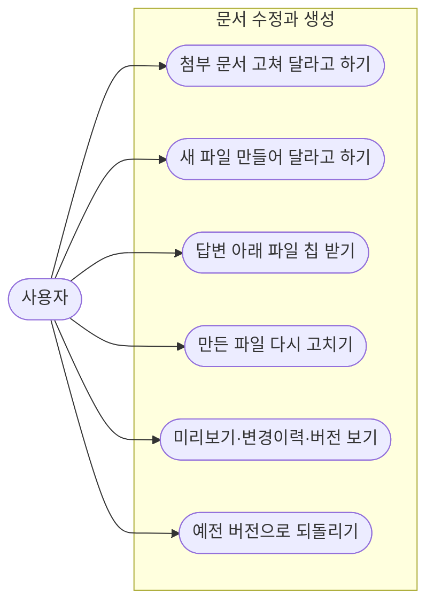
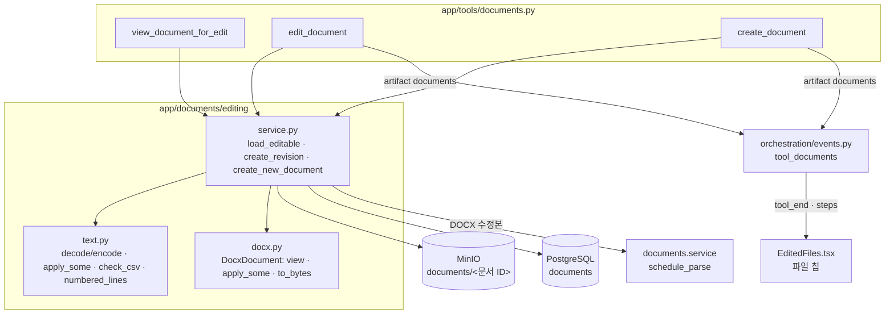
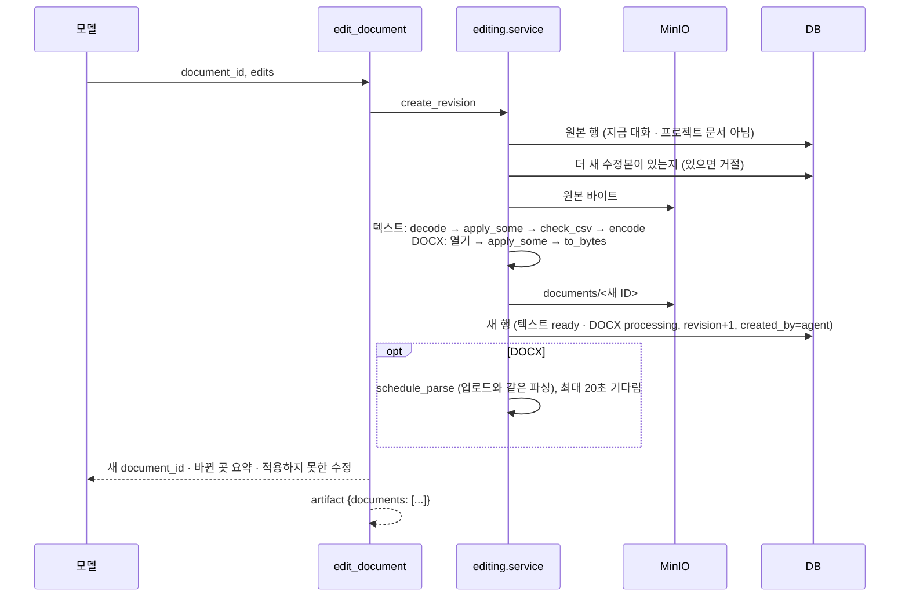

# 문서 수정과 생성

> 에이전트가 대화에 첨부된 TXT·MD·CSV·Word(DOCX) 문서를 고쳐 수정본을 만들거나, 새 TXT·MD·CSV 문서를 만들어 답변 아래 파일 칩으로 돌려줍니다.
> 원본은 바꾸지 않습니다.
> 관련 코드: `backend/app/documents/editing/`, `backend/app/tools/documents.py`, `backend/app/orchestration/events.py`,
> `frontend/src/components/EditedFiles.tsx`, `frontend/src/components/EditedDocumentPanel.tsx`
> 설계 기록: [`works/00.document-editing.md`](../../works/00.document-editing.md), [`works/01.text-formats.md`](../../works/01.text-formats.md),
> [`works/02.docx.md`](../../works/02.docx.md), [`works/02.docx-advencement.md`](../../works/02.docx-advencement.md)

올리기·파싱·읽기는 [첨부 문서](documents.md)를, 도구가 한 턴 안에서 도는 흐름은 [한 턴의 흐름](chat-turn.md)을 보세요.

## 사용자 관점



- 고칠 수 있는 형식: TXT, MD, CSV, Word(DOCX). 다른 형식(PDF, Excel, PowerPoint, 한글)은 에이전트가 아직 못 고친다고 답합니다.
- Word 문서는 서식(굵게, 색, 표, 그림, 머리글)을 지키며 고칩니다. 글자 바꾸기 말고도 문단 나누기·합치기·넣기·지우기·옮기기,
  제목 단위(섹션) 옮기기·지우기, 표 행·열 넣기·지우기(세로·가로 병합 표 포함), 표 만들기·지우기, 빈 표 칸 채우기, 문단 안 줄바꿈,
  문단을 제목·본문·번호 목록·글머리표 목록으로 바꾸기(새 목록 시작 포함), Markdown 으로 쓴 제목·목록·표 넣기, 글 ↔ 표 바꾸기,
  굵게·기울임·밑줄·취소선·글자색·형광펜 넣고 빼기가 됩니다.
  문단을 거의 다시 써도 그 안의 굵은 말·링크가 새 글에 그대로 나오면 서식을 지킵니다. 긴 문서는 찾을 말로 해당 문단만 봅니다.
- Word 검토 흐름: "고친 곳을 Word 에서 확인할 수 있게" 라고 하면 **변경 내용 추적**으로 고쳐서 Word 의 검토 탭에서 하나씩 수락·거절할 수 있습니다(작성자 "AI 에이전트").
  원본에 변경 내용 추적이 켜져 있으면 말하지 않아도 추적으로 고칩니다. 본문에 **메모**를 달고, 메모에 **답글**을 달거나 **해결**로 표시하거나 **지울** 수 있습니다.
  남이 남긴 변경 추적 기록(표 행 넣기·지우기, 표·칸·구역 설정 변경 포함)과 메모·답글을 읽고, 기록을 모두·문단 하나·**한 사람 것만** 수락·거절할 수 있습니다.
  문단 합치기·옮기기, 스타일 바꾸기, 표 행 넣기·지우기, 표 지우기, Markdown 넣기, 섹션 옮기기·지우기도 추적으로 남습니다. 표 열 넣기·지우기만 추적 모드에서 실패합니다.
- Word 문서 요소: **그림** 넣기(같은 문서의 그림 복사, 프로젝트 문서의 그림)·크기·바꾸기·대체 글자·지우기와 캡션, **각주·미주** 달기·고치기·지우기, 글상자 안 글자 고치기,
  **머리글·바닥글** 쓰기(없으면 만듦, 쪽 번호 `{쪽}`·`{전체 쪽}`, 표지 빼기), **목차** 넣기·갱신(쪽 번호는 Word 가 열 때 채움), 문서 정보(제목·작성자·주제·키워드) 바꾸기가 됩니다.
  웹이나 채팅의 그림 파일은 넣지 못한다고 답합니다. 워터마크·문서 보호는 아직 없습니다.
- 여러 곳을 한 번에 고칠 때 일부를 적용할 수 없으면 나머지만 저장하고, 못 한 것을 알려 줍니다.
- 예전 버전을 고치려 하면 최신 버전을 고치라고 거절합니다 (예전 버전을 고치면 그 뒤의 수정이 빠진 갈래가 생기므로).
- 새로 만들 수 있는 형식은 Word(DOCX), TXT, MD, CSV 입니다. Word 는 에이전트가 Markdown 으로 쓴 내용을 제목·목록·표·인용·코드 서식의 문서로 만듭니다.
  올린 Word 문서를 **양식**으로 주면 그 머리글·바닥글·스타일·쪽 설정에 본문만 새로 씁니다. 양식 안의 빈칸(`{{이름}}`)은 그 양식을 고쳐서 채웁니다.
  프로젝트 문서의 그림(Markdown 그림 주소를 `img:<id>` 로)과 각주(`[^1]`)도 넣을 수 있습니다.
- 고칠 때마다 새 버전이 생깁니다: `보고서.md` → `보고서 (수정 2).md` → `보고서 (수정 3).md`. 원본은 그대로 남습니다.
- 새로 만든 문서의 칩에는 "새 문서", 수정본의 칩에는 "수정본 v2" 가 붙습니다. 칩을 누르면 오른쪽 패널이 열립니다.
  - **미리보기**: Word 는 브라우저에서 그리고(`docx-preview`, 실제 Word 와 조금 다를 수 있음), TXT 는 글자, MD 는 Markdown, CSV 는 표로 보여 줍니다.
  - **변경이력**: 직전 버전과 문단(줄) 단위로 맞추고 바뀐 문단 안은 낱말 단위로, 지운 글자는 빨간 취소선, 넣은 글자는 초록으로 보여 줍니다. 서식만 바뀐 곳은 글자가 같아 나오지 않습니다.
  - **버전**: 원본부터 최신까지 목록, 버전마다 보기·다운로드, "이 버전으로 되돌리기"(그 버전을 복사한 새 수정본을 최신 뒤에 붙임, 예전 버전은 남김).
- 칩은 실행 단계(`messages.steps`)에 저장되어 새로고침해도 남습니다.

## 구조



| 도구 | 하는 일 | 화면 문구 |
|---|---|---|
| `view_document_for_edit(document_id, start)` | 원본에 번호를 붙여 보여준다. 텍스트는 줄(`[L12] 내용`), DOCX 는 문단(`[p12] (표1 2행 1열) 내용`). `start` 는 형식에 따라 줄·문단 번호다. 고칠 수 없는 문서는 여기서 미리 알려준다 | 수정할 곳 보는 중 / 봄 |
| `edit_document(document_id, edits)` | `edits` 를 차례로 적용해 수정본을 만든다. 수정 하나는 `{op, old_text, new_text, replace_all, paragraph, position, target, style, cells, format, whole_section}` (아래 [수정 종류](#수정-종류-op)). 텍스트 형식은 `replace` 만 | 문서 수정하는 중 / 수정함 |
| `create_document(filename, content, template_document_id)` | 새 DOCX·TXT·MD·CSV 문서를 만든다. DOCX 는 `content` 가 Markdown, `template_document_id` 로 양식 | 문서 만드는 중 / 만듦 |

세 도구 모두 `documents` 도구 그룹에 속합니다([도구 결정](tool-decision.md)).

## 흐름

### 고치기



- **고칠 수 있는 문서**: 지금 대화에 붙은 문서와 그 수정본입니다. 다른 대화·프로젝트의 문서는 없는 문서와 같은 말로 거절합니다(있는지 숨김).
- **원본 형태 지키기**: 원본 바이트에서 BOM 과 줄바꿈을 기억했다가 저장할 때 되돌립니다. 그래서 고친 곳 말고는 원본과 바이트까지 같습니다.
  줄바꿈이 `\r\n` 과 `\n` 으로 섞인 파일은 고치지 않습니다. 하나로 맞추면 고치지 않은 줄까지 바뀌기 때문입니다.
- **수정 규칙**: `old_text` 는 문서 안에서 정확히 한 번 나와야 합니다(`replace_all` 이면 모두). 수정은 순서대로 적용하고, 뒤 수정은 앞 수정을 적용한 글자에서 찾습니다.
  바뀌는 게 없는 수정도 거절합니다. `old_text` 에 `[L12]` 를 넣은 실수에는 힌트를 줍니다.
- **`replace_all` 과 웹 주소**: 글자 속 주소(`https://…`·`www.…`, ASCII 까지)도 바꾸되, 결과에 "N of them inside web addresses (p118, …)" 로 알려 모델이 확인하게 합니다.
  DOCX 에서 **주소가 글자로 보이는 하이퍼링크** 안은 건너뛰고 "skipped N inside links that show a web address" 로 알립니다. 보이는 주소만 바뀌고 실제 링크 대상(관계 파일)은 그대로라 둘이 어긋나기 때문입니다.
  `old_text` 자체에 `://` 가 있거나 `www.` 로 시작하면 주소를 고치려는 것으로 보고 알리지도 건너뛰지도 않습니다.
- **바뀐 곳을 모두 적습니다**: `replace_all` 이 여러 문단(줄)을 바꾸면 결과에 `29 places in 24 paragraphs (p2, p3, p73 (x4), …)` 처럼 모두 적습니다(30개까지, 나머지는 개수).
  전/후 글자는 처음 달라지는 자리 근처부터 보여 주고, 문단을 나누면 나뉜 문단마다 앞부분을 적습니다.
- **수정마다 따로 성공·실패**: 적용할 수 없는 수정은 그 수정만 되돌리고 건너뜁니다(DOCX 는 수정마다 문서 상태를 저장해 둡니다). 나머지로 수정본을 만들고 결과에
  "Not applied" 목록과 이유를 붙입니다. 하나도 적용하지 못하면 수정본을 만들지 않습니다. CSV 검사와 "빈 문서가 된다" 검사는 모든 수정을 적용한 뒤 한 번 하고, 걸리면 전부 취소합니다.
- **최신 버전만**: 고치려는 문서로 만든 수정본이 같은 대화에 있으면(`source_document_id` 사슬) 거절하고 최신 수정본의 document_id 를 알려 줍니다. 보기는 막지 않습니다.
- **CSV 검사**: 원본이 엄격한 규칙(`strict`)으로 읽히면 수정본도 그래야 하고(따옴표 짝), 원본의 모든 행이 같은 열 수면 수정본도 같아야 합니다.
- **바로 읽기**: 텍스트 형식은 파싱이 글자 그대로라서 수정본을 바로 `ready` 로 기록합니다. 다음 `read_document` 가 바로 새 내용을 읽습니다.
- **준비 상태**: 업로드한 문서는 파싱이 끝나(`ready`) 있어야 고칠 수 있습니다. 에이전트가 만든 수정본은 원본을 우리가 만들었으므로
  파싱 전이거나 파싱이 실패했어도 다시 고칠 수 있습니다(고칠 때는 파싱 결과가 아니라 원본 파일을 씁니다).

### DOCX 고치기

DOCX 는 ZIP 안의 XML(`word/document.xml`, 머리글·바닥글)을 `lxml` 로 직접 고칩니다. python-docx 는 쓰지 않습니다.

- **보기**: 본문 → 머리글 → 바닥글 → 각주 → 미주 → 글상자 순서로 모든 문단에 번호를 매깁니다(표 칸·중첩 표 안 포함, 빈 문단은 번호만 차지).
  위치(`(표1 2행 1열)`, `(머리글 1)`), 제목 스타일(`(제목 1)`), 목록 종류·수준(`(번호 목록)`, `(글머리표 목록 2수준)`, 종류를 모르면 `(목록)`)을 함께 적고, 결과 끝에 범례를 붙입니다.
  빈 문단은 보여주지 않지만 표 칸의 빈 문단은 `(빈 칸)` 으로 보여줍니다(채울 수 있게). 세로 병합으로 위 칸에 이어진 칸은 `(위 칸과 병합)` 으로 보이고 채울 수 없습니다(글자는 시작 칸에 있음).
  문단 안 줄바꿈(`w:br`·`w:cr`)은 `⏎` 로 보입니다. 수정의 `old_text`·`new_text`·`cells` 에서도 `⏎` 가 줄바꿈이고 `\n` 은 문단 나누기입니다(예전처럼 `old_text` 의 `\n` 으로 줄바꿈을 찾는 것도 받음).
  고칠 수 없는 자리(도형·수식 등)는 `` 로, 필드(쪽 번호·날짜)는 결과 글자 그대로 보여 줍니다.
  그림은 `[그림 g1]`(문단 아래 `(그림 g1 · 12.0×8.0cm · 대체 글자 '…')`), 각주·미주 표시는 `[각주 f1]`·`[미주 e1]`, 글상자는 `[글상자 1]` 이름표로 보입니다(글자로는 `` 하나라
  `old_text` 에 이름표를 넣어도 찾습니다). 그림은 문서 순서(본문 → 머리글 → 바닥글 → 각주)로, 각주는 본문에 표시가 나온 순서로 셉니다. 도형·차트·SmartArt 는 그림으로 세지 않습니다.
  각주·미주 문단은 `(각주 f1)`, 글상자 문단은 `(글상자 1 · p2 안)` 위치로 보이고 일반 문단처럼 고칩니다. 목차 필드 문단은 `(목차)` 입니다.
  문서 정보(제목·작성자·주제·키워드)가 있으면 보기 도구 결과 첫머리에 `(문서 정보: …)` 로 적습니다.
- **변경 추적·메모 보기**: 추적 기록이 있는 문단은 `(변경 추적: 김민지)` 라벨과 함께 넣은 글자 `{+…+}`, 지운 글자 `{-…-}` 로 보여 줍니다.
  서식 변경(`rPrChange`·`pPrChange`)과 문단 기호 추적은 라벨(`서식 바뀜`, `문단 넣음·나눔 추적`, `문단 합침 추적`)로만 알립니다. 표기는 보기에만 있고 `old_text` 는 수락한 모습의 글자에서 찾습니다.
  메모는 표시(`w:commentReference`)가 있는 문단 아래에 `(메모 c3 · 김민지: '내용' → '가리키는 글자')` 로 보여 줍니다(범위가 문단을 넘으면 이어 모읍니다). 메모 표시는 벽 글자가 아닙니다.
  답글은 그 아래 `(↳ 답글 c4 · 이름: '내용')`, 해결된 메모는 끝에 `· 해결됨` 을 붙입니다(`commentsExtended.xml` 의 `w15:paraIdParent`·`w15:done`, 메모 마지막 문단의 `w14:paraId` 로 짝짓습니다).
  표 행·칸·표·구역의 구조 기록은 라벨(`행 넣음 추적`, `행 지움 추적`, `행 서식 바뀜`, `칸 서식 바뀜`, `표 서식 바뀜`(표 첫 문단), `구역 설정 바뀜`)로 알립니다.
- **보기에서 찾기** (`view_document_for_edit` 의 `query`): 그 글자가 든 문단(텍스트는 줄)만 번호와 함께 보여 줍니다. 대소문자는 무시하고, 추적 문단은 수락한 모습에서 찾습니다.
  맞는 곳이 많으면 `start` 로 이어 봅니다. 앞뒤 문단은 붙이지 않습니다(번호로 따로 보면 됨).
- **서식 보기** (`formatting: true`): 문단 아래에 직접 서식이 있는 글자를 `(서식: 굵게 '135억' · 글자색 빨강 '주의')` 로 적습니다. 스타일(제목·링크)에서 오는 서식은 적지 않습니다. 기본은 끔(토큰 절약).
- **찾기**: `old_text` 는 문단 하나 안에서 찾습니다. 문단을 넘으면 "문단마다 따로 고치거나 합치라(`merge`)" 고 거절합니다. `paragraph` 로 한 문단 안에서만 찾게 할 수 있습니다.
- **문단 번호**: 수정 안의 `pN`(`paragraph`, `target`)은 모두 **호출을 시작할 때의 번호**입니다. 호출 동안 문단마다 임시 속성으로 번호를 달아 두므로, 앞 수정이 문단을 나누거나 지워도
  뒤 수정의 `p7` 은 원래 p7 을 가리킵니다(지워졌으면 그 수정은 실패). 임시 속성은 호출이 끝나면 지웁니다. 구조가 바뀌면 결과에 "다시 보기로 번호를 확인하라" 를 붙입니다.
- **서식 지키기**: 화면에서는 한 문장이어도 XML 에서는 서식 조각(run) 여러 개입니다. 문단을 글자 목록으로 펼쳐 글자마다 출처(run)를 기억하고,
  원래 글자와 새 글자를 글자 단위로 비교(`difflib.SequenceMatcher`)해 **달라진 글자만** 고칩니다. "매출 **120**억" 에서 "120억 → 135억" 은 "20" 만 "35" 로 바뀌어 굵게가 남습니다.
  - 넣은 글자는 `old_text` 안의 이웃 글자(앞, 없으면 뒤)의 run 서식을 따릅니다. 그래야 링크 글자 맨 앞에 넣은 글자가 링크 밖으로 새지 않습니다.
  - 거의 다 바뀐 문장(비슷한 정도 0.5 미만)은 범위를 통째로 첫 run 에 넣습니다. 글자 단위로 맞추면 우연히 같은 글자만 남아 run 조각이 이상해집니다.
    다만 첫 글자와 서식이 다른 조각(굵은 말, 링크 글자 등, 공백 빼고 2글자 이상)이 새 글자에 **정확히 한 번, 순서대로** 나오면 그 조각은 그대로 둡니다.
    그래서 링크가 든 문단을 다시 써도 링크 경계에서 거절되지 않습니다. 지키지 못한 조각 수는 결과에 알려 `format` 으로 다시 입힐 수 있게 합니다.
  - 비게 된 run 은 지우고, 앞뒤 공백이 있는 글자에는 `xml:space="preserve"` 를 붙입니다. 책갈피 같은 길이 없는 표시는 건드리지 않아 그대로 남습니다.
- **거절**: 바꾸는 범위가 그림·필드·각주 번호에 걸릴 때, 링크·콘텐츠 컨트롤 경계를 넘을 때, **남의** 변경 추적 기록(넣은 글자, 숨은 지운 자리, 서식 변경)에 닿을 때,
  `new_text` 로 `` 를 새로 넣을 때, 매크로 문서(`.docm`)일 때. 추적 기록이 있는 문단도 기록에 닿지 않는 글자는 고칠 수 있지만 나누기·구조 `op` 는 거절합니다.
#### 수정 종류 (`op`)

| `op` | 쓰는 필드 | 동작 |
|---|---|---|
| `replace` (기본) | `old_text`, `new_text`, `replace_all`, `paragraph` | 글자 바꾸기. `new_text` 의 `\n` 에서 **문단을 나눕니다**. `old_text` 가 비고 `paragraph` 가 빈 문단(빈 표 칸)이면 그 문단을 채웁니다 |
| `merge` | `paragraph` | 그 문단과 바로 다음 문단을 합칩니다. 경계에 공백이 없으면 하나 넣습니다 |
| `insert_paragraph` | `paragraph`, `position`, `new_text`, `style` | 기준 문단 앞·뒤에 새 문단(줄마다 하나)을 넣습니다 |
| `insert_markdown` | `paragraph`, `position`, `new_text` | 본문 문단 앞·뒤에 Markdown 내용(제목·문단·목록·표·인용·코드)을 넣습니다. 표 만들기·새 목록·섹션 넣기에 씁니다 |
| `delete_paragraph` | `paragraph`, `whole_section` | 문단을 지웁니다. `whole_section` 이면 제목부터 그 섹션 끝까지 |
| `move_paragraph` | `paragraph`, `position`, `target`, `whole_section` | 문단을 서식 그대로 `target` 앞·뒤로 옮깁니다 (같은 부분 안에서만). `whole_section` 이면 섹션 통째로 |
| `insert_row` | `paragraph`, `position`, `cells` | `paragraph` 가 든 표 행 앞·뒤에 행을 넣고 `cells` 를 칸마다 넣습니다 |
| `delete_row` | `paragraph` | `paragraph` 가 든 표 행을 지웁니다 |
| `insert_column` | `paragraph`, `position`, `cells` | `paragraph` 가 든 칸의 열 앞·뒤에 열을 넣고 `cells` 를 위에서 아래로 넣습니다 |
| `delete_column` | `paragraph` | `paragraph` 가 든 칸의 열을 지웁니다 |
| `delete_table` | `paragraph` | `paragraph` 가 든 (가장 안쪽) 표를 통째로 지웁니다 |
| `set_style` | `paragraph`, `style` | 문단을 `제목 N`·`본문`·`문서 제목`·`부제목`·문서의 스타일 이름·`번호 목록`·`글머리표 목록`(+`N수준`)·`목록 N수준` 으로 바꿉니다 |
| `comment` | `old_text`(없으면 문단 전체), `paragraph`, `new_text`, `comment` | `old_text` 에 메모를 답니다. 메모 내용은 `new_text` (줄마다 메모 문단 하나). `comment`(`c3`)를 주면 그 메모의 답글 |
| `resolve_comment` | `comment`, `new_text`(선택) | 메모를 해결됨으로 표시합니다. `new_text` 가 있으면 먼저 답글을 답니다 |
| `delete_comment` | `comment` | 메모와 그 답글을 지웁니다 (답글 id 면 그 답글만) |
| `format` | `old_text`(없으면 문단 전체), `paragraph`, `replace_all`, `format` | 글자 서식을 넣고 뺍니다: `bold`·`italic`·`underline`·`strike`(true/false), `color`(이름·`#RRGGBB`·`auto`), `highlight`(Word 형광펜 색·`none`) |
| `accept_changes` / `reject_changes` | `paragraph`(없으면 문서 전체), `author`(선택) | 변경 추적 기록을 수락·거절합니다. `author` 를 주면 그 사람의 기록만 |
| `insert_image` | `paragraph`, `position`, `image`, `width`, `new_text`(대체 글자), `caption` | 기준 문단 앞·뒤에 그림 문단(+캡션)을 넣습니다. `image` 는 같은 문서의 `g2` 나 프로젝트 그림 `img:<id>` |
| `edit_image` | `image`, `target`, `width`, `new_text` | 그림을 `target` 그림으로 바꾸고(너비는 지키고 높이는 새 비율), 너비(cm)·대체 글자를 바꿉니다 |
| `delete_object` | `image` | 그림(`g2`)·각주(`f1`)·미주(`e1`)를 지웁니다 |
| `footnote` | `paragraph`, `old_text`, `new_text`, `endnote` | `old_text` 바로 뒤에 각주(`endnote` 면 미주)를 답니다 |
| `set_header` / `set_footer` | `new_text`, `align`, `first_page` | 모든 쪽의 머리글·바닥글을 씁니다(없으면 만듦). `{쪽}`·`{전체 쪽}` 은 쪽 번호 필드, `first_page: false` 면 첫 쪽 빼기 |
| `insert_toc` | `paragraph`, `position`, `levels` | 목차를 넣습니다. 이미 있으면 지금 제목으로 다시 만듭니다 |
| `set_properties` | `properties` | 문서 정보(제목·작성자·주제·키워드)를 바꿉니다 |

- **나누기**: 문단 서식은 양쪽 조각에 복사하고, 나누는 자리의 run 은 둘로 쪼개 글자 서식을 양쪽에 둡니다. 구역 나누기(`w:sectPr`)는 마지막 조각으로 옮깁니다.
  빈 줄(`\n\n`)은 한 번 나누기로 보고, 빈 문단이 생기거나 링크·필드 안을 나누면 거절합니다.
- **새 문단 서식**: 기준 문단의 문단 서식(구역 나누기·변경 기록 빼고)과 첫 글자 run 의 서식을 따릅니다. 목록 문단 옆에 넣으면 번호 설정(`w:numPr`)이 따라와 번호가 이어집니다.
  기준이 제목이면 이웃 본문 문단을 따르고, 없으면 기본 문단으로 넣습니다. `style` 을 주면 그 스타일만 두고 글자 서식은 복사하지 않습니다.
- **지우기·옮기기**: 구역 나누기를 가진 문단, 다른 문단으로 이어지는 필드, 변경 추적 문단은 거절합니다. 메모가 달린 문단은 바로 지우지 않고 `delete_comment` 를 먼저 하라고 안내합니다(추적으로 지우면 메모는 지운 글자에 붙은 채 남습니다). 책갈피는 짝을 함께 지웁니다.
  표 칸·본문의 마지막 문단처럼 지우면 구조가 깨지는 자리(칸에 문단이 없어지거나 표가 끝이 됨)는 지우지 않고 글자만 비웁니다(옮기기는 거절).
- **변경 추적으로 고치기** (`edit_document` 의 `track_changes`): `true` 면 추적으로, `false` 면 바로, 없으면 원본 `settings.xml` 의 `w:trackRevisions` 를 따릅니다.
  작성자는 `DOCUMENT_EDIT_AUTHOR`, 시각은 호출 시각 하나, id 는 모든 XML 부분의 `w:id` 최댓값 다음부터입니다.
  - `replace`: 바꾸기와 같은 글자 비교로 지운 글자는 run 을 잘라 `w:del`+`w:delText`, 넣은 글자는 같은 서식의 새 run 을 `w:ins` 로 감쌉니다. `\n` 으로 나누면 앞 조각들의 문단 기호에 `w:pPr/w:rPr/w:ins` 를 답니다.
  - `insert_paragraph`: 새 문단의 글자와 문단 기호를 `w:ins` 로. `delete_paragraph`: 글자를 모두 `w:del` 로 감싸고 문단 기호에 `w:del` (칸·구역·문서의 마지막 문단은 거절). 빈 칸 채우기도 `w:ins`.
  - 우리가 추적으로 넣은 글자를 다시 고치면 Word 처럼 그 기록 안을 바로 고칩니다(지우면 기록 없이 없앰). 우리가 지운 자리에 걸쳐도 됩니다.
  - `merge`: 앞 문단 기호에 `w:del`, 사이 공백은 `w:ins` (수락하면 Word 처럼 합쳐지고 뒤 문단의 문단 서식을 따름). `set_style`: `w:pPr` 끝에 옛 문단 서식을 담은 `w:pPrChange` (새 목록 정의·스타일 정의는 기록하지 않음).
  - `insert_row`·`insert_markdown`의 표: 행마다 `w:trPr/w:ins`(행 속성 뒤, `w:trPrChange` 앞) + 칸 글자 `w:ins`. `delete_row`·`delete_table`: 행마다 `w:trPr/w:del` + 칸 글자 `w:del` (행은 남고 세로 병합 정리는 수락할 때). 칸 안 문단 기호는 행 기록이 대신합니다.
  - `insert_markdown` 의 문단: 글자·문단 기호 `w:ins` (표 앞뒤에 붙인 빈 문단은 기록하지 않음). 섹션 지우기: 블록마다 위와 같이 지운 기록.
  - `move_paragraph`(섹션 포함): 새 자리에 사본을 넣은 기록, 옛 자리는 지운 기록 (사본에서 문단 번호 표시·`w14:paraId`·책갈피는 뺌). 메모가 든 문단·섹션은 사본이 메모를 겹치게 하므로 거절합니다.
  - 우리가 추적으로 통째로 넣은 문단·행·표를 지우면 기록 없이 없앱니다. run 밖의 개체(수식)가 든 블록을 지우거나 옮기는 것은 거절합니다.
  - 표 열 넣기·지우기만 추적 모드에서 **실패**합니다(Word 도 행 기록처럼 남기지 못함). 메모 달기·답글·해결·지우기는 추적 모드에서도 기록 없이 됩니다.
- **수락·거절**: 글자 넣기·지우기(`ins`·`del`·`moveTo`·`moveFrom`), 서식 변경(`rPrChange`·`pPrChange`, 거절하면 옛 서식으로), 문단 기호 기록,
  행 넣음·지움(`w:trPr/w:ins|del`: 행을 지울 때는 세로 병합을 정리하고, 마지막 행이면 표째 지움), 표·행·칸·구역 속성 변경(`tblPrChange`·`tblGridChange`·`trPrChange`·`tcPrChange`·`tblPrExChange`·`sectPrChange`: 거절하면 옛 속성으로, 구역의 머리글·바닥글 참조는 그대로)을 다룹니다.
  `numberingChange` 는 수락만 됩니다. 칸 단위 기록(`cellIns`·`cellDel`·`cellMerge`)이 범위에 있으면 그 수정은 실패합니다(Word 에서 처리).
  `paragraph` 를 주면 그 문단이 든 행·칸·표의 구조 기록도 다룹니다. `author` 를 주면 그 사람의 기록만 보고, 없으면 문서의 작성자 목록을 알려 줍니다. 남의 기록이 안에 든 넣은 글자를 거절하면 안쪽 기록도 함께 사라집니다(Word 와 같음).
  문단 기호를 없애는 쪽(넣은 문단 기호 거절, 지운 문단 기호 수락)은 그 문단을 다음 문단 앞에 붙이고, 글자가 남지 않은 문단은 지웁니다(칸·본문의 마지막 문단이면 빈 문단으로 남김).
  지운 글자째 메모 표시가 없어지면 Word 처럼 그 메모도 지우고 결과에 알립니다.
- **메모 답글·해결·지우기**: 답글은 `comments.xml` 에 새 메모를 더하고 `commentsExtended.xml`(없으면 만들고 내용 형식·관계 등록)에 부모를 적습니다. 메모 문단에 `w14:paraId` 가 없으면 붙이고 메모 부분 뿌리에 `w14` 이름공간과 `mc:Ignorable` 을 더합니다.
  본문에서는 부모 메모의 범위 표시·표시 run 바로 뒤에 답글의 것을 둡니다. 답글의 답글은 부모 메모의 답글로 답니다. `commentsIds.xml`·`commentsExtensible.xml` 이 있으면 새 항목(`durableId`)을 더하고, 없으면 만들지 않습니다.
  해결은 `w15:done="1"`(이미 해결이면 알림, 해결 취소는 없음). 지우기는 메모 부분·본문 표시·답글·`commentsExtended`·`commentsIds`·`commentsExtensible` 항목을 함께 지웁니다.
- **메모 달기**: `old_text` 의 시작·끝에서 run 을 잘라 `w:commentRangeStart`/`End` 를 넣고 끝에 `w:commentReference` run 을 둡니다. `comments.xml` 이 없으면 만들고
  `[Content_Types].xml`·본문 관계에 등록합니다(새 ZIP 항목은 끝에 붙입니다). 문서에 `annotation reference`·`annotation text` 스타일이 있으면 씁니다. 범위는 한 문단 안, 링크 경계를 넘지 않습니다.
- **표 행**: 기준 행의 칸 서식·첫 문단 서식·첫 글자 서식만 따른 새 칸을 만듭니다. 머리글 행(`w:tblHeader`) 뒤에 넣으면 아래 데이터 행의 모양을 따릅니다. 값이 칸보다 적으면 나머지는
  빈 칸(문단 기호 서식을 남겨 나중에 같은 서식으로 채울 수 있음)입니다. 표의 마지막 한 행 지우기는 거절합니다.
  - 세로 병합(`w:vMerge`): 병합 구역 가운데에 넣으면 새 칸을 이어진 칸(`continue`)으로 만들어 구역을 늘리고(그 칸 값은 버리고 알림), 경계에 넣으면 병합 없는 칸입니다.
    병합 시작 행을 지우면 아래 칸을 시작 칸으로 바꾸고 글자를 옮기며, 구역이 한 칸만 남으면 병합 표시를 뗍니다.
- **표 열**: 행마다 `w:gridBefore` 와 칸의 `w:gridSpan` 을 더해 칸의 격자 열을 계산하고, 열은 `paragraph` 가 든 칸의 격자 열로 정합니다(보기의 `n열` 은 칸 순서라 가로 병합이 있으면 다를 수 있음).
  결과의 열 이름은 그 열만 덮는 첫 칸의 글자입니다. 새 경계가 가로 병합 칸 가운데를 지나면 그 칸을 넓히고(지울 때는 좁히고), 아니면 같은 행의 기준 칸 서식으로 새 칸을 만듭니다.
  표 전체 너비는 그대로 두고 열 너비(`w:gridCol`, `dxa` 로 적힌 `w:tcW`)를 비율대로 다시 나눕니다(새 열은 기준 열과 같은 몫). 격자가 행과 맞지 않으면 너비는 고치지 않습니다.
  모양이 불규칙한 행(`gridBefore`·`gridAfter` 가 새 경계에 걸림), 추적 기록이 있는 표, 마지막 열 지우기, 메모가 있는 칸은 거절합니다.
- **Markdown 넣기** (`insert_markdown`): 새 문서 만들기의 변환기(`docx_create`)를 기존 문서에 씁니다. 제목·인용·코드·표 스타일은 문서에 같은 이름이 있으면 그것을, 없으면 정의를 더합니다.
  스타일 없는 본문 문단은 `insert_paragraph` 처럼 이웃 본문 문단의 문단·글자 서식을 따르고(목록 번호는 뺌) Markdown 서식(굵게 등)을 그 위에 둡니다.
  표 너비는 넣는 자리 구역의 본문 너비(쪽 너비 − 좌우 여백)로 나눕니다. 목록은 문서 본문이 이미 쓰는 같은 종류 목록 정의를 따르고 번호는 1부터 다시 시작하며,
  `numbering.xml`·`styles.xml` 이 없으면 만들어 관계·내용 형식에 등록합니다. 본문 바로 아래 문단만 기준으로 받고(표 칸·머리글·바닥글 안은 거절),
  표가 본문 끝이나 다른 표 옆에 오면 빈 문단을 사이에 둡니다. 글 → 표는 한 호출에서 표를 넣고 원래 문단을 지우면 됩니다(시스템 프롬프트에 적음).
- **표 지우기** (`delete_table`): 추적 기록·메모·표 밖으로 이어지는 필드가 있으면 거절합니다. 칸의 유일한 내용이거나 지우면 앞뒤 표가 붙는 자리는 빈 문단을 남깁니다.
- **섹션** (`whole_section`): 본문 바로 아래 제목 문단(보기의 `(제목 N)`, 없으면 문단의 `w:outlineLvl`)부터 같거나 높은 수준의 다음 제목 전까지의 블록(문단·표)입니다.
  옮길 때 `after` 이고 `target` 이 제목이면 그 섹션 끝 뒤로 옮깁니다("2장 뒤로" 는 2장 전체 뒤). 구역 나누기·추적 기록·밖으로 이어지는 필드·섹션 밖으로 걸친 메모는 거절하고,
  지울 때는 메모가 있으면 거절합니다. 본문이 표로 끝나게 되면 빈 문단을 붙입니다.
- **글자 서식** (`format`): 범위 경계에서 run 을 쪼개고 조각마다 `w:rPr` 를 스키마 순서대로 고칩니다. 굵게·기울임은 `b`+`bCs`, `i`+`iCs` 를 같이 씁니다.
  빼면 직접 서식을 지우고, 그래도 스타일(문자 스타일, 문단 스타일의 `basedOn` 사슬, 문서 기본값)이 켜 두면 `w:val="0"`(밑줄 `none`, 색 `auto`)로 끕니다.
  run 밖의 벽(수식)은 건너뜁니다. 이미 그 서식이면(짝 태그 빼고) 실패로 알립니다. 추적 모드에서는 옛 서식을 `w:rPrChange` 로 남기고, 우리 기록이 이미 있으면 처음 서식을 그대로 둡니다.
  우리가 추적으로 넣은 글자의 서식은 기록 없이 바꿉니다. 색 이름은 Word 표준 색, 형광펜은 Word 가 아는 16색만 받습니다.
- **목록**: `목록 N수준` 은 목록 문단이면 수준(`w:ilvl`)만 바꾸고, 목록이 아니면 바로 앞·뒤 목록 문단의 번호 설정을 복사해 이어 붙입니다. 제목·본문으로 바꾸면 목록 번호를 뗍니다.
  `번호 목록`·`글머리표 목록` 은 바로 앞·뒤의 같은 종류 목록에 이어 붙이고, 없으면 새 목록을 시작합니다(문서의 같은 종류 정의를 따르고 번호는 1부터). 목록 종류는 `numbering.xml` 의 그 수준 번호 형식(`bullet` 이면 글머리표)으로 압니다.

- **그림** (`docx_objects.py` 도우미): Word 모양의 인라인 그림(`w:drawing/wp:inline`, `pic:pic`, `a:blip r:embed`)을 만들고 개체 id(`wp:docPr/@id`)는 문서 전체에서 겹치지 않게 매깁니다.
  같은 문서의 그림은 그 파일을 다시 가리키고(같은 부분이면 관계도 같이 씀), 프로젝트 그림은 `word/media/imageN.png` 로 더하고 관계와 `[Content_Types].xml` 의 확장자 기본 형식을 등록합니다.
  너비를 안 주면 원래 크기(96dpi)와 넣는 자리 폭(본문 폭, 표 칸이면 칸 폭) 중 작은 쪽이고, 넘치면 줄여 알립니다. 그림 문단은 근처 본문 문단 서식에서 목록·들여쓰기를 떼고 가운데 정렬합니다.
  캡션은 `Caption` 스타일 문단(번호 필드 없이 글자 그대로)입니다. 바꾸기·지우기로 어느 관계도 가리키지 않게 된 그림 파일은 ZIP 에서 뺍니다. 떠 있는 그림은 크기·대체 글자·바꾸기만 됩니다.
- **프로젝트 그림** (`img:<요소 id>`): `search_project` 결과의 그림 항목에 `image: img:<id>` 를 적습니다. 수정·Markdown 안의 그림 id 를 모아(`image_refs`) **대화가 속한 프로젝트 문서의 그림 요소만**
  저장소에서 읽고(`project_images`), PNG·JPEG·GIF 가 아니면(WebP 등) Pillow 로 PNG 로 바꿉니다(2019 이전 Word 는 WebP 를 못 보여 줌). 찾지 못한 id 는 그 수정이 실패합니다.
- **각주·미주**: `old_text` 끝 글자의 run 을 잘라 표시 run(`FootnoteReference` 스타일)을 넣고 `footnotes.xml`(`endnotes.xml`)에 항목을 더합니다(id = 최댓값 + 1).
  부분이 없으면 구분선 항목(-1·0)과 함께 만들고 `settings.xml` 의 `w:footnotePr` 에 등록합니다. 각주 스타일이 없으면 더합니다. 표시가 없어진 각주(지우기·문단 지우기·거절)는 항목도 지웁니다.
- **글상자**: 새 Word 용(`mc:Choice`)만 보이고 고칩니다. 고친 뒤 옛 Word 용 사본(`mc:Fallback` 의 `w:txbxContent`)을 고친 내용의 사본으로 갈아 끼웁니다(문단 id·책갈피는 뺌).
- **머리글·바닥글** (`set_header`·`set_footer`): 모든 구역의 기본(짝·홀 머리글을 쓰면 짝수 쪽 것도) 머리글 내용을 바꾸고, 첫 구역에 없으면 새 부분(`word/headerN.xml`)을 만들어 참조를 답니다.
  쪽 번호는 복합 필드(`PAGE`·`NUMPAGES`, 캐시 1)라 추적 기록에 넣을 수 있습니다. 그림·도형·글상자가 든 머리글은 통째로 바꾸지 않고 문단 단위로 고치라고 안내합니다(로고를 잃지 않게).
  `first_page: false` 는 `w:titlePg` 와 빈 첫 쪽 머리글을 둡니다. `w:sectPr`·`w:settings`·`w:pPr` 의 자식은 스키마 순서대로 넣습니다(`insert_ordered`).
- **목차** (`insert_toc`): `TOC \o "1-N" \h \z \u` 복합 필드를 넣고 결과 글자를 지금 제목들(`TOC1`~ 스타일)로 미리 채웁니다. 쪽 번호는 계산할 수 없어 비우고 `w:updateFields` 를 켜서
  Word 가 열 때 물은 뒤 채우게 합니다(LibreOffice 는 목차로 알아봄). 이미 목차 필드가 있으면 그 문단들을 새로 만든 것으로 바꿉니다. 새로 넣을 때는 `목차` 제목 문단(`TOC Heading`)을 앞에 둡니다.
- **문서 정보** (`set_properties`): `docProps/core.xml`(없으면 만들고 패키지 관계·내용 형식 등록)의 `dc:title`·`dc:creator`·`dc:subject`·`cp:keywords` 와 마지막 수정자·시각을 씁니다.
- **추적 모드의 문서 요소**: 그림 넣기·캡션(글자와 문단 기호 `w:ins`), 그림·각주 지우기(`w:del`), 그림 바꾸기(옛 그림 `w:del` + 새 그림 `w:ins`), 각주 달기(표시와 각주 글자 `w:ins`),
  머리글·바닥글(옛 내용 지움 + 새 내용 넣음), 목차(넣음, 갱신이면 옛 목차 지움)가 기록됩니다. 그림 크기·대체 글자·문서 정보는 기록 없이 바꾸고 결과에 알립니다(Word 도 기록하지 않음).
- **개체 이름**: 수정 안의 `g2`·`f1` 은 문단 번호처럼 **호출을 시작할 때의 이름**입니다(호출 동안 임시 속성 `okdoit-object` 로 기억).
- **저장**: 고친 XML 부분만 다시 쓰고(원래 XML 선언 유지), 나머지 ZIP 항목은 내용 그대로 복사합니다. 항목 순서·이름·압축 방식도 원본을 따릅니다. 더한 그림 파일은 끝에 붙이고, 쓰지 않게 된 그림 파일은 뺍니다.
- **본문 다시 만들기**: DOCX 의 `content` 는 파싱 결과(Markdown, 그림 OCR)라서 수정본을 `processing` 으로 저장하고 업로드와 같은 파싱(`schedule_parse`)을 돌립니다.
  `DOCUMENT_EDIT_PARSE_WAIT_SECONDS`(20초)까지 기다려 끝나면 바로 `read_document` 로 읽힙니다. 넘기면 수정본은 받을 수 있게 저장해 두고 파싱은 백그라운드에서 이어지며,
  도구 결과에 "본문은 아직 준비 중" 이라고 적습니다.

### 만들기

- 확장자로 형식을 정합니다(`.txt`, `.md`, `.markdown`, `.csv`). 다른 확장자는 거절합니다.
- 줄바꿈은 `\n` 입니다. **CSV 에만 BOM 을 붙입니다**: Excel 은 BOM 이 없는 UTF-8 CSV 의 한글을 깨뜨려 보여줍니다. 수정본은 원본 형태를 따르므로 이 규칙을 쓰지 않습니다.
- CSV 는 엄격한 규칙으로 읽혀야 하고 모든 행의 열 수가 같아야 합니다. 빈 내용과 NUL 글자는 거절합니다.
- 주인은 대화의 주인입니다(`conversations.user_id`). 모델이 넘긴 값이 아니라 서버에서 찾습니다. 원본 받기가 주인인지 확인하기 때문입니다.

### Word 만들기

`app/documents/editing/docx_create.py`. Markdown 을 `markdown-it-py`(CommonMark + 표·취소선 + `mdit-py-plugins` 각주)로 읽어 본문 XML 을 `lxml` 로 만듭니다.

| Markdown | Word |
|---|---|
| `#`~`######` | `heading 1`~`6` 스타일 (보기에서 `(제목 N)`) |
| `**굵게**`·`*기울임*`·`~~취소선~~`·`` `코드` `` | `w:b`·`w:i`·`w:strike`·고정폭 문자 스타일 |
| `[글](https://…)` | `w:hyperlink` + 외부 관계 (`http`·`https`·`mailto` 만, 같은 주소는 관계 하나) |
| `-`·`1.` 목록 (들여 써서 중첩) | 글머리표·번호 정의 + `w:numPr`. 번호 목록은 목록마다 새 번호라 1(또는 `3.` 이면 3)부터 다시 |
| 표 | `Table Grid` 스타일 + 표에 직접 테두리, 너비 고정, 머리글 행 반복·굵게, 열 정렬 |
| `>` 인용, ```` ``` ```` 코드, `---` | `Quote`·`Code` 스타일, 문단 아래 테두리 |
| 그림 주소가 `img:<id>` 인 Markdown 그림 (프로젝트 그림) | 그림 (본문 폭 안, 대체 글자 = 설명). 찾지 못하면 `[설명]` |
| `글[^1]` + `[^1]: 각주 글` | 각주 (`footnotes.xml`) |
| 그 밖의 이미지, HTML | `[대체 텍스트]`, 글자 그대로 (결과에 알림) |

- **기본 양식은 코드로 만듭니다**(바이너리 파일을 저장소에 두지 않음): 맑은 고딕(`ascii`·`eastAsia` 모두)·`ko-KR`, 11pt, A4·여백 25.4mm, 위 스타일, 문서 속성 만든 이 = `DOCUMENT_EDIT_AUTHOR`.
- **양식**: 올린 DOCX 를 그대로 복사하고 본문 내용만 바꿉니다(마지막 구역 설정은 남김). 스타일은 양식의 것을 이름으로 찾고, 없는 것만 정의를 더합니다(id 가 겹치면 새 id).
  목록 번호 정의는 양식 `numbering.xml` 뒤에 더합니다(없으면 만들고 관계·내용 형식 등록). 고치지 않은 ZIP 항목은 내용 그대로입니다. 본문이 쓰던 그림 파일은 남겨 둡니다.
- 그림·각주는 변환기가 run 안에 자리 표시(`okdoit-image`·`okdoit-note`)만 두고, 문서를 만든 뒤(또는 `insert_markdown` 으로 넣은 뒤) `DocxDocument` 가 고치기와 같은 코드로 그림·각주로 바꿉니다.
- 수정본처럼 `processing` 으로 저장하고 파싱을 `DOCUMENT_EDIT_PARSE_WAIT_SECONDS` 까지 기다립니다. 만든 뒤에는 `edit_document` 의 모든 기능(구조·변경 추적·메모)을 그대로 씁니다.
- 미리보기 주의: macOS Quick Look 은 표 열 너비를 무시하고 좁게 그립니다(LibreOffice 가 저장한 표도 같음). LibreOffice·Word 는 쪽 너비로 그립니다.

### 실패

- 고치거나 만들 수 없으면 `EditError`(`ToolError`)를 올립니다. `ToolNode` 가 그 문구를 도구 결과로 주고 `status="error"` 로 표시해서, 화면에는 도구 단계가 실패로 보입니다.
- 결과 끝에 "No changes were saved." / "No file was created." 를 붙여서 모델이 아무것도 저장되지 않았음을 압니다.
- 수정 일부만 실패하면 도구는 성공(수정본 있음)이고, 결과에 "Not applied" 목록과 "사용자에게 못 한 것을 알리라" 는 안내가 붙습니다.

### 화면까지

1. 도구가 `{"documents": [{document_id, filename, revision, source_document_id, kind, size_bytes}]}` 를 artifact 로 돌려줍니다. artifact 는 모델 입력에 들어가지 않습니다.
2. `tool_documents` 가 문서 ID 를 UUID 형식만 남기고 `ToolFinished.documents` 에 넣습니다.
3. SSE `tool_end` 의 `documents` 와 실행 단계(`ToolStep.documents`)로 화면에 갑니다.
4. `EditedFiles` 가 답변 아래에 칩을 그립니다. 칩을 누르면 `EditedDocumentPanel` 이 열립니다(문서 보기 패널과 한 번에 하나만).
   - 미리보기·받기: `GET /api/documents/{id}/file`
   - 변경이력: `GET /api/documents/{id}/changes` (직전 버전과 원본 파일끼리 비교, `app/documents/editing/compare.py`)
   - 버전: `GET /api/documents/{id}/versions` (같은 대화 안 `source_document_id` 사슬, 갈래가 있으면 가장 최근 것)
   - 되돌리기: `POST /api/documents/{id}/restore` (그 버전 파일과 파싱 결과를 복사한 새 행, `created_by='user'`, `source_document_id`=최신, 최신이면 409)
   - 모두 내 문서만(남의 문서는 404). 되돌린 뒤 에이전트가 예전 id 를 고치려 하면 "더 새 버전이 있음" 으로 새 id 를 안내받습니다.

## 데이터

- 수정본과 새 문서도 `documents` 행입니다. `created_by='agent'`, `message_id` 는 비어 있고, 원본과 같은 대화에 속합니다([ERD 3. 문서](../data/erd.md#3-문서)).
  화면에서 예전 버전으로 되돌린 행은 `created_by='user'` 이고 `source_document_id` 는 그때의 최신 버전입니다.
  - `source_document_id`: 수정본을 만든 직전 문서. 새 문서와 업로드한 문서는 비어 있습니다. 직전 문서가 지워지면 비웁니다(`ON DELETE SET NULL`).
  - `revision`: 업로드·새 문서는 1, 고칠 때마다 직전 문서보다 1 큽니다.
- 원본 저장 위치와 보관 기간은 대화 첨부와 같습니다: MinIO `documents/<문서 ID>`, 만든 날부터 30일. 대화를 지우면 함께 지워집니다.
  그래서 읽기·받기·삭제·정리 코드는 바꾸지 않았습니다.

| 설정 | 기본값 | 의미 |
|---|---|---|
| `DOCUMENT_MAX_BYTES` | 20MB | 수정본·새 문서의 최대 크기 (업로드와 같은 상한) |
| `DOCUMENT_EDIT_VIEW_MAX_LINES` | 400 | `view_document_for_edit` 한 번의 줄 수 (DOCX 는 문단 수, 빈 문단은 세지 않음) |
| `DOCUMENT_EDIT_PARSE_WAIT_SECONDS` | 20 | DOCX 수정본을 다시 파싱할 때 도구가 기다리는 최대 시간(초) |
| `DOCUMENT_EDIT_AUTHOR` | AI 에이전트 | DOCX 에 남기는 변경 추적 기록·메모의 작성자 |
| `DOCUMENT_READ_MAX_CHARS` | 8,000 | `view_document_for_edit` 한 번의 글자 수 상한 (`read_document` 와 같은 값) |

## 설계 결정

- **수정본도 `documents` 행.** 버전 테이블을 따로 두면 읽기·받기·파일 칩·대화 삭제·30일 정리를 모두 다시 만들어야 합니다.
- **정해진 수정 도구(str_replace 방식).** 모델이 문서를 통째로 다시 쓰면 시키지 않은 곳이 바뀔 수 있습니다. 바꿀 글자와 새 글자만 받습니다.
  모델이 코드를 짜서 실행하는 방식은 샌드박스가 없어서 쓰지 않습니다.
- **바로 새 버전을 만든다.** 원본이 남으므로 잘못 고쳐도 잃는 것이 없습니다. 적용 전 승인은 나중에 LangGraph `interrupt` 로 붙입니다.
- **수정 기준은 MinIO 원본 바이트.** DB 본문만으로는 BOM·`\r\n` 을 모릅니다. DOCX 의 본문은 변환된 사본이라 원본 문단과 1:1 로 맞지 않습니다.
- **DOCX 는 ZIP + lxml 직접.** python-docx 로 문단 글자를 바꾸면 run 이 지워져 서식이 사라지고, 저장할 때 읽은 부분을 다시 써서 원본 보존이 나쁩니다.
- **DOCX 구조 고치기는 `edit_document` 의 `op` 로.** 도구가 늘면 작은 모델이 엉뚱한 도구를 고르고, "한 번 부르면 수정본 하나" 규칙과 섞어 쓰기(나누기 + 행 추가)가 어렵습니다.
- **설명은 한 곳에만 둔다.** `op` 설명에 "무엇을 하고 어떤 필드를 쓰는지"(`insert_row [paragraph, position, cells]`), 필드 설명에 "무엇을 어떤 형식으로 넣는지",
  도구 설명에 "고치는 규칙", system 프롬프트에 "언제 도구를 쓰고 사용자에게 무엇을 말할지" 를 둡니다. 같은 기능 목록이 세 곳(system 프롬프트, 도구 설명, `op`)에
  반복되어 도구 정의가 15KB 였습니다(2026-11-25 정리 후 약 12KB, system 프롬프트 6.4KB → 5.1KB).
  인자 모델(`DocumentEdit` 등)의 한국어 클래스 docstring 과 필드 `title` 은 스키마에서 뺍니다(`_model_facing_schema`). 빼지 않으면 개발자용 설명이 모델에게 갑니다.
- **`replace_all` 은 바뀐 곳을 모두 알리고, 주소는 막지 않고 알린다.** 실제 문서 시험(2026-11-24)에서 제품 이름을 바꾸다 참고문헌 링크 글자까지 바뀌었고,
  결과에 첫 문단만 적혀 있어 모델이 되돌리면서 엉뚱한 문단을 고쳤습니다. 주소 안을 모두 건너뛰면 "도메인을 전부 바꿔 줘" 가 반만 되므로,
  구조적으로 항상 어긋나는 경우(주소가 보이는 DOCX 하이퍼링크)만 건너뛰고 나머지는 알리기만 합니다.
- **변경 추적은 호출 단위 인자, 기본은 문서 설정을 따른다.** 사용자가 Word 에서 고친 곳을 확인하려는 경우에만 켜고, 원본에 추적이 켜져 있으면 그 문서의 규칙을 따릅니다(Copilot 방식).
  추적할 수 없는 수정은 실패시킵니다. 사용자는 모든 변경을 Word 에서 수락·거절할 수 있다고 믿기 때문입니다.
- **Word 만들기는 Markdown 입력 + 코드로 만든 양식 + lxml.** 모델이 가장 잘 쓰는 형식이고, 고치기와 같은 방식이라 사용자 양식에도 같은 코드가 됩니다.
  python-docx 는 양식 문서를 저장할 때 다른 부분까지 다시 쓰고, Pandoc 같은 외부 변환기는 이미지·운영 부담이 큽니다.
- **표 만들기·새 목록·섹션 넣기·글 ↔ 표는 `insert_markdown` 하나로.** 모델이 가장 잘 쓰는 형식이고 새 문서 만들기의 변환기를 그대로 써서, 기능마다 `op` 를 늘리지 않습니다.
- **문단 안 줄바꿈은 `⏎`.** `\n` 은 이미 문단 나누기라서, 보기와 입력 모두 같은 기호로 나타내야 모델이 복사한 글자가 그대로 맞습니다.
- **표 열을 넣고 지워도 표 전체 너비는 그대로.** 표를 넓히면 쪽 밖으로 나갈 수 있습니다.
- **글자 서식은 `op: "format"` + `format` 객체, 보기의 서식 줄은 켤 때만.** 보기는 `old_text` 를 복사하는 곳이라 글자 안에 표시를 넣지 않고,
  굵은 글자가 많은 문서에서 토큰이 늘지 않게 "어느 글자가 빨간지" 알아야 할 때만 켭니다.
- **고쳐 쓰기의 서식은 "새 글에 그대로 한 번 나오는 조각" 만 지킨다.** 낱말 단위로 맞추면 우연히 같은 낱말(조사·숫자)에 서식이 흩어집니다.
- **미리보기는 브라우저에서(`docx-preview`), 비교는 원본 파일끼리.** 서버에서 PDF 로 바꾸려면 LibreOffice·한글 글꼴이 필요하고, 파서 결과(`content`)는 수정본 파싱이 끝나야 생기며 에이전트가 본 글자와 다릅니다.
- **되돌리기는 복사로 새 버전.** 최신 행을 지우면 그 버전을 가리키던 칩·에이전트 기억이 끊깁니다. 예전 버전을 고치지 않는 규칙(최신만 고치기)과도 맞습니다.
- **수정마다 따로 성공·실패.** 맞춤법 교정처럼 수정이 많으면 한 번의 실수로 전부 취소되어 재시도가 반복됐습니다. 원본이 남으므로 일부만 적용해도 잃는 것이 없습니다.
- **DOCX 수정본 파싱을 기다린다(시간 제한).** 글자만 바꿔 그림은 그대로라 대부분 금방 끝나고, 끝나면 다음 질문에서 바로 새 내용을 읽습니다.
- **결과 첫 줄에 새 document_id.** 지난 도구 결과는 다음 턴에 앞 300자만 남기 때문입니다([지난 도구 결과 줄이기](context-management.md)).
- 대화 요약 뒤에 수정본 ID 를 잃을 수 있는 위험은 알려진 한계로 남겨 두었습니다(설계 기록 결정 G).
