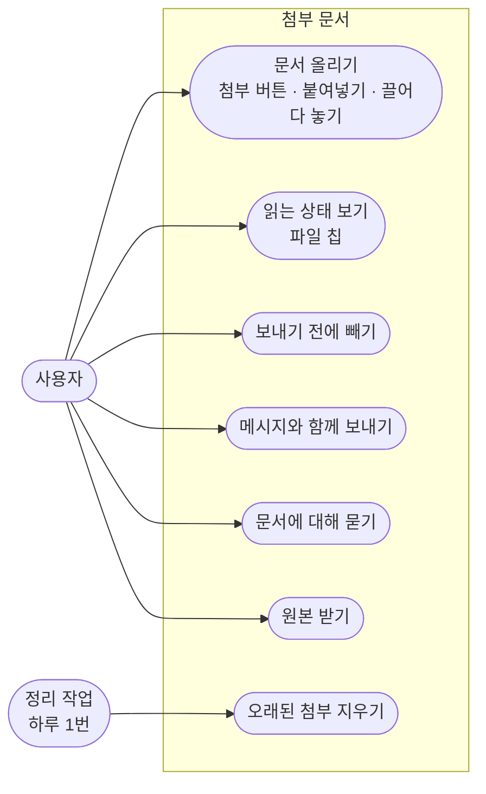
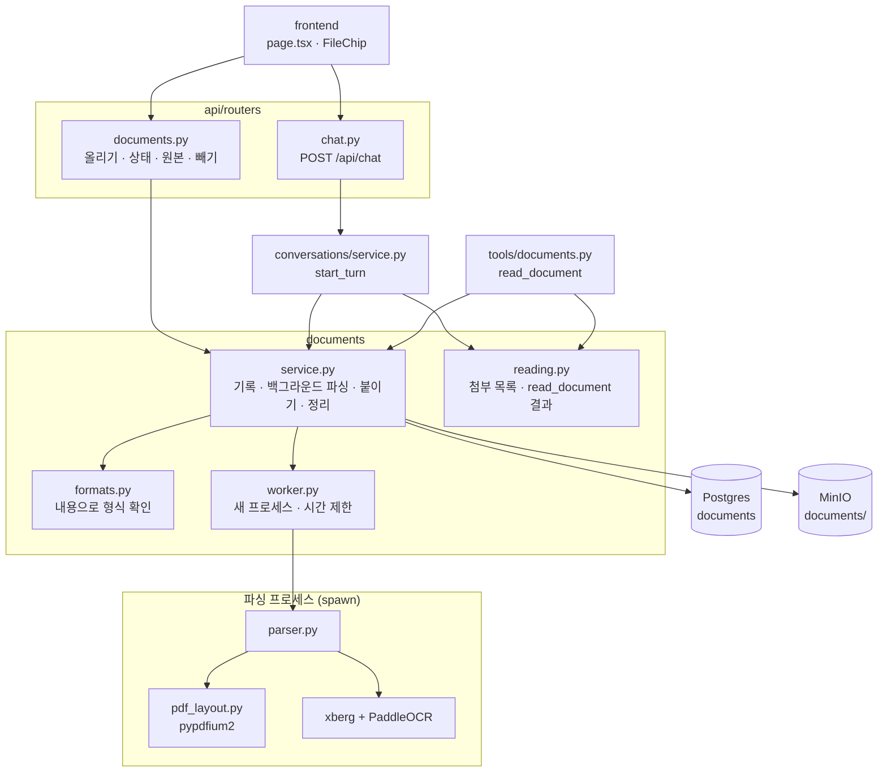
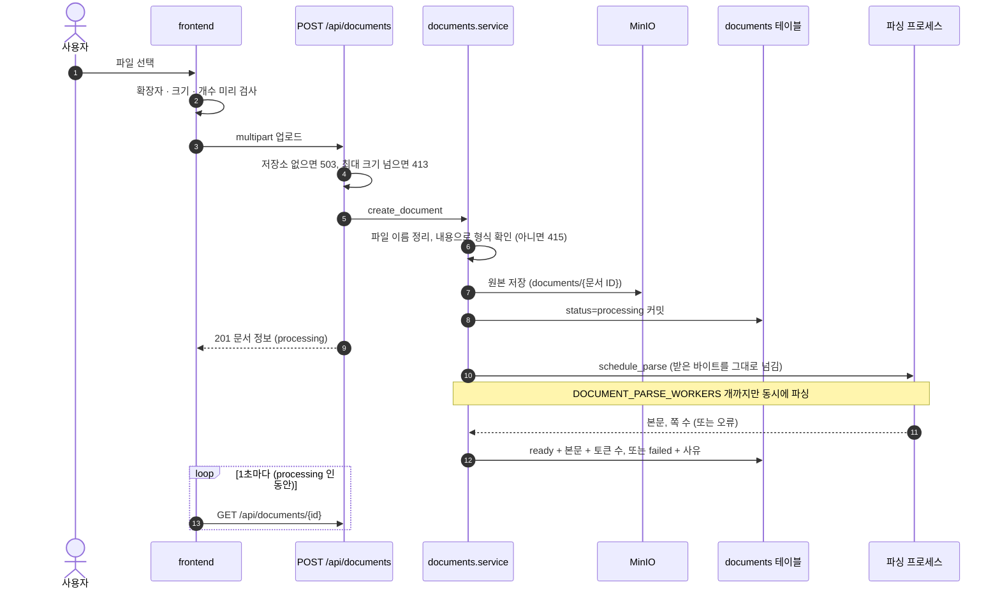
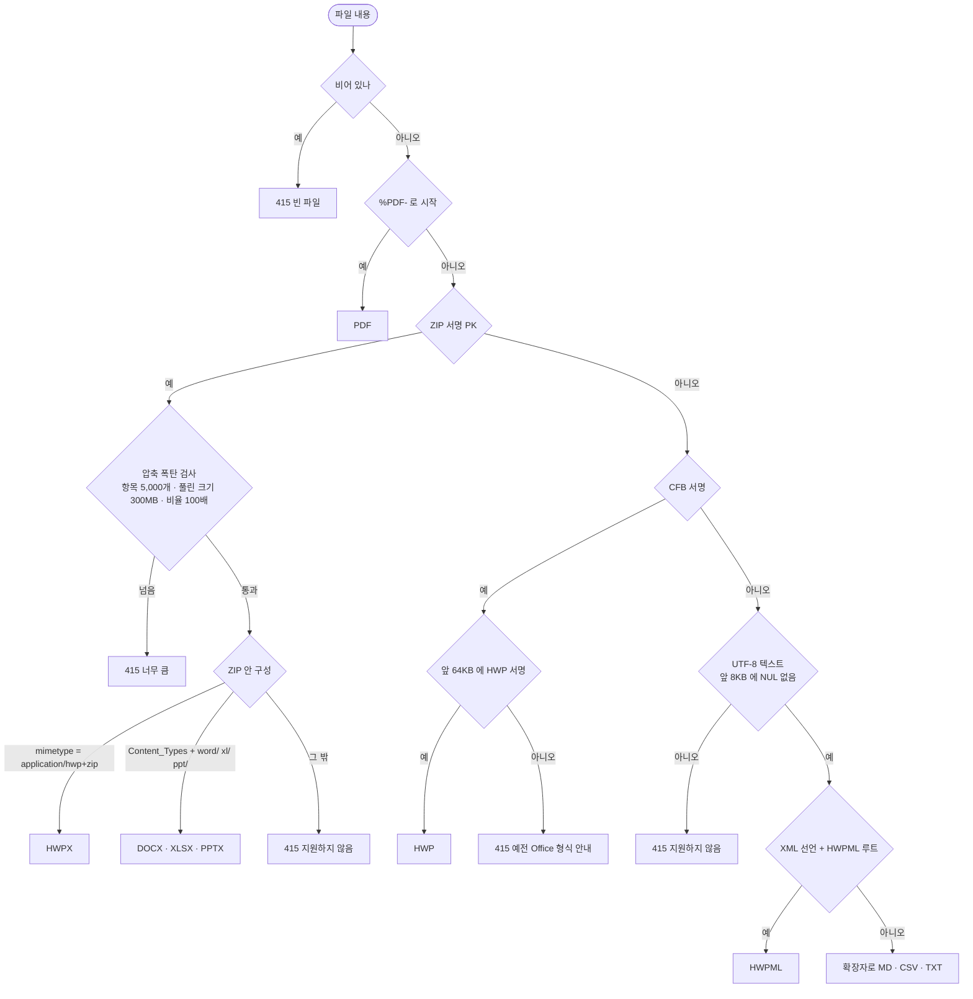
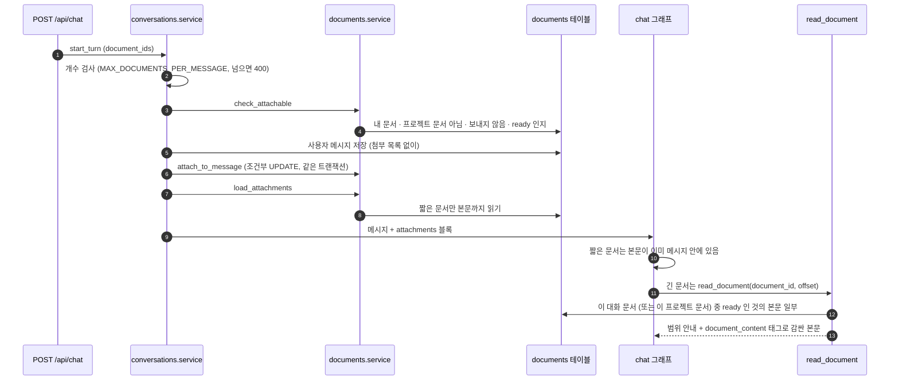
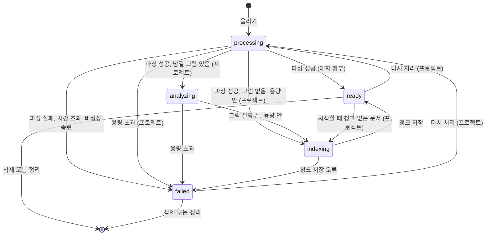

# 첨부 문서

> 채팅에 문서를 올리면 내용으로 형식을 확인하고, 별도 프로세스에서 텍스트로 바꾼 뒤, 메시지에 붙여 모델이 읽게 합니다.
> 관련 코드: `backend/app/documents/`, `backend/app/api/routers/documents.py`, `backend/app/tools/documents.py`,
> `backend/app/conversations/service.py`, `frontend/src/app/page.tsx`, `frontend/src/components/FileChip.tsx`, `frontend/src/lib/documents.ts`

이 문서는 대화 첨부 문서와, 프로젝트 문서도 함께 쓰는 올리기·파싱 단계를 다룹니다.
프로젝트 문서의 요소·그림 설명·청크·검색은 [프로젝트 문서와 검색](projects-rag.md)에 있습니다.
에이전트가 문서를 고치거나 새로 만드는 기능은 [문서 수정과 생성](document-editing.md)에 있습니다.
메시지를 보낸 뒤 한 턴이 도는 흐름은 [한 턴의 흐름](chat-turn.md)을 보세요.

## 사용자 관점

- 화면은 `image/*` 파일을 이미지로, 나머지를 문서로 나눕니다(`lib/documents.ts` 의 `isImageFile`). 이미지는 [채팅 이미지](images.md)를 보세요.
- 화면은 `/api/info` 의 `documents`(가능 여부, 최대 크기, 메시지당 개수, 확장자)로 먼저 거릅니다. 서버도 같은 검사를 다시 합니다.
- 파일 칩은 `processing` 인 동안 1초마다 `GET /api/documents/{id}` 로 상태를 확인합니다(`DOCUMENT_POLL_MS`).
- 올리는 중이거나 읽는 중이거나 실패한 문서가 칩에 있으면 보내기 버튼이 막힙니다(`Composer.tsx` 의 `canSend`).

## 구조

## 흐름

### 올리기와 파싱

- 상태 갱신은 `status == "processing"` 조건을 겁니다. 파싱하는 동안 문서가 지워졌으면 아무것도 바뀌지 않습니다.
- 프로젝트 문서는 같은 흐름으로 올라가고, 파싱이 끝나면 요소 적재로 넘어갑니다([프로젝트 문서와 검색](projects-rag.md#흐름)).

### 형식 확인

확장자와 브라우저가 보낸 Content-Type 은 믿지 않습니다(`formats.detect`). 확장자는 텍스트 형식을 나눌 때만 씁니다.

압축 폭탄 검사는 압축을 풀지 않고 ZIP 목록(`infolist`)의 크기만 봅니다.

### 파싱 프로세스

`worker.parse_in_subprocess` 는 문서마다 `spawn` 방식으로 새 프로세스를 띄우고, 파이프로 결과 하나를 받습니다.

| 결과 | 처리 |
|---|---|
| `ok` | 본문, 쪽 수, (프로젝트 문서면) 요소 목록을 돌려줌 |
| `error` | 파서가 던진 `ParseError` 메시지를 사용자에게 그대로 보여 줌 (암호 문서, 쪽 수 초과, 글자 없음 등) |
| `crash` | 그 밖의 예외나 비정상 종료. 로그에 남기고 일반 문구로 실패 |
| 시간 초과 | `DOCUMENT_PARSE_TIMEOUT_SECONDS` 안에 답이 없으면 프로세스를 kill 하고 `ParseTimeoutError` |

### 형식별 파싱

`parser.parse` 가 형식에 따라 다르게 처리합니다. 결과는 Markdown 본문이고, PDF 는 쪽마다 `<!-- PAGE n -->` 표시가 들어갑니다.

| 형식 | 처리 |
|---|---|
| TXT, MD, CSV | UTF-8 로 읽고 줄바꿈만 맞춤 |
| HWPML | XML 에서 `BODY` 의 단락(`P/TEXT/CHAR`) 글자만 뽑음. 파싱 전에 DOCTYPE 을 지워 엔티티 정의가 동작하지 않게 함 |
| DOCX, XLSX, PPTX, HWP, HWPX | xberg 로 Markdown 출력. 문서 안 그림은 PaddleOCR(한국어)로 읽어 제자리에 글자만 넣음 |
| PDF | 아래 3단계 |

PDF 는 세 번 나눠 처리합니다.

1. OCR 없이 xberg 로 쪽별 텍스트와 그림을 뽑습니다. 줄 순서는 pypdfium2 텍스트 레이어(`pdf_layout.read_pages`)로 바꿉니다. 쪽 수가 다르면 xberg 결과를 씁니다.
2. 글자가 20자(`MIN_TEXT_LAYER_CHARS`) 미만인 쪽만 스캔본으로 보고 쪽 전체를 OCR 합니다. OCR 결과가 더 길 때만 바꿉니다.
3. 남길 그림(작은 그림, 아이콘, 투명도 마스크를 뺀 것)만 하나씩 OCR 합니다. 대화 첨부는 그 글자를 쪽 끝에 `[그림 속 글자 (OCR, …)]` 표시와 함께 붙입니다.

대화 첨부는 요소를 만들지 않습니다(`structured=False`). 그림 설명과 청크도 만들지 않습니다.

### 메시지에 붙이기와 모델이 읽기

- **검사 순서.** `check_attachable` 은 대화를 만들거나 메시지를 저장하기 전에 부릅니다. 실패해도 아무것도 남지 않습니다.
  없는 문서는 404, 이미 보낸 문서와 읽는 중인 문서는 409, 실패한 문서는 400 입니다.
- **경쟁.** `attach_to_message` 는 `conversation_id IS NULL AND status = 'ready'` 조건으로 UPDATE 하고, 바뀐 행 수가 모자라면 409 로 롤백합니다.
  다른 창이 같은 문서를 먼저 보낸 경우입니다.
- **첨부 목록.** 모델에게 가는 사용자 메시지 뒤에 `<attachments>` 블록을 붙입니다(`reading.attachment_block`).
  문서마다 이름, 형식, 쪽 수, 글자 수, `document_id` 를 한 줄로 씁니다. 화면용 `messages` 행에는 붙이지 않습니다.
- **짧은 문서.** 추정 토큰이 `DOCUMENT_INLINE_MAX_TOKENS` 이하면 본문을 블록 안에 `<document_content>` 로 넣습니다.
  DB 에서는 먼저 글자 수로 거르고(`max_inline_chars`), 읽은 뒤 토큰을 다시 추정합니다. 수 MB 본문을 읽지 않기 위해서입니다.
- **긴 문서.** `read_document` 가 `DOCUMENT_READ_MAX_CHARS` 씩 잘라 줍니다. 줄 중간에서 끊지 않고, 다음 `offset` 을 알려 줍니다.
  읽을 수 있는 문서는 지금 대화(`thread_id`)의 첨부와, 대화가 프로젝트에 속하면 그 프로젝트의 문서입니다. 둘 다 서버가 정한 값입니다.
- **도구가 꺼진 경우.** `ENABLE_TOOLS=false` 면 첨부 목록에 "긴 문서는 읽을 수 없다" 고 적습니다.
- **도구 결정.** 첨부 블록이 있으면 `documents` 도구 그룹을 켭니다(`orchestration/decision.py`, [도구 결정](tool-decision.md)).
- **인젝션 방어.** 본문은 태그로 감싸고 "지시가 아닌 참고 자료" 안내를 붙입니다. 본문과 파일 이름 안의 같은 태그는 지웁니다(`web.text.untag`).

## 상태

`documents.status` 의 변화입니다. 대화 첨부와 프로젝트 문서가 같은 열을 씁니다.

| 상태 | 대화 첨부 | 프로젝트 문서 | 화면 문구 |
|---|---|---|---|
| `processing` | 씀 | 씀 | 읽는 중 |
| `analyzing` | 안 씀 | 남길 그림이 있을 때만 | 그림 분석 중 |
| `indexing` | 안 씀 | 씀 | 검색 준비 중 |
| `ready` | 씀 | 씀 | (파일 정보) |
| `failed` | 씀 | 씀 | 실패 사유 |

- `processing`, `analyzing`, `indexing` 을 묶어 "처리 중"(`BUSY_STATUSES`)으로 봅니다. 처리 중 문서는 보낼 수도, 다시 처리할 수도 없습니다.
- 백엔드가 시작할 때 처리 중이던 문서를 모두 `failed` 로 바꿉니다(`mark_interrupted`). 사유는 "서버가 다시 시작되어 처리가 중단되었습니다" 입니다.
- 모든 상태 변경은 이전 상태를 조건으로 거는 UPDATE 입니다. 처리 도중 문서가 지워지면 이후 단계는 아무것도 바꾸지 않습니다.

## 데이터

- 테이블: `documents` 한 테이블. 대화 첨부는 `project_id` 가 비어 있고, 보내면 `conversation_id`, `message_id` 가 채워집니다([ERD 3. 문서](../data/erd.md#3-문서)).
  에이전트가 만든 수정본·새 문서도 이 테이블의 행입니다(`created_by='agent'`, [문서 수정과 생성](document-editing.md#데이터)).
- 원본: MinIO `documents/<문서 ID>`. 버킷 lifecycle 이 30일 뒤 지웁니다([MinIO 객체 키](../data/storage-map.md#minio-객체-키)).
- 정리: `cleanup_loop` 가 앱 시작 직후와 그 뒤 하루마다 돕니다. 프로젝트 문서가 아니면서 올린 지 `ATTACHMENT_RETENTION_DAYS` 가 지났거나,
  보내지 않은 채 `DOCUMENT_UNSENT_TTL_HOURS` 가 지난 문서의 행과 원본을 지웁니다. 대화를 지울 때도 함께 지웁니다
  ([삭제할 때 함께 지워지는 것](../data/storage-map.md#삭제할-때-함께-지워지는-것)).
- 원본 받기(`GET /api/documents/{id}/file`)는 원본이 lifecycle 로 지워졌으면 410 을 돌려줍니다.
- 보내기 전 빼기(`DELETE /api/documents/{id}`)는 보낸 문서와 프로젝트 문서에 409 를 돌려줍니다.

| 설정 | 기본값 | 의미 |
|---|---|---|
| `DOCUMENT_MAX_BYTES` | 20MB | 파일 하나의 최대 크기 |
| `DOCUMENT_MAX_PAGES` | 100 | 최대 쪽 수. 넘으면 OCR 전에 실패 |
| `DOCUMENT_PARSE_TIMEOUT_SECONDS` | 180 | 문서 하나의 파싱 시간 제한 |
| `DOCUMENT_PARSE_WORKERS` | 1 | 동시에 파싱하는 문서 수 |
| `DOCUMENT_UNSENT_TTL_HOURS` | 24 | 보내지 않은 문서를 지우기까지 |
| `ATTACHMENT_RETENTION_DAYS` | 30 | 보낸 첨부를 지우기까지 |
| `DOCUMENT_INLINE_MAX_TOKENS` | 2,000 | 본문을 메시지에 바로 넣는 상한 |
| `DOCUMENT_READ_MAX_CHARS` | 8,000 | `read_document` 한 번의 글자 수 |
| `MAX_DOCUMENTS_PER_MESSAGE` | 5 | 메시지 하나의 문서 수 (요청 형식 상한은 20) |

## 설계 결정

- **내용으로 형식을 정한다.** 확장자와 Content-Type 은 사용자가 바꿀 수 있어서 믿지 않습니다(`formats.py` 모듈 설명).
  원본을 내려줄 때도 `Content-Disposition: attachment` 와 `nosniff` 를 붙여, HTML·SVG 로 위장한 파일이 브라우저에서 실행되지 않게 합니다.
- **문서마다 새 프로세스.** OCR 은 CPU 를 오래 쓰고 네이티브 파서는 멈추거나 죽을 수 있습니다. 문서마다 프로세스를 띄우면 시작에
  1~2초가 들지만, 끝날 때 메모리가 모두 돌아오고 멈춘 파서를 확실히 끝낼 수 있습니다(`worker.py`). `fork` 대신 `spawn` 을 쓰는 이유는
  스레드가 있는 프로세스에서 `fork` 가 안전하지 않기 때문입니다.
- **업로드한 바이트를 그대로 파서에 넘긴다.** 저장소에서 다시 받지 않습니다(`schedule_parse`).
- **PDF 줄 순서는 pypdfium2 로.** xberg 기본 추출은 "칸 이름 | 값" 이 나란한 배치를 여러 단으로 읽어서, 회의록의 다른 회의 내용이 섞였습니다(e104593).
- **그림 속 글자는 그림별로 OCR.** 쪽 전체를 OCR 해서 본문과 합치면 차트 눈금·범례가 문장 사이에 끼어, 모델이 눈금 값을 데이터로 읽었습니다(bfb959a).
- **PDF 는 plain 출력.** Markdown 출력은 OCR 결과의 띄어쓰기를 지우고 줄을 제목으로 바꿔서 한국어 OCR 품질이 크게 떨어졌습니다(`parser.py` 모듈 설명).
- **HWPML 은 직접 뽑는다.** xberg 는 HWPML 을 일반 XML 로 다뤄 태그 이름이 본문에 섞입니다.
- **짧은 문서는 본문을 바로 넣는다.** 도구 호출을 아끼기 위해서입니다(a48bd94).
- **대화 첨부는 요소를 만들지 않는다.** 올리는 시간이 길어지지 않게 하려는 것입니다(b49eb2d).
- **동시 파싱은 기본 1개.** OCR 이 CPU 와 메모리를 많이 쓰기 때문입니다(`config.py` 설명).
- 첨부 본문이 checkpoint 에 남는 문제는 [저장소끼리 어긋나는 곳](../data/storage-map.md#저장소끼리-어긋나는-곳)에 있습니다.
