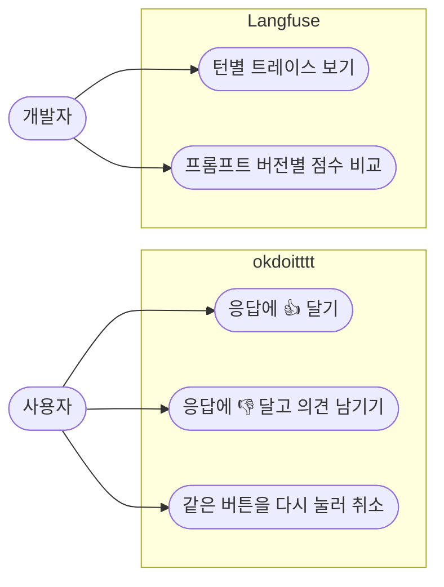
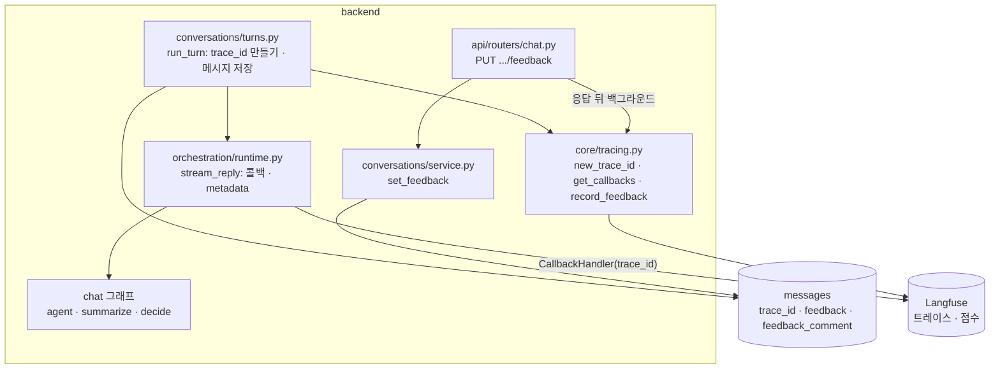
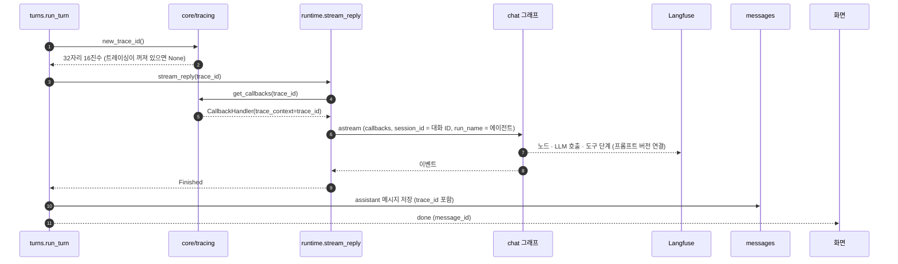
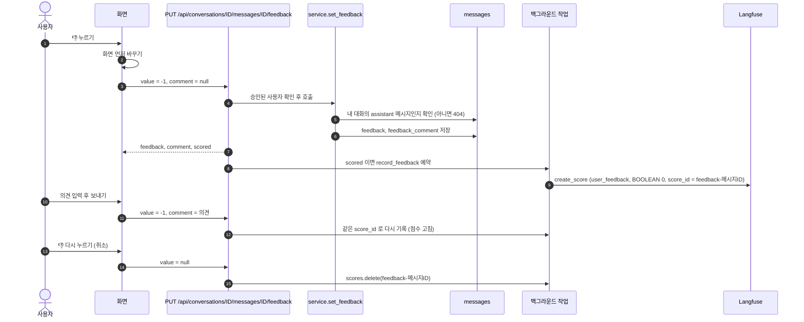

# 트레이싱과 응답 피드백

> 응답 한 턴을 Langfuse 트레이스 하나로 남기고, 그 응답에 단 👍/👎 를 같은 트레이스의 점수로 기록합니다.
> 관련 코드: `backend/app/core/tracing.py`, `backend/app/conversations/turns.py`, `backend/app/orchestration/runtime.py`,
> `backend/app/api/routers/chat.py`, `backend/app/conversations/service.py`, `frontend/src/components/MessageList.tsx`

Langfuse 는 선택 사항입니다. `LANGFUSE_PUBLIC_KEY` 와 `LANGFUSE_SECRET_KEY` 가 모두 있어야 트레이싱이 켜집니다(`tracing_enabled`).
꺼져 있어도 피드백은 DB 에 저장됩니다.

## 사용자 관점

- 버튼은 저장된 응답(서버 메시지 ID 가 있는 것) 아래, 모델 이름 옆에 있습니다.
- 누르면 화면을 먼저 바꾸고 저장합니다. 저장이 실패하면 되돌리고 알립니다.
- 👎 를 고르면 의견 입력칸이 열립니다(선택, 2,000자까지). 남긴 의견은 버튼 아래에 보입니다.

## 구조

## 흐름

### 한 턴의 트레이스

한 턴 전체는 [한 턴의 흐름](chat-turn.md)에 있습니다. 여기서는 트레이스 ID 가 지나가는 길만 봅니다.

- 트레이스 ID 를 Langfuse 가 만들게 두지 않고 미리 만듭니다. 그래야 같은 값을 메시지에 저장하고, 나중에 그 트레이스에 점수를 달 수 있습니다.
- 대화 ID 를 `langfuse_session_id` 로 넘겨서 한 대화의 턴들이 Langfuse 에서 한 세션으로 묶입니다.
- 중단이나 오류로 저장한 응답에도 `trace_id` 가 들어갑니다(`_save_partial`).
- LLM 호출은 그때 쓴 프롬프트 버전에 연결됩니다. 연결 방식은 [프롬프트 관리](prompts.md#렌더링)에 있습니다.
- 도구 결정 모델 호출은 `tool_decision` 이라는 이름의 한 단계로 트레이스에 남습니다.
- 앱이 종료될 때 `tracing.shutdown()` 이 남은 트레이스를 보냅니다.

### 피드백 저장과 점수

| 화면 동작 | 요청 `value` | DB `feedback` | Langfuse `user_feedback` |
|---|---|---|---|
| 👍 | `1` | `1` | `1` (true) |
| 👎 | `-1` | `-1` | `0` (false), 의견은 comment |
| 같은 버튼 다시 누르기 | `null` | `null`, 의견도 지움 | 점수 삭제 |

- 점수 ID 는 메시지마다 하나(`feedback-<메시지 ID>`)입니다. 피드백을 바꾸면 새 점수가 아니라 같은 점수를 고칩니다.
- 점수는 HTTP 응답을 보낸 뒤 스레드에서 기록합니다. Langfuse 가 느리거나 실패해도 피드백 저장에는 영향이 없고, 실패는 로그에만 남습니다.

### `scored` 값

응답의 `scored` 는 `messages.trace_id` 가 있고 지금 트레이싱이 켜져 있을 때 `true` 입니다.

- 트레이싱이 꺼진 채 만든 응답이나 피드백 기능 전의 응답은 `trace_id` 가 없어서 `false` 입니다. 이때는 DB 에만 저장합니다.
- `scored` 는 점수 기록을 **예약했다**는 뜻입니다. 기록이 성공했는지는 알려 주지 않습니다.

## 데이터

- `messages.trace_id`, `feedback`, `feedback_comment` 컬럼은 [ERD](../data/erd.md#2-대화)에 있습니다.
- 트레이스에는 모델 입력과 출력이 들어 있습니다. 대화를 지워도 Langfuse 트레이스는 지우지 않습니다([데이터 저장 위치](../data/storage-map.md#저장소끼리-어긋나는-곳)).

## 설계 결정

**피드백을 트레이스의 점수로 남깁니다.** 트레이스는 쌓였지만 점수가 없어서, 프롬프트 버전을 바꿔도 어느 쪽이 나은지 판단할 근거가 없었습니다(커밋 `6ef972f`).
프롬프트 버전이 그 아래 LLM 호출에 연결되어 있으므로, Langfuse 에서 프롬프트 버전별 점수를 비교할 수 있습니다(`tracing.py` 모듈 docstring).

**트레이스 ID 를 앱이 미리 만듭니다.** 응답이 끝난 뒤에도 그 턴의 트레이스를 가리킬 값이 메시지에 있어야 점수를 달 수 있습니다.

**점수 ID 를 메시지에서 정합니다.** 같은 메시지의 피드백을 바꾸면 Langfuse 에서도 같은 점수가 고쳐지고, 취소는 그 ID 로 지웁니다.
점수가 여러 개 쌓이지 않습니다.

**DB 저장과 Langfuse 기록을 나눴습니다.** DB 가 피드백의 원본이고, Langfuse 기록은 응답 뒤의 부가 작업입니다.
외부 서비스 장애가 사용자 동작을 막지 않게 합니다(`put_feedback` docstring).

**값을 BOOLEAN 으로 기록합니다.** 👍 1, 👎 0 입니다. 다른 형식(숫자 척도 등)과 비교한 기록은 코드와 커밋에 없습니다.
