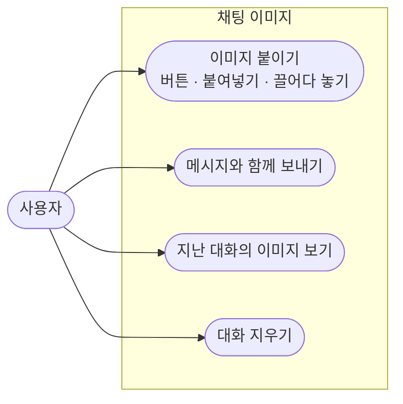
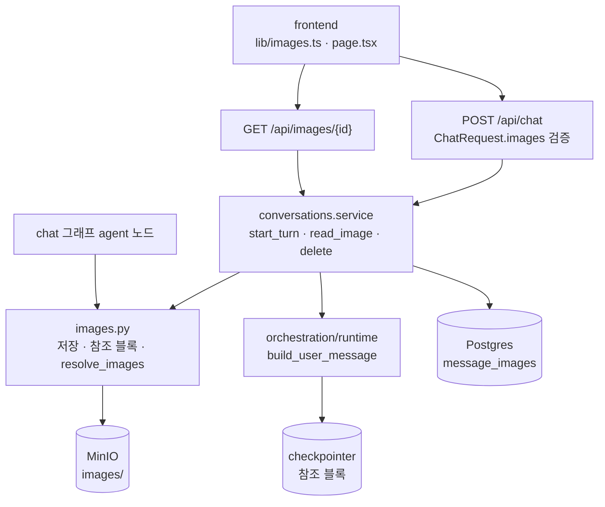
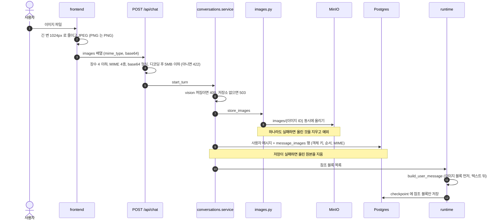
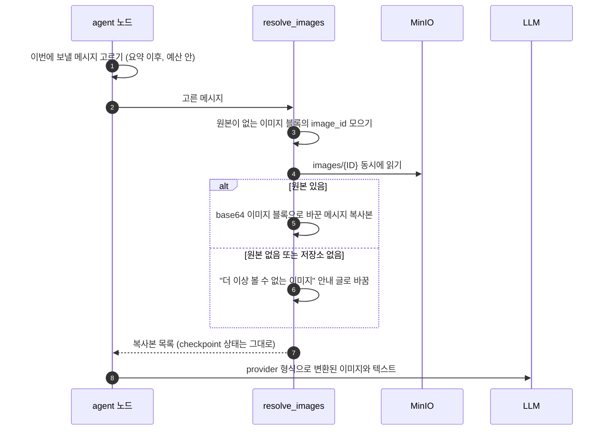

# 채팅 이미지

> 채팅에 붙인 이미지는 원본을 MinIO 에 두고, checkpoint 에는 이미지 ID 만 담은 참조 블록을 둡니다. 모델을 부르기 직전에 원본으로 바꿉니다.
> 관련 코드: `backend/app/images.py`, `backend/app/api/schemas.py`, `backend/app/conversations/service.py`,
> `backend/app/orchestration/runtime.py`, `backend/app/agents/chat/graph.py`, `backend/app/api/routers/chat.py`,
> `frontend/src/lib/images.ts`, `frontend/src/app/page.tsx`

한 턴 전체의 흐름은 [한 턴의 흐름](chat-turn.md)에 있습니다. 여기서는 이미지가 지나가는 부분만 다룹니다.
프로젝트 문서 속 그림은 이 기능이 아닙니다([프로젝트 문서와 검색](projects-rag.md)).

## 사용자 관점



- 메시지 하나에 4장까지 붙입니다(`MAX_IMAGES`, 서버는 `MAX_IMAGES_PER_MESSAGE`).
- `/api/info` 의 `vision` 이 꺼져 있으면 화면이 "현재 모델은 이미지를 지원하지 않습니다" 를 보여 주고 붙이지 않습니다.

## 구조



## 흐름

### 보내기



참조 블록은 LangChain 표준 이미지 블록 모양이지만 원본 데이터가 없습니다(`image_ref_block`).

```json
{"type": "image", "mime_type": "image/jpeg", "extras": {"image_id": "<message_images.id>"}}
```

`type` 이 `image` 라서 컨텍스트 예산 계산과 요약은 이 블록을 이미지 한 장(`IMAGE_TOKEN_ESTIMATE`, 기본 1,500토큰)으로 셉니다.

### 모델 부르기 직전



- 보낼 메시지만 바꿉니다. 이력 예산 밖으로 잘린 오래된 이미지는 저장소에서 읽지 않습니다.
- `base64`, `url`, `data` 가 이미 있는 블록은 그대로 둡니다. 이 기능 전에 base64 로 저장된 대화를 그대로 읽기 위해서입니다.
- 표준 블록을 provider 형식(Anthropic `source`, Ollama `images` 필드 등)으로 바꾸는 일은 LangChain 이 합니다(`build_user_message` 설명).

### 화면에서 보기

- 대화를 열면 `GET /api/conversations/{id}` 가 메시지마다 `image_ids` 만 내려줍니다. 바이너리는 넣지 않습니다.
- 화면은 `GET /api/images/{id}` 로 이미지를 받습니다. 서버는 `message_images → messages → conversations` 를 이어 내 대화의 이미지인지 확인합니다.
- 응답에는 `Cache-Control: private, max-age=31536000, immutable` 을 붙입니다. 저장한 이미지는 바뀌지 않기 때문입니다.
- 행이 없거나, 남의 대화이거나, 저장소가 없거나, 원본이 없으면 모두 404 입니다.
- 보내는 순간에는 미리보기 data URL(`previewUrl`)로 먼저 그립니다.

### 지우기

이미지는 보관 기간으로 지우지 않습니다. 대화나 프로젝트를 지울 때 함께 지웁니다
([삭제할 때 함께 지워지는 것](../data/storage-map.md#삭제할-때-함께-지워지는-것)).

1. 지울 이미지의 객체 키를 모읍니다.
2. 대화 행을 지우고 커밋합니다. `message_images` 행은 CASCADE 로 지워집니다.
3. MinIO 원본을 지웁니다(`delete_images`). 실패하면 경고 로그만 남깁니다.

`images/` 에는 lifecycle 규칙이 없어서, 3단계에서 실패한 원본은 저장소에 계속 남습니다. 문서 원본은 lifecycle 이 결국 지우는 것과 다릅니다.

## 데이터

- 테이블: `message_images` (`id`, `message_id`, `position`, `mime_type`, `storage_key`). [ERD 2. 대화](../data/erd.md#2-대화)를 보세요.
- MinIO: `images/<이미지 ID>`. `documents/` 와 접두어가 달라서 30일 lifecycle 을 받지 않습니다([MinIO 객체 키](../data/storage-map.md#minio-객체-키)).
- checkpointer: 사용자 메시지 안의 참조 블록([checkpointer 에 있는 것](../data/storage-map.md#checkpointer-에-있는-것)).

| 설정·상수 | 값 | 의미 |
|---|---|---|
| `MAX_IMAGES` (frontend) · `MAX_IMAGES_PER_MESSAGE` (backend) | 4 | 메시지 하나의 이미지 수 |
| `MAX_DIMENSION` (frontend) | 1024px | 긴 변 상한 |
| `JPEG_QUALITY` (frontend) | 0.85 | JPEG 품질 |
| `MAX_IMAGE_BYTES` (backend) | 5MB | 디코딩한 이미지 하나의 상한 (Anthropic API 의 이미지당 한도와 같음) |
| `ImageMimeType` (backend) | jpeg · png · webp · gif | 받는 MIME 타입 |
| `ENABLE_VISION` | true | 꺼지면 이미지가 있는 요청은 400 |
| `IMAGE_TOKEN_ESTIMATE` | 1,500 | 컨텍스트 예산에서 이미지 한 장의 토큰 수 |

## 설계 결정

- **checkpoint 에는 참조만.** checkpoint 는 턴마다 대화 상태를 새로 저장합니다. base64 를 넣으면 같은 이미지가 턴마다 쌓이고,
  대화를 자동으로 지우지 않기로 해서 DB 가 대화 길이에 비례해 끝없이 커질 수 있었습니다(89f05b2, `images.py` 모듈 설명).
- **원본을 먼저 올리고 메시지를 저장한다.** 메시지 행이 원본 없는 이미지를 가리키지 않게 합니다. 중간에 실패하면 올린 원본을 지웁니다(89f05b2).
- **보관 기간 없이 대화와 함께 지운다.** 이미지는 대화 내용 그 자체라서 문서 원본처럼 30일 뒤 지우지 않습니다(`images.py` 모듈 설명).
- **원본이 없으면 안내 글로 바꾼다.** 지워진 이미지 하나 때문에 대화 전체가 실패하지 않게 합니다(`resolve_images` 설명).
- **화면에서 1024px 로 줄인다.** 더 크게 보내도 모델이 내부에서 줄이므로 토큰과 전송량만 늘어납니다(`lib/images.ts` 주석).
- **5MB 상한.** Anthropic API 의 이미지당 한도와 맞춘 값입니다(`schemas.py` 주석).
- 서버는 `mime_type` 과 실제 바이트가 맞는지 확인하지 않습니다. 이렇게 둔 이유는 코드와 커밋에서 찾지 못했습니다.
