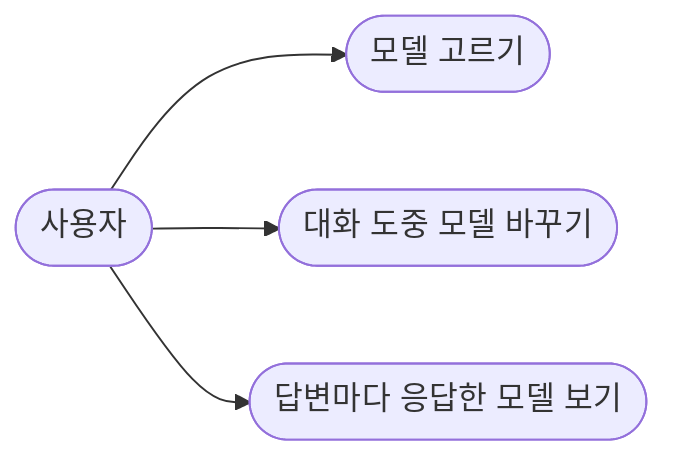
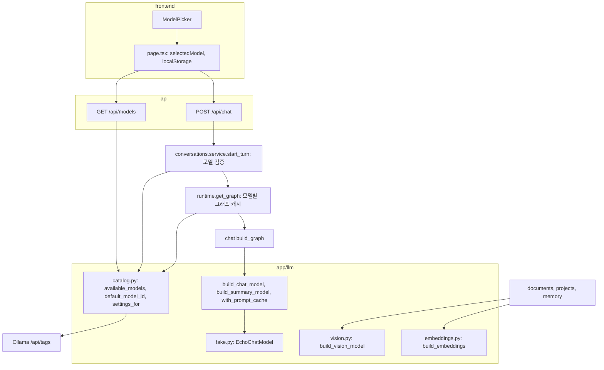
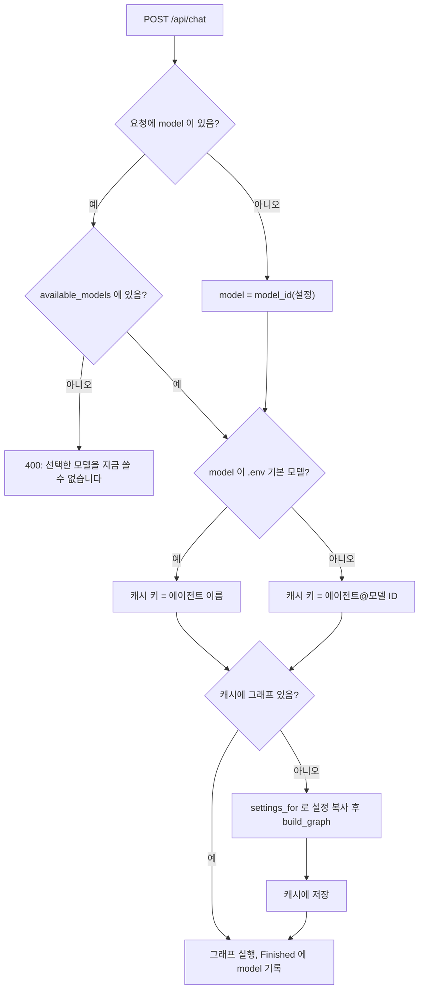
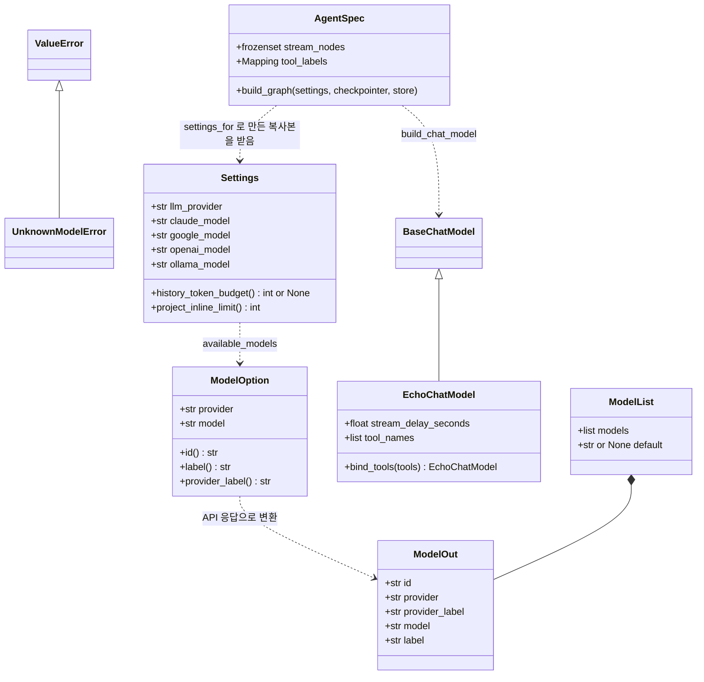

# LLM provider

> 화면에서 고른 모델 ID 로 provider 별 chat model 과 그래프를 만들고, 모델마다 캐시합니다.
> 관련 코드: `backend/app/llm/__init__.py`, `backend/app/llm/catalog.py`, `backend/app/llm/fake.py`, `backend/app/llm/vision.py`, `backend/app/llm/embeddings.py`, `backend/app/orchestration/runtime.py`, `backend/app/api/routers/chat.py`, `frontend/src/components/ModelPicker.tsx`, `frontend/src/app/page.tsx`

에이전트는 provider 를 모릅니다. `build_chat_model` 이 돌려준 LangChain chat model 만 씁니다. provider 를 바꾸는 일은 모두
`app/llm` 과 `runtime.get_graph` 가 맡습니다.

한 턴의 전체 흐름은 [한 턴의 흐름](chat-turn.md)에 있습니다.

## 사용자 관점

- 입력창의 드롭다운(`ModelPicker`)에서 고릅니다. provider 별로 묶어 보여 주고, 열 때마다 목록을 새로 받습니다.
- 고른 모델은 다음에 보내는 메시지부터 쓰고, 브라우저 `localStorage` 의 `selected-model` 에 기억합니다.
- 고른 모델이 목록에서 사라지면(키를 지웠거나 Ollama 를 껐음) 마지막으로 기억한 모델, 서버 기본 모델, 첫 모델 순으로 고릅니다.
- 대화 도중 바꿔도 이력은 이어집니다. 각 답변 아래에 응답한 모델을 표시합니다(`messages.model`).

## 구조

## 모델 ID

모델은 `"<provider>:<모델 이름>"` 형식의 문자열로 구분합니다. 예: `anthropic:claude-opus-5-5`, `ollama:qwen3.5:9b`.

- provider 는 첫 번째 `:` 앞부분입니다. Ollama 모델 이름에는 `:` 가 들어갈 수 있어서 첫 번째에서만 나눕니다(`parse_model_id`).
- provider 는 `anthropic`, `google`, `openai`, `ollama`, `fake` 중 하나입니다. 아니면 `UnknownModelError` 입니다.
- `settings_for` 는 모델 ID 에 맞게 `llm_provider` 와 그 provider 의 모델 필드(`claude_model` 등)만 바꾼 설정 복사본을 만듭니다.
  다른 설정(키, 시간 제한, 예산 관련 값)은 `.env` 그대로입니다.
- `.env` 의 기본 모델 ID 는 `model_id(settings)` 입니다. fake 는 `fake:fake` 입니다.

## 모델 목록

`GET /api/models` 는 `available_models` 와 `default_model_id` 를 돌려줍니다. 목록에는 **지금 바로 쓸 수 있는 모델만** 넣습니다.

| provider | 목록에 나오는 조건 | 모델 |
|---|---|---|
| `openai` | `OPENAI_API_KEY` 가 있음 | `OPENAI_MODELS` |
| `google` | `GOOGLE_API_KEY` 가 있음 | `GOOGLE_MODELS` |
| `anthropic` | `ANTHROPIC_API_KEY` 가 있음 | `ANTHROPIC_MODELS` |
| `ollama` | `/api/tags` 가 1.5초 안에 응답 | 설치된 모델 전체 (이름순) |
| `fake` | `LLM_PROVIDER=fake` | `fake` 하나 |

- 순서는 표의 순서(OpenAI, Google, Anthropic, Ollama, fake)입니다.
- 키가 있는 provider 는 `*_MODEL` 이 `*_MODELS` 에 없으면 맨 앞에 넣습니다(`_with_default`).
- Ollama 목록은 같은 주소에 대해 15초 캐시합니다. Ollama 를 꺼 둔 경우가 많아서 시간 제한을 짧게 둡니다.
- 기본 모델은 `.env` 의 모델이 목록에 있으면 그 모델, 없으면 첫 모델입니다. 목록이 비면 `None` 입니다.
- 화면 표시 이름은 `MODEL_LABELS` 에 있으면 그 값, 없으면 모델 이름입니다.

`POST /api/chat` 의 `model` 도 같은 목록으로 검사합니다. 목록에 없으면 `start_turn` 이 400 으로 거절합니다.
그래서 그래프 캐시에는 목록에 있었던 모델만 들어갑니다.

## 모델 고르기

요청 한 번에서 어떤 모델과 그래프를 쓸지 정하는 순서입니다.

## provider 별 모델

`build_chat_model` 이 `settings.llm_provider` 로 고릅니다. provider 패키지는 그 provider 를 쓸 때만 import 합니다.

| provider | 클래스 | 주요 설정 | 추론 표시 |
|---|---|---|---|
| `anthropic` | `ChatAnthropic` | `CLAUDE_MAX_TOKENS`, `CLAUDE_EFFORT`, `model_kwargs` 의 `cache_control` | `thinking={"type": "adaptive", "display": "summarized"}` |
| `google` | `ChatGoogleGenerativeAI` | `GOOGLE_MAX_OUTPUT_TOKENS`, `GOOGLE_TEMPERATURE`, 시간 제한, `GOOGLE_MAX_RETRIES` | `GOOGLE_INCLUDE_THOUGHTS` |
| `openai` | `ChatOpenAI` (`use_responses_api=True`) | `OPENAI_MAX_OUTPUT_TOKENS`, 시간 제한, 재시도 | `OPENAI_REASONING_EFFORT`, `OPENAI_REASONING_SUMMARY` |
| `ollama` | `ChatOllama` | `OLLAMA_NUM_CTX`, `OLLAMA_NUM_PREDICT`, `OLLAMA_KEEP_ALIVE`, `OLLAMA_TIMEOUT_SECONDS` | `OLLAMA_REASONING` |
| `fake` | `EchoChatModel` | `FAKE_STREAM_DELAY_SECONDS` | 표시 문구가 있을 때만 |

- 모든 provider 가 스트리밍으로 응답합니다. 추론 요약은 화면의 "생각 과정"에 보입니다.
- OpenAI 는 추론 요약과 추론 이어가기가 Responses API 에서만 되어서 Responses API 를 씁니다.
- Ollama 의 `client_kwargs={"timeout": …}` 는 Ollama 가 멈췄을 때 요청이 무한히 기다리지 않게 합니다.
- provider 마다 다른 종료 사유(`stop_reason`, `done_reason`, `finish_reason`, `status`)는 `runtime._stop_reason` 이 공통 이름으로 바꿉니다.
- provider 예외는 `describe_error` 가 화면 문구로 바꾸고, `is_transient_error` 가 잠깐 기다리면 풀릴 오류(5xx, 429, 시간 초과)를 가립니다.
  OpenAI 크레딧 부족(429 `insufficient_quota`)은 일시적 오류로 보지 않습니다.

### fake 모델

`EchoChatModel` 은 LLM 없이 파이프라인(SSE, LangGraph, checkpointer, Langfuse)을 확인하는 테스트용 모델입니다.
마지막 사용자 메시지를 `[echo · turn N] …` 형식으로 돌려줍니다. N 은 모델이 본 사용자 턴 수라서, 자르기와 요약을 확인할 수 있습니다.

| 메시지에 넣는 표시 | 동작 |
|---|---|
| `[[fail]]` | 답변 도중 오류 |
| `[[think]]` | 답변 전에 추론 과정 (`reasoning_content`) |
| `[[tool]]` | `get_current_time` 이 바인딩되어 있으면 호출 |
| `[[remember]]` | `remember` 가 바인딩되어 있으면 뒤의 글을 기억으로 저장 |

fake 는 예산이 없어서 자르기와 요약이 일어나지 않습니다. 확인하려면 `CONTEXT_MAX_TOKENS` 를 지정합니다.

### 요약 모델

`build_summary_model` 은 같은 provider 와 모델에 요약용 설정을 덮어씁니다. 표는 [컨텍스트 관리](context-management.md#요약-모델)에 있습니다.

### 채팅 밖의 모델

| 함수 | 쓰는 곳 | 모델 | 키가 없으면 |
|---|---|---|---|
| `vision.build_vision_model` | 프로젝트 문서의 그림 설명 (`documents/service.py`) | OpenAI `VISION_MODEL` (기본 `gpt-6-luna`), `detail: "low"` | `VisionUnavailableError` |
| `embeddings.build_embeddings` | 프로젝트 검색, 장기 기억 Store | `EMBEDDING_PROVIDER=openai` 면 `EMBEDDING_MODEL`, `fake` 면 글자 조각 해시 | `EmbeddingUnavailableError` |

두 함수는 채팅에 고른 모델과 상관없이 항상 OpenAI(또는 fake 임베딩)를 씁니다. 그래서 다른 provider 로 채팅해도 OpenAI 키가 필요할 수
있습니다([전체 아키텍처](../architecture/00-overview.md#1-시스템-컨텍스트)). 결정 모델 d3 도 채팅 모델과 따로 Ollama 에서 부릅니다([도구 결정](tool-decision.md)).

## 그래프 캐시

`runtime.get_graph(agent, model)` 은 모델마다 그래프를 따로 만들어 `_graphs` 에 둡니다.

- 기본 모델의 그래프는 앱이 시작할 때(`startup`) 만들고, 다른 모델은 처음 요청될 때 만듭니다.
- 캐시 키는 기본 모델이면 에이전트 이름, 아니면 `"<에이전트>@<모델 ID>"` 입니다.
- 프로세스가 떠 있는 동안 지우지 않습니다. `register` 를 다시 부를 때만 비웁니다.
- 모든 그래프가 같은 checkpointer 와 Store 를 씁니다. 그래서 대화 도중 모델을 바꿔도 이력과 기억이 이어집니다.

모델마다 그래프를 따로 만드는 이유는 그래프 모양이 설정에 따라 달라지기 때문입니다.

| 모델마다 다른 것 | 결과 |
|---|---|
| provider | chat model 클래스, 요약 모델 |
| `history_token_budget` | `summarize` 노드 유무, 자르기 예산 |
| `project_inline_limit` | 프로젝트 문서 본문을 system 프롬프트에 모두 넣는 기준 (Ollama 만 작음) |
| `with_prompt_cache` | Anthropic 만 `cache_control` |

### 대화 도중 모델을 바꿀 때

`agent` 노드는 응답에 모델 ID 를 적고(`tag_model`), 다음 호출 때 다른 모델이 만든 추론 블록을 뺍니다(`drop_foreign_reasoning`).
추론 블록에는 만든 provider 의 서명이 붙어 있어서, 다른 provider 에 보내면 요청이 거절될 수 있습니다. 자세한 규칙은
[컨텍스트 관리](context-management.md#다른-모델의-추론-빼기)에 있습니다.

## 프롬프트 캐시

`with_prompt_cache` 는 Anthropic 이면 모델 호출에 최상위 `cache_control={"type": "ephemeral"}` 을 붙입니다. 다른 provider 는 그대로 둡니다.

- Anthropic 이 도구 정의, system 프롬프트, 대화 이력을 마지막 블록까지 캐시하고, 다음 요청은 같은 앞부분을 캐시에서 읽습니다.
- 캐시는 기본 5분 유지됩니다. 캐시에 쓰는 요청은 입력 단가가 1.25배, 읽는 요청은 0.1배입니다(코드 주석).
- OpenAI 와 Gemini 는 같은 앞부분을 자동으로 캐시해서 따로 켜지 않습니다.
- 캐시를 지키려고 이력과 도구 목록의 앞부분을 되도록 바꾸지 않습니다. [컨텍스트 관리](context-management.md#anthropic-프롬프트-캐시와의-관계)와
  [도구 결정](tool-decision.md#설계-결정)을 보세요.

## 주요 타입

## 데이터

| 저장소 | 키 | 내용 |
|---|---|---|
| `messages.model` | 답변 행 | 응답한 모델 ID. 사용자 메시지는 `None` |
| checkpointer | AI 메시지의 `response_metadata["app_model"]` | 응답한 모델 ID (`tag_model`) |
| 프로세스 메모리 | `runtime._graphs` | 모델별 컴파일된 그래프 |
| 프로세스 메모리 | `catalog._ollama_cache` | Ollama 모델 목록 (15초) |
| 브라우저 | `localStorage["selected-model"]` | 마지막으로 고른 모델 ID |

자세한 위치는 [데이터 저장 위치](../data/storage-map.md)에 있습니다.

## 설계 결정

- **화면에서 모델을 고른다.** 전에는 `.env` 의 `LLM_PROVIDER` 로만 정했습니다. 여러 provider 를 번갈아 쓰고 비교하려고 드롭다운을 만들었고,
  `.env` 값은 처음 선택될 기본 모델이 되었습니다(커밋 `fc02f28`).
- **쓸 수 있는 모델만 보여 준다.** 키가 없는 provider 와 꺼진 Ollama 를 숨겨서, 고른 뒤에 실패하는 일을 줄입니다. 보낼 때도 같은 목록으로 다시 검사합니다.
- **API 키로 쓰는 provider 는 모델 목록을 설정에 적는다.** OpenAI 는 선불 크레딧에서 차감되므로 비싼 모델이 실수로 쓰이지 않게 목록을 직접 정합니다(커밋 `6cce260`).
  Ollama 만 설치된 모델을 그대로 보여 줍니다.
- **모델마다 그래프를 만든다.** provider 와 이력 예산에 따라 노드 구성이 달라서입니다. checkpointer 는 하나라 이력은 이어집니다(커밋 `fc02f28`).
- **Google 과 OpenAI 를 추가한 이유.** Ollama 는 노트북 메모리를 너무 많이 써서 무료 티어의 Gemini API 를 추가했고(커밋 `38d4562`),
  Gemini 무료 티어의 503 이 잦아 선불 크레딧의 OpenAI 를 추가했습니다(커밋 `6cce260`).
- **Anthropic 만 캐시를 직접 켠다.** 프로젝트 문서 본문처럼 매 응답 다시 보내는 큰 system 프롬프트의 비용을 줄이려고 켰습니다.
  OpenAI 와 Gemini 는 자동 캐시입니다(커밋 `199ee8c`).
- **vision 과 임베딩은 OpenAI 로 고정한다.** 고른 이유는 코드와 커밋에 적혀 있지 않습니다.
