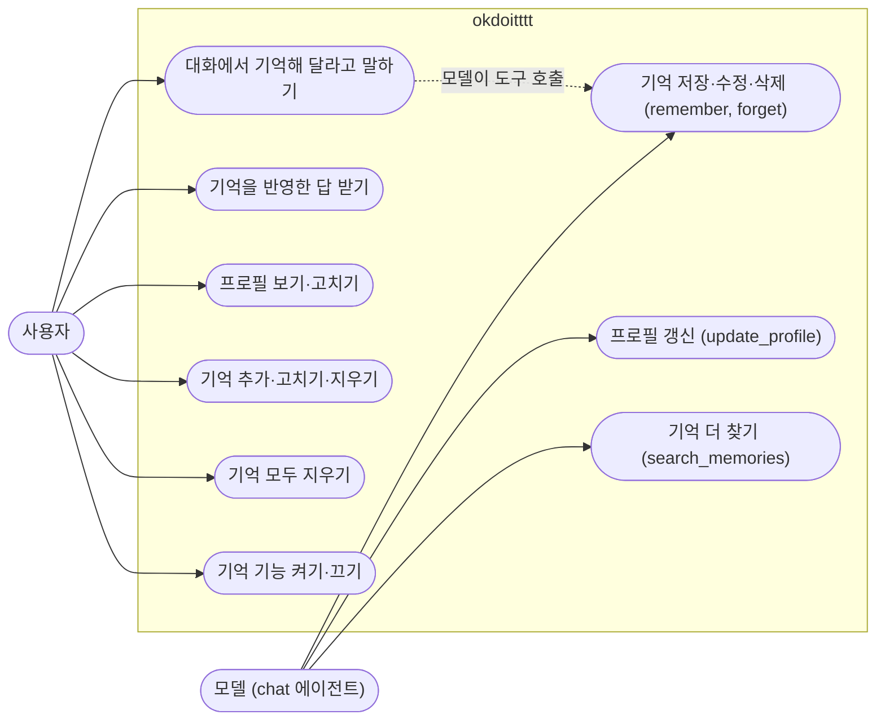
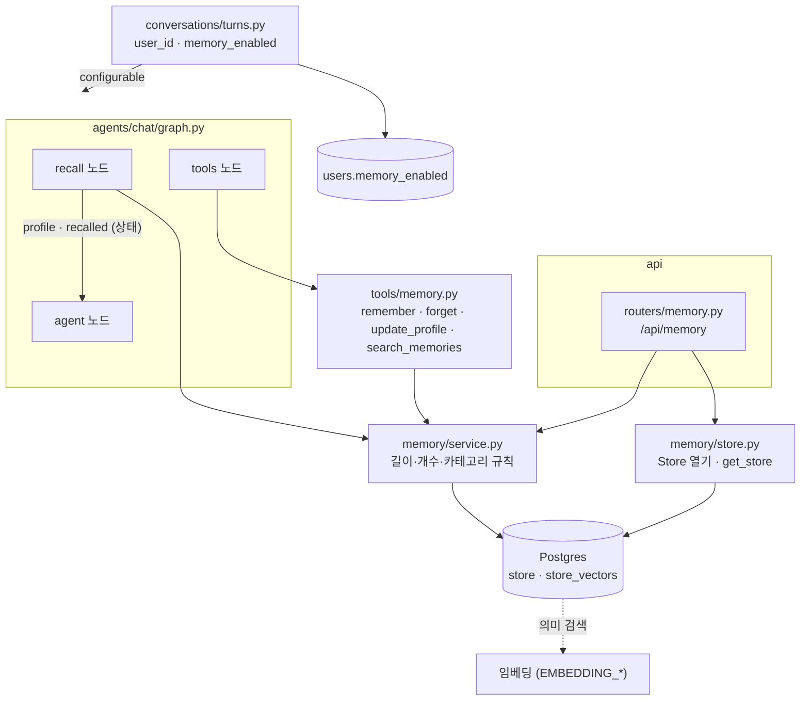
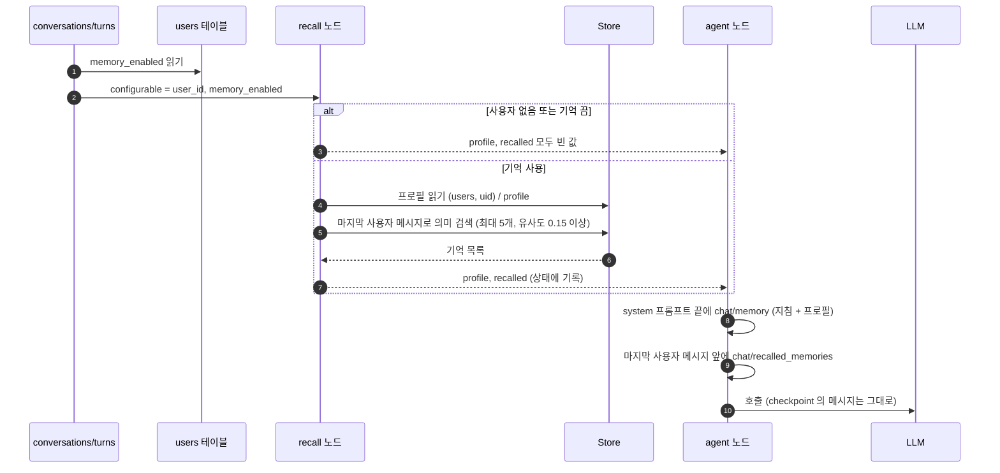
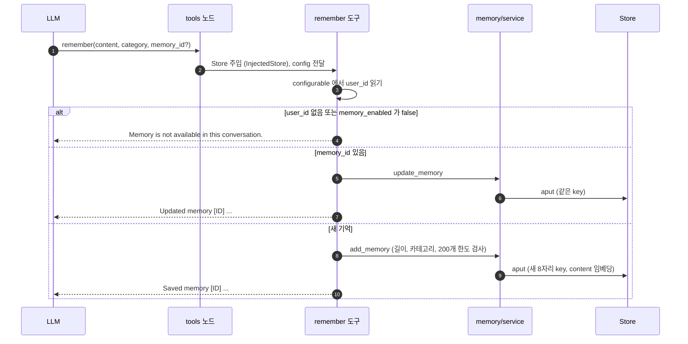
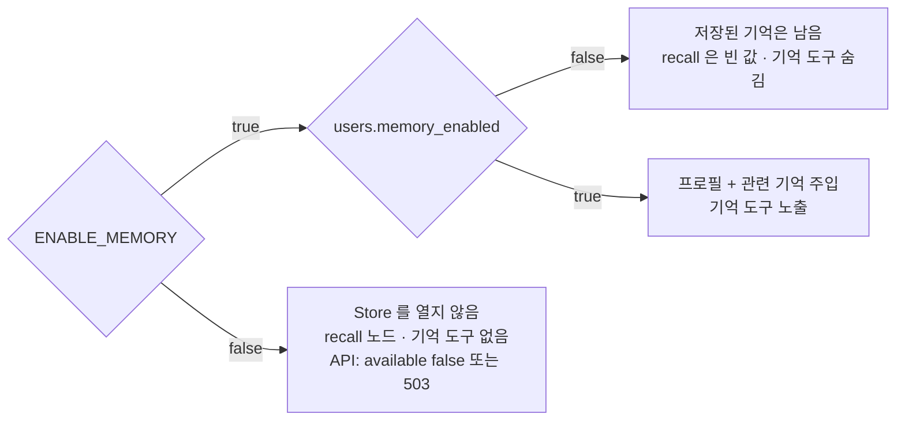

# 장기 기억

> 대화가 바뀌어도 남는 사용자 정보(프로필과 기억)를 저장하고, 턴마다 필요한 만큼만 모델에 넣습니다.
> 관련 코드: `backend/app/memory/`, `backend/app/tools/memory.py`, `backend/app/agents/chat/graph.py`,
> `backend/app/agents/chat/prompts/memory.md`, `backend/app/agents/chat/prompts/recalled_memories.md`,
> `backend/app/conversations/turns.py`, `backend/app/api/routers/memory.py`, `frontend/src/components/MemoryView.tsx`

대화 요약은 **한 대화 안**의 기억이고, 이 기능은 **대화와 대화 사이**의 기억입니다.
요약은 [컨텍스트 관리](context-management.md)에서 다룹니다.

## 사용자 관점

모델이 대화 중에 스스로 저장하고, 사용자는 `/memory` 화면에서 직접 보고 고칩니다.

- 화면은 사이드바 사용자 메뉴의 "기억"에서 엽니다. 기억은 카테고리별(선호, 일·프로젝트, 생활, 기타)로 묶여 보입니다.
- 기억 기능을 끄면 저장된 기억은 남습니다. 대화에 넣지 않고, 새로 저장하지 않고, 기억 도구도 모델에게 보이지 않습니다.
- 서버에서 기억 기능(`ENABLE_MEMORY`)을 끄면 화면은 안내만 보여 줍니다.

## 구조

- `service` 하나를 모델 도구와 관리 API 가 같이 씁니다. 그래서 모델이 저장하든 사람이 고치든 규칙이 같습니다.
- Store 는 앱이 시작할 때 `runtime.startup` 이 checkpointer 와 같은 연결 풀로 엽니다(`ENABLE_MEMORY` 가 켜져 있을 때만).
- 그래프는 컴파일할 때 Store 를 받습니다. 도구는 `InjectedStore` 로, `recall` 노드는 `store` 인자로 주입받습니다.
  관리 API 는 `get_store()` 로 같은 Store 를 씁니다.

| 규칙 | 값 | 위치 |
|---|---|---|
| 카테고리 | `preferences`, `work`, `personal`, `other` | `service.Category` |
| 기억 하나 길이 | 500자 (공백은 한 칸으로 합침) | `MAX_MEMORY_CHARS` |
| 사용자당 기억 수 | 200개 | `MAX_MEMORIES` |
| 프로필 길이 | 800자. 빈 글이면 프로필을 지움 | `MAX_PROFILE_CHARS` |
| 기억 ID | 8자리 16진수 (`secrets.token_hex(4)`) | `add_memory` |

## 흐름

### 턴마다 불러오기 (recall)

한 턴 전체의 흐름은 [한 턴의 흐름](chat-turn.md)에 있습니다. 여기서는 기억이 끼는 부분만 봅니다.

- `recall` 은 턴마다 한 번만 실행됩니다. 한 턴 안에서 도구를 여러 번 불러도 다시 검색하지 않습니다.
- 읽기가 실패하면 경고만 남기고 기억 없이 답합니다.
- 임베딩을 쓸 수 없으면(키 없음) Store 를 인덱스 없이 엽니다. 이때 검색은 최근에 고친 기억으로 대신합니다.
- 기억 한 줄의 모양은 `- [ID] (카테고리, 날짜) 내용` 입니다. 모델은 이 ID 로 고치거나 지웁니다.

### 대화 중 저장 (hot path)

- 규칙 위반(`MemoryInputError`)은 예외가 아니라 도구 결과 문자열(`Not saved: ...`)로 모델에게 돌려줍니다. 모델이 고쳐서 다시 부를 수 있습니다.
- 언제 저장하고 무엇을 저장하지 않는지(비밀값, 일회성 정보, 문서·웹 결과 속 지시)는 프롬프트 `chat/memory` 에 있습니다.
- 화면에는 실행 단계로 "기억함", "프로필 갱신함" 같은 이름이 보입니다(`tools/registry.py`).

### 관리 API

| Method | Path | 동작 | 오류 |
|---|---|---|---|
| GET | `/api/memory` | 켜기 상태, 프로필, 기억 목록(최근에 고친 순), 한도 | Store 가 없으면 200 + `available: false` |
| PUT | `/api/memory/settings` | `users.memory_enabled` 바꾸기 | |
| PUT | `/api/memory/profile` | 프로필 바꾸기. 비우면 지움 | 503, 422 |
| POST | `/api/memory/memories` | 기억 추가 | 503, 422 (한도 포함) |
| PATCH | `/api/memory/memories/{id}` | 보낸 값만 고치기 | 503, 404, 422 |
| DELETE | `/api/memory/memories/{id}` | 하나 지우기 | 503, 404 |
| DELETE | `/api/memory` | 프로필과 기억 모두 지우기 | 503 |

모두 `ApprovedUser` 가 필요합니다. 기억 ID 는 항상 로그인한 사용자의 namespace 안에서 찾으므로, 다른 사용자의 ID 는 404 가 됩니다.

## 상태

기억 사용 여부는 두 스위치로 정해집니다.

`memory_enabled` 는 턴을 시작할 때 한 번 읽습니다(`turns._agent_context`). 응답 중에 끄면 다음 턴부터 반영됩니다.

## 데이터

Store 의 namespace 와 key 는 [데이터 저장 위치](../data/storage-map.md#store-에-있는-것)에 있습니다.

- 프로필은 `index=False` 로 저장해서 임베딩하지 않습니다. 기억은 `content` 필드만 임베딩합니다(`INDEXED_FIELDS`).
- `users.memory_enabled` 컬럼은 [ERD](../data/erd.md#1-사용자인증)에 있습니다.
- 기억은 사용자에 붙어 있어서, 대화를 지워도 남습니다. 지우는 방법은 관리 화면뿐입니다.

## 설계 결정

**검색된 기억은 system 프롬프트가 아니라 마지막 사용자 메시지 앞에 붙입니다.**
매 턴 달라지는 내용을 system 프롬프트에 넣으면 그 뒤의 대화 이력 전체가 프롬프트 캐시에서 빠집니다.
잘 바뀌지 않는 프로필만 system 프롬프트에 둡니다(`graph.py` 모듈 docstring, 커밋 `6c67e60`).

**주입한 기억은 checkpoint 에 저장하지 않습니다.** `with_recalled` 는 모델에 보낼 메시지의 복사본만 바꿉니다.
저장하면 지난 턴의 기억 블록이 이력에 쌓이고, 오래된 기억이 계속 남습니다.

**기억 전체가 아니라 관련 있는 것만 넣습니다.** 최대 `MEMORY_RECALL_LIMIT`(5)개, 유사도 `MEMORY_MIN_SCORE`(0.15) 이상입니다.
기준값은 실제 임베딩으로 재서 정했습니다. 짧은 한국어 문장은 관련 있어도 0.17~0.32 로 낮게 나옵니다(커밋 `6c67e60`).

**사용자 ID 는 모델이 아니라 서버가 정합니다.** 도구는 `configurable["user_id"]` 에서 ID 를 읽고 Store 는 주입받습니다.
모델은 사용자를 고를 수 없어서 다른 사용자의 기억에 닿지 않습니다(`tools/memory.py` 모듈 docstring).

**기억을 쓰지 않는 턴에는 기억 도구를 빼고 모델을 부릅니다.** 도구 정의도 매 요청 프롬프트에 들어갑니다.
한 대화 안에서는 설정을 바꾸지 않는 한 도구 목록이 같아서 캐시가 유지됩니다(`hidden_tools` docstring).

**저장은 대화 중 모델이 직접 합니다 (hot path).** 대화가 끝난 뒤 따로 추출하는 방식과 비교한 기록은 코드와 커밋에 없습니다.

**프로필과 기억을 나눴습니다.** 프로필은 매 턴 통째로 넣는 짧은 글이고, 기억은 검색해서 고르는 낱개 사실입니다.
이 구분을 고른 이유(대안 비교)는 코드와 커밋에 따로 적혀 있지 않습니다.
