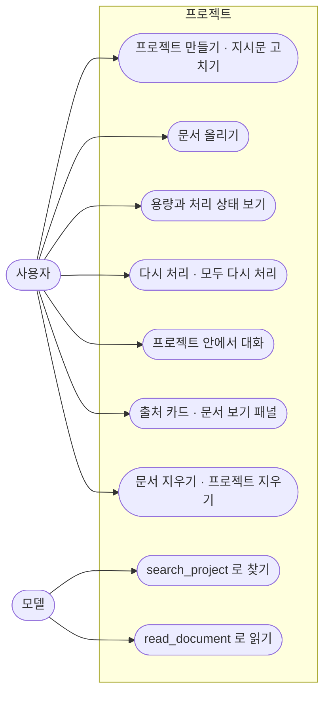
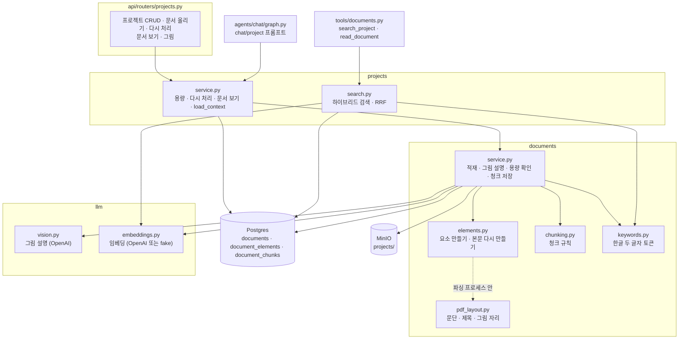
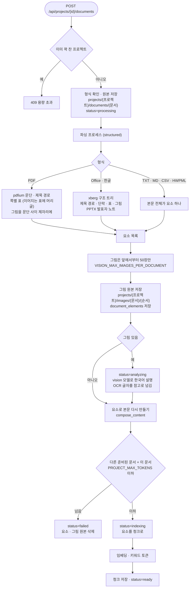
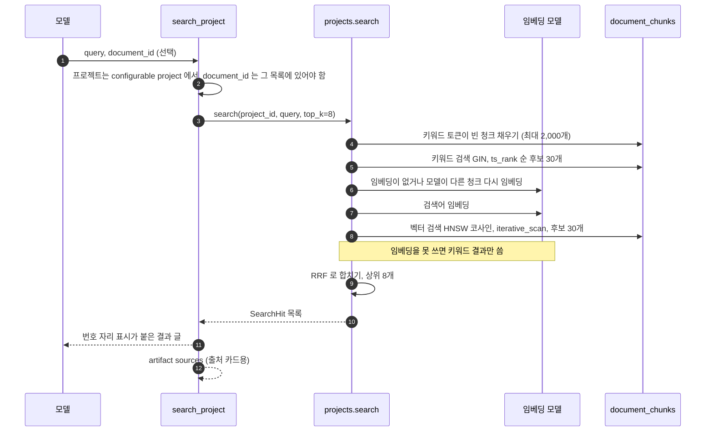
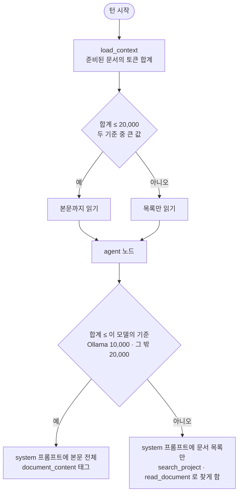
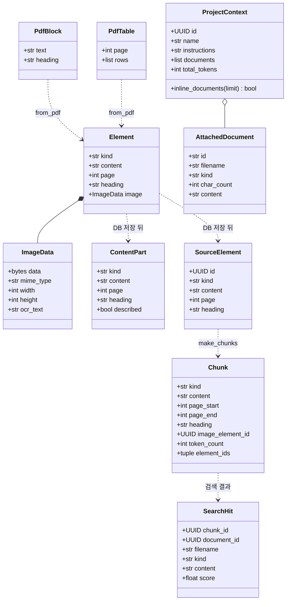

# 프로젝트 문서와 검색

> 프로젝트는 지시문, 문서, 대화를 묶습니다. 문서는 요소(본문·표·그림)로 적재하고, 작으면 본문을 통째로, 크면 하이브리드 검색으로 모델에게 줍니다.
> 관련 코드: `backend/app/projects/`, `backend/app/documents/{elements,pdf_layout,chunking,keywords,service}.py`,
> `backend/app/llm/{vision,embeddings}.py`, `backend/app/tools/documents.py`, `backend/app/api/routers/projects.py`,
> `backend/app/agents/chat/{graph.py,prompts/project.md}`, `frontend/src/components/{ProjectView,DocumentViewer,Sources}.tsx`

올리기, 형식 확인, 파싱 프로세스, `documents.status` 상태도는 [첨부 문서](documents.md)와 같습니다. 여기서는 그 뒤의 단계를 다룹니다.

## 사용자 관점

- 프로젝트 화면에서 보낸 메시지는 그 프로젝트 안의 새 대화가 됩니다(`POST /api/chat` 의 `project_id`). 이어가는 대화는 대화의 프로젝트를 따릅니다.
- 프로젝트 화면은 처리 중인 문서가 있으면 1초마다 상세를 다시 읽습니다(`ProjectView.tsx` 의 `POLL_MS`).
- 프로젝트 문서는 메시지에 첨부할 수 없습니다. 모델은 도구로만 읽습니다.

## 구조

## 흐름

### 적재 파이프라인

프로젝트 문서는 `structured=True` 로 파싱해서 본문과 함께 요소 목록을 받습니다. 그 뒤 `_ingest_project_document` 가 이어받습니다.

- 그림 설명에 실패한 그림은 `image_status=fallback` 이 되고, 본문에는 OCR 글자를 `[그림 속 글자 (OCR)]` 로 넣습니다. 문서는 실패하지 않습니다.
  실패한 그림 수는 `documents.image_fallback_count` 에 남습니다.
- `OPENAI_API_KEY` 가 없으면 그림 설명을 건너뛰고 모든 그림이 `fallback` 이 됩니다.
- 임베딩이 실패하면 청크를 임베딩 없이 저장하고 문서는 `ready` 가 됩니다. 빠진 임베딩은 검색할 때 채웁니다.
- 단계마다 이전 상태를 조건으로 UPDATE 합니다. 도중에 문서가 지워지면 올린 그림 원본을 지우고 멈춥니다.
- 앱이 시작할 때 `index_missing_documents` 가 청크가 없는 준비된 프로젝트 문서를 `indexing` 으로 바꿔 청크를 만듭니다.

### 요소 만들기

| 형식 | 본문 요소 | 표 요소 | 그림 요소 |
|---|---|---|---|
| PDF | 문단 하나가 요소 하나. 본문보다 1.15배 이상 크고 2줄·80자 이하인 문단은 제목이 되어 뒤 문단의 제목 경로로 이어짐 | 쪽별 표 추출 결과. 바로 다음 쪽의 첫 표가 열 수가 같으면 앞 표의 머리글을 붙임 | 그림 세로 가운데보다 아래의 첫 문단 앞. 자리를 모르면 쪽 끝 |
| Office·한글 | 같은 제목·쪽의 단락을 묶음 | Markdown 표 | 구조 트리의 자리 |
| 텍스트·HWPML | 본문 전체 하나 | 없음 | 없음 |

버리는 그림은 xberg 분류가 아이콘·로고·장식·마스크인 것, 짧은 변 80px 미만이거나 넓이 5만 픽셀 미만인 것,
압축 크기가 픽셀당 0.002바이트 미만인 빈 그림입니다. PDF 는 같은 쪽·같은 크기의 컬러 그림이 있는 회색조 그림을 투명도 마스크로 보고 뺍니다.
그림 원본은 WebP, 긴 변 1600px 이하로 받습니다.

### 본문 다시 만들기

`documents.content` 는 파서 출력이 아니라 저장한 요소로 다시 만듭니다(`elements.compose_content`).

- 쪽이 바뀌면 `<!-- PAGE n -->`, 제목 경로가 바뀌면 `## 제목 경로` 를 넣습니다.
- 그림은 설명이 있으면 `[그림] 설명`, 없으면 `[그림 속 글자 (OCR)] 글자` 입니다.
- **PDF 는 표 요소를 뺍니다**(`tables_in_body`). 표 글자가 텍스트 레이어 본문에 이미 들어 있기 때문입니다.
- 같은 규칙(`is_shown`)을 청크 만들기와 문서 보기 패널도 씁니다. 그래서 세 곳이 같은 내용을 봅니다.

### 청크 규칙

`chunking.make_chunks` 는 DB 와 임베딩을 모르는 순수 함수입니다. 크기는 모두 추정 토큰 수(`estimate_tokens`)입니다.

| 요소 | 규칙 |
|---|---|
| 짧은 본문 | 같은 제목 경로 아래 이어지는 본문을 목표 크기(500)까지 묶음. 제목이 바뀌면 새 청크 |
| 긴 본문 (800 초과) | 문단 → 줄 → 문장 → 공백 → 글자 순으로 잘라 목표 크기 조각을 만들고, 앞 조각 끝 80 토큰을 다음 조각 앞에 겹침 |
| 표 | 따로 한 청크. 800 을 넘으면 행 단위로 나누고 조각마다 머리글 행과 구분선을 다시 붙임 |
| 그림 | 설명(또는 OCR 글자) 하나가 청크 하나. `image_element_id` 로 원본 그림을 가리킴 |

- 청크마다 만든 요소의 ID(`element_ids`)를 남깁니다. 문서 보기 패널이 이 값으로 근거 블록을 강조합니다.
- 요소가 없는 문서(구조화 적재 전에 올린 것)는 본문 전체를 요소 하나로 보고 나눕니다.
- 임베딩과 키워드 토큰의 입력은 `문서: 이름 | 제목: 경로 | 쪽: n | 그림 설명` 머리말 + 청크 본문입니다(`embedding_text`).

### 키워드 토큰

Postgres `simple` 전문 검색은 띄어쓰기로만 낱말을 나눕니다. 그래서 `keywords.keyword_tokens` 가 토큰을 미리 만듭니다.

- 한글·한자 낱말은 낱말 자체와 두 글자 조각으로 나눕니다. "부산의" → `부산의`, `부산`, `산의`.
- 영문·숫자는 소문자 낱말 그대로 씁니다. 다른 글자는 버려서 tsquery 문법 글자가 섞이지 않습니다.
- 청크 토큰은 공백으로 이어 `to_tsvector('simple', …)` 로 저장합니다. 검색어 토큰은 최대 64개를 `|` 로 이어 `to_tsquery` 로 찾습니다.

### 검색

- **범위.** 모든 검색 조건에 `document_chunks.project_id = 이 프로젝트` 와 `documents.status = 'ready'` 가 들어갑니다.
  `document_id` 를 주면 그 문서로 더 좁힙니다. 모델이 다른 프로젝트의 ID 를 넣어도 찾지 못합니다.
- **도구 노출.** 프로젝트 밖의 대화에는 `search_project` 정의를 넘기지 않습니다(`graph.hidden_tools`). `read_document` 는 첨부 문서도 읽으므로 그대로 둡니다.
- **벡터 검색.** 프로젝트로 거르면 HNSW 가 찾은 후보가 다른 프로젝트 것뿐일 수 있어서 `SET LOCAL hnsw.iterative_scan = relaxed_order` 를 켭니다.
  순서가 조금 어긋날 수 있어서 거리로 다시 정렬합니다.
- **키워드 검색.** `ts_rank` 정규화 1(점수를 `1 + log(길이)` 로 나눔)로 긴 청크가 낱말 수만으로 앞서지 않게 합니다.
- **합치기.** RRF 는 청크마다 검색별 `1 / (k + 순위)` 를 더합니다(`k = 60`). 점수 단위가 다른 두 검색을 순위만으로 합칩니다.
- **결과 글.** 결과마다 `⟦source:i⟧` 자리 표시, 문서 이름·ID, 쪽, 제목 경로, 종류(표·그림 설명), 본문을 씁니다.
  도구 노드가 끝나면 자리 표시가 한 턴 안에서 이어지는 번호로 바뀝니다(`orchestration/citations.py`).
- **출처 카드.** artifact 의 `sources` 에 문서 ID, 위치(`p.3 · 제목`), 그림 요소 ID, 청크 ID 를 담습니다.
  카드를 누르면 문서 보기 패널(`GET /api/projects/{id}/documents/{doc}/view?chunk_id=…`)이 근거 블록을 강조합니다.

### 작은 프로젝트와 큰 프로젝트

- 프로젝트 정보는 턴마다 실행 설정(`configurable["project"]`)으로 넘깁니다. checkpoint 에 저장하지 않아서 지시문을 고치면 다음 응답부터 적용됩니다.
- system 프롬프트 끝에 `chat/project` 를 붙입니다. 이름, `<project_instructions>`, `<project_documents>` 가 들어갑니다.
- `token_count` 가 없는 예전 문서는 기준을 넘는 것으로 봅니다. 본문을 넣지 않습니다.
- 본문을 넣을 때는 그림 설명을 `## 그림 설명` 으로 본문 뒤에 한 번 더 붙입니다(`_with_descriptions`). 지금 본문에는 `[그림] 설명` 이
  이미 들어 있어서 같은 설명이 두 번 들어갑니다. 본문을 요소로 다시 만들기(6235c38) 전의 코드가 남은 것으로 보입니다.

### 프롬프트 캐시

작은 프로젝트는 매 응답마다 문서 본문 전체를 다시 보냅니다. Anthropic 모델이면 요청 최상위에 `cache_control: ephemeral` 을 붙입니다
(`llm.with_prompt_cache`, 기본 5분 유지). 도구 정의, system 프롬프트, 대화 이력의 같은 앞부분을 캐시에서 읽습니다.
OpenAI 와 Gemini 는 자동으로 캐시하므로 따로 켜지 않습니다. 한 대화 안에서 도구 목록이 바뀌지 않게 하는 것도 캐시를 지키기 위해서입니다.

### 용량, 다시 처리, 삭제

- **용량.** 준비된 문서의 `token_count` 합계로 잽니다. 문서 수는 제한하지 않습니다. 그림 설명도 본문에 들어가므로 용량에 셉니다.
  올릴 때는 이미 꽉 찬 프로젝트만 409 로 거절하고, 분량은 파싱해야 알 수 있어서 적재 중에 다시 확인합니다.
- **다시 처리.** `POST /api/projects/{id}/documents/{doc}/reprocess` 는 저장된 원본을 읽고, 청크·요소·본문·그림 원본을 지운 뒤 `processing` 으로 되돌려 다시 파싱합니다.
  처리 중이면 409, 원본이 없으면 404 입니다. `POST /api/projects/{id}/reprocess` 는 처리 중이 아닌 문서(실패한 문서 포함)를 모두 다시 처리하고, 원본이 없거나 그 사이 처리가 시작된 문서는 건너뜁니다.
- **삭제.** 문서를 지우면 행(요소·청크는 CASCADE)과 원본·그림 원본을 지웁니다. 프로젝트 삭제는 [저장소 삭제 규칙](../data/storage-map.md#삭제할-때-함께-지워지는-것)을 따릅니다.

## 주요 타입

파싱 프로세스에서 만드는 값(`elements`)과 적재 뒤 쓰는 값(`chunking`, `search`, `projects.service`)입니다. 모두 dataclass 입니다.

`Element.kind` 와 `Chunk.kind` 는 `text`, `table`, `image` 중 하나입니다. `Element` 는 DB 의 `document_elements` 행이 되고,
`Chunk` 는 `document_chunks` 행이 됩니다.

## 데이터

- 테이블: `documents`, `document_elements`, `document_chunks`. 컬럼과 인덱스(HNSW, GIN)는 [ERD 3. 문서](../data/erd.md#3-문서)에 있습니다.
- MinIO: `projects/<프로젝트>/documents/<문서>` 원본, `projects/<프로젝트>/images/<문서>/<순서>` 그림. 보관 기간 규칙을 받지 않습니다([MinIO 객체 키](../data/storage-map.md#minio-객체-키)).
- `document_elements.image_status` 는 `pending`(설명 전), `described`, `fallback` 입니다.
- `document_chunks.embedding_model` 은 `openai:text-embedding-3-small:1536` 처럼 provider·모델·차원입니다. 지금 설정과 다르면 검색할 때 다시 임베딩합니다.

| 설정 | 기본값 | 의미 |
|---|---|---|
| `PROJECT_MAX_TOKENS` | 1,000,000 | 프로젝트 용량 (추정 토큰 합계) |
| `PROJECT_INLINE_MAX_TOKENS` | 20,000 | 본문을 통째로 넣는 상한 |
| `OLLAMA_PROJECT_INLINE_MAX_TOKENS` | 10,000 | Ollama 모델의 같은 상한 |
| `VISION_MODEL` | `gpt-6-luna` | 그림 설명 모델 (OpenAI, `detail: low`, 추론 low) |
| `VISION_MAX_IMAGES_PER_DOCUMENT` | 50 | 문서 하나에서 설명할 그림 수 |
| `VISION_CONCURRENCY` | 3 | 동시에 설명할 그림 수 |
| `EMBEDDING_PROVIDER` | `openai` | `fake` 는 네트워크 없는 글자 조각 해시 임베딩 |
| `EMBEDDING_MODEL` · `EMBEDDING_DIMENSIONS` | `text-embedding-3-small` · 1536 | 차원은 DB 열과 같아야 함 |
| `CHUNK_TARGET_TOKENS` · `CHUNK_MAX_TOKENS` · `CHUNK_OVERLAP_TOKENS` | 500 · 800 · 80 | 청크 크기 |
| `PROJECT_SEARCH_TOP_K` | 8 | 돌려줄 청크 수 |
| `PROJECT_SEARCH_CANDIDATES` | 30 | 검색별 후보 수 |
| `PROJECT_SEARCH_RRF_K` | 60 | RRF 상수 |

## 설계 결정

- **요소로 적재한다.** 문서 전체를 글자 하나로 두면 표, 그림, 쪽 번호, 제목 경로를 잃어 청크를 만들 수 없습니다(b49eb2d).
- **그림을 글로 설명한다.** 그림은 검색되지 않으므로 vision 모델로 한국어 설명을 만들어 둡니다. 낮은 해상도에서 작은 숫자·라벨을 놓치기 쉬워
  그림 속 OCR 글자를 참고로 넘깁니다(9499f31, `vision.py`).
- **본문을 요소로 다시 만든다.** 검색은 깨끗한 그림 설명을 보는데 `read_document` 와 본문 넣기는 OCR 잡음이 든 파서 본문을 봐서,
  같은 문서인데 내용이 달랐고 모델이 오답을 냈습니다(6235c38).
- **PDF 표 청크를 만들지 않는다.** 표 내용이 본문 청크에 이미 있어서 같은 내용이 검색 결과 두 자리를 차지했습니다(f5be507).
- **PDF 본문을 문단과 제목으로 나눈다.** 청크가 절 경계에서 나뉘고 임베딩 앞에 제목이 붙어, 비슷한 내용(회의록의 여러 회의)을 구분하기 쉬워집니다(a6fc064).
- **하이브리드 검색.** 벡터 검색은 코드명·숫자·고유명사를 놓치고 비슷한 글이 많으면 정답이 밀렸습니다. 거의 같은 회의록 1,300줄 시험에서
  정답 순위가 벡터만 썼을 때 2·4·2·30위 밖, 하이브리드로 1·1·1·2위였습니다(cb183e1).
- **두 글자 토큰.** 형태소 분석기나 확장 없이 조사가 붙은 말을 찾습니다. `pg_trgm` 은 짧은 낱말의 순위가 약해서 쓰지 않았습니다(cb183e1).
- **임베딩이 없어도 검색한다.** 키가 없거나 실패하면 키워드 검색만 씁니다. 그래서 키가 없을 때 `search_project` 를 빼던 처리를 없앴습니다(cb183e1).
- **빠진 값은 검색할 때 채운다.** 적재 때 임베딩이 실패했거나 모델을 바꿨어도 다시 올리지 않아도 됩니다(1d68149).
- **작은 프로젝트는 본문을 통째로.** 짧은 문서도 매번 `read_document` 로 읽느라 도구 호출이 늘고 답이 늦었습니다. 대신 Claude 프롬프트 캐시를 켭니다(199ee8c).
- **프로젝트 정보는 checkpoint 밖에.** 실행 설정으로 넘겨 지시문 수정이 다음 응답부터 적용되게 합니다(0c2e765).
- **용량은 토큰 합계로.** 문서 수보다 실제 분량이 컨텍스트와 비용을 정하기 때문으로 보입니다. 커밋에는 이유가 적혀 있지 않습니다.
- **프로젝트 밖에서는 `search_project` 를 주지 않는다.** 도구 정의도 매 요청의 프롬프트 토큰이고, 쓸 수 없는 도구를 헛되이 부르지 않게 합니다(22b97ee).
