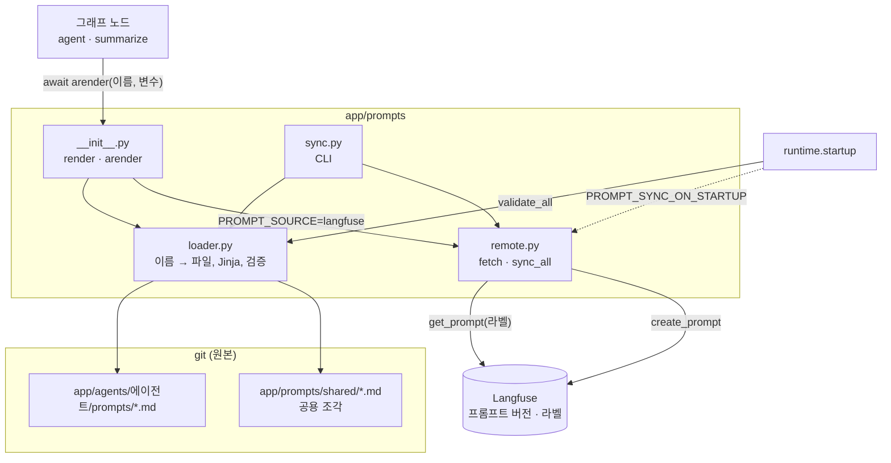
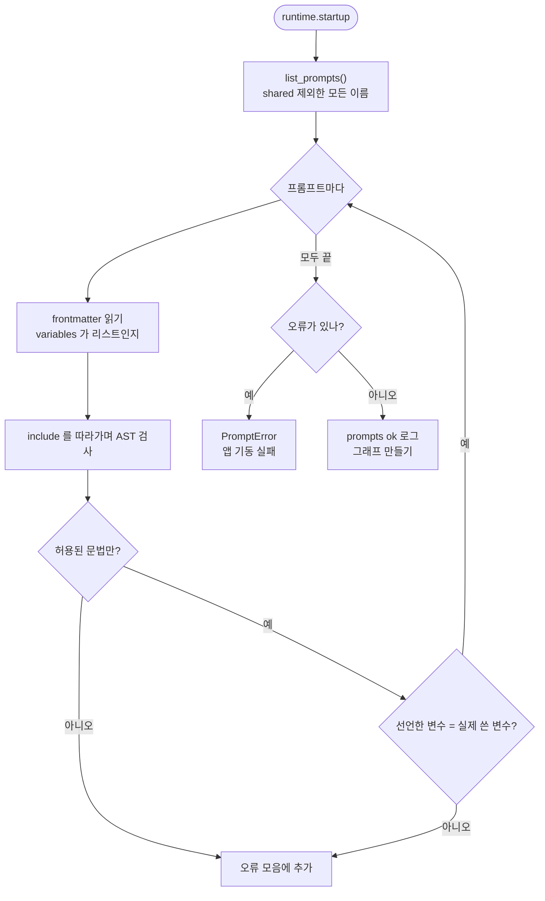
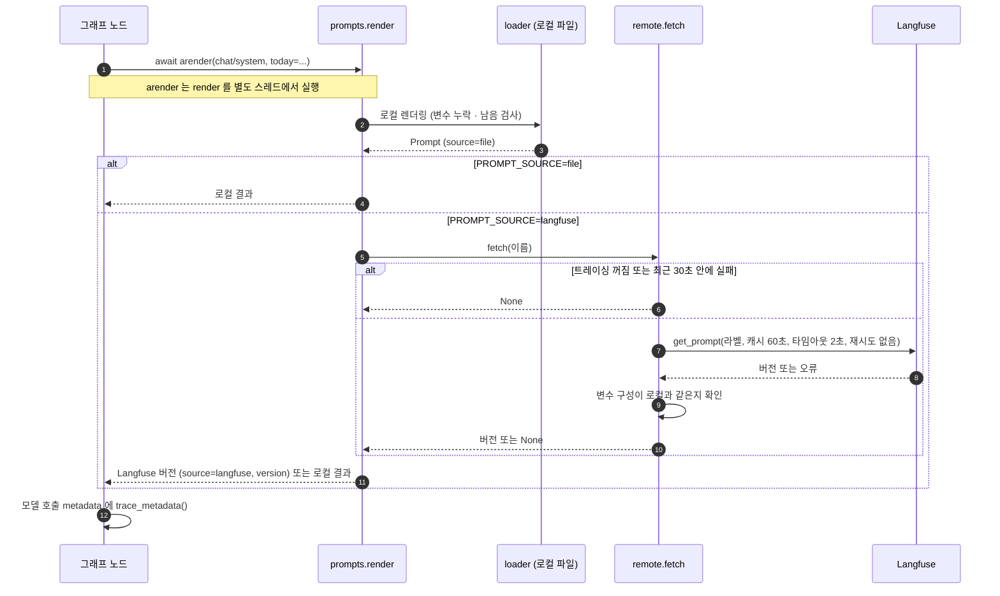
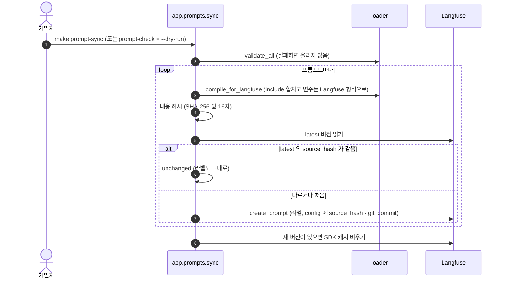
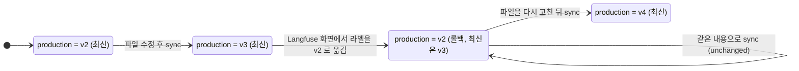

# 프롬프트 관리

> 프롬프트는 git 의 Markdown 파일이 원본이고, 코드는 이름으로 부릅니다. Langfuse 에 버전으로 올려 실행 중에 바꿀 수 있습니다.
> 관련 코드: `backend/app/prompts/`, `backend/app/agents/chat/prompts/`, `backend/app/orchestration/runtime.py`,
> `backend/app/agents/chat/graph.py`, `backend/app/orchestration/summary.py`

## 구조



### 이름과 파일

이름의 첫 부분이 네임스페이스입니다. `shared` 는 예약된 이름이고, 나머지는 `prompts/` 폴더가 있는 에이전트 폴더 이름입니다.

| 이름 | 파일 | 쓰는 곳 |
|---|---|---|
| `chat/system` | `app/agents/chat/prompts/system.md` | 매 호출의 system 프롬프트 |
| `chat/project` | `.../project.md` | 프로젝트 대화일 때 system 프롬프트에 덧붙임 |
| `chat/memory` | `.../memory.md` | 기억을 쓰는 사용자일 때 덧붙임 ([장기 기억](memory.md)) |
| `chat/recalled_memories` | `.../recalled_memories.md` | 마지막 사용자 메시지 앞에 붙이는 관련 기억 |
| `chat/conversation_summary` | `.../conversation_summary.md` | 요약이 있을 때 system 프롬프트에 덧붙임 |
| `chat/summary` | `.../summary.md` | 요약 노드가 요약을 만들 때 |
| `shared/language` | `app/prompts/shared/language.md` | include 전용 조각 |
| `shared/formatting` | `app/prompts/shared/formatting.md` | include 전용 조각 |

`shared` 조각은 단독으로 렌더링하지 않으므로 `list_prompts()` 에서 빠집니다. 검증과 동기화 대상도 아닙니다.

### 파일 형식

YAML frontmatter 와 Jinja2 본문입니다.

```markdown
---
description: 기본 채팅 에이전트의 system 프롬프트
variables: [today]
---
Today's date is {{ today }}.


```

- `variables` 는 렌더링에 필요한 변수 목록입니다. 템플릿이 실제로 쓰는 변수(include 포함)와 정확히 같아야 합니다.
- include 된 조각의 frontmatter 는 본문에 섞이지 않게 읽을 때 지웁니다(`_FrontmatterStrippingLoader`).
- 쓸 수 있는 Jinja 문법은 텍스트, 변수 치환, 정적 include 뿐입니다. `if`, `for`, 필터, 동적 include 는 검증에서 막힙니다.
- 빠진 변수는 빈 문자열이 아니라 오류입니다(`StrictUndefined`). HTML 이 아니므로 자동 이스케이프는 끕니다.

## 흐름

### 검증 (앱 시작 시)



같은 `validate_all` 을 테스트와 `make prompt-sync` 도 부릅니다. 잘못된 프롬프트는 배포 뒤 첫 요청이 아니라 기동할 때 실패합니다.

### 렌더링



- 로컬 렌더링은 출처와 상관없이 항상 먼저 합니다. 그래서 변수 계약은 Langfuse 를 써도 로컬 템플릿 기준입니다.
- Langfuse 를 쓸 수 없으면 로컬 파일로 렌더링합니다. 실패하면 30초 동안 Langfuse 를 부르지 않아서 요청마다 타임아웃을 기다리지 않습니다.
- Langfuse 화면에서 고친 버전의 변수가 코드와 다르면 그 버전은 쓰지 않습니다.
- `trace_metadata()` 의 `langfuse_prompt` 를 보고 Langfuse 콜백이 그 아래 LLM 호출을 프롬프트 버전에 연결합니다.
- agent 노드의 호출에는 `chat/system` 하나만 연결됩니다. 덧붙이는 `chat/project`, `chat/memory` 같은 프롬프트의 버전은 트레이스에 연결되지 않습니다.
  요약 호출에는 `chat/summary` 가 연결됩니다.

### 동기화 (git → Langfuse)



- 공용 조각을 고치면 그 조각을 include 하는 모든 프롬프트의 새 버전이 생깁니다. Langfuse 에는 합친 결과가 올라가기 때문입니다.
- `PROMPT_SYNC_ON_STARTUP=true` 면 앱이 시작할 때 백그라운드 스레드에서 같은 동기화를 합니다. Langfuse 가 늦게 뜰 수 있어 6초 간격으로 10번까지 다시 시도하고, 기동은 막지 않습니다.
- 한 프롬프트가 실패해도 나머지는 계속 올립니다. CLI 는 하나라도 실패하면 종료 코드 1 을 돌려줍니다.

## 상태

Langfuse 쪽 라벨이 어느 버전을 가리키는지가 실행 중인 프롬프트를 정합니다.



- 롤백은 재배포 없이 반영됩니다. 실행 중인 프로세스는 캐시(`PROMPT_CACHE_TTL_SECONDS`, 기본 60초)가 만료되면 새 라벨을 읽습니다.
- 롤백한 뒤 sync 를 다시 돌려도 최신 버전과 내용이 같으면 아무것도 바꾸지 않아서 롤백이 유지됩니다.

| 설정 | 기본값 | 의미 |
|---|---|---|
| `PROMPT_SOURCE` | `file` | `langfuse` 면 라벨이 붙은 버전을 쓰고 실패하면 로컬 파일, `file` 이면 항상 로컬 파일 |
| `PROMPT_LABEL` | `production` | 실행 중 가져올 라벨이자 sync 가 새 버전에 붙일 라벨 |
| `PROMPT_CACHE_TTL_SECONDS` | `60` | Langfuse SDK 캐시 시간. 만료 뒤에는 이전 값을 쓰면서 뒤에서 갱신 |
| `PROMPT_SYNC_ON_STARTUP` | `false` | 기동할 때 자동 sync (개발 환경용) |

Langfuse 키(`LANGFUSE_PUBLIC_KEY`, `LANGFUSE_SECRET_KEY`)가 없으면 `PROMPT_SOURCE=langfuse` 여도 로컬 파일을 씁니다.

## 데이터

앱 DB 에는 프롬프트를 저장하지 않습니다. Langfuse 에 프롬프트 버전이 쌓입니다([데이터 저장 위치](../data/storage-map.md)).
각 버전의 `config` 에 `source: git`, `source_hash`, `git_commit` 이 들어 있어서 어느 커밋에서 올렸는지 알 수 있습니다.

## 설계 결정

**git 이 원본이고 Langfuse 는 사본입니다.** 정식 변경은 파일 수정 뒤 sync 로 합니다. Langfuse 화면에서의 수정은 실험용입니다(`remote.py` 모듈 docstring).

**코드는 경로가 아니라 이름으로 부릅니다.** 저장소를 Langfuse 등으로 바꿔도 에이전트 코드를 고치지 않아도 됩니다(`loader.py` 모듈 docstring).

**Jinja 문법을 변수 치환과 정적 include 로 제한합니다.** Langfuse 템플릿은 `{{var}}` 치환만 있어서,
변수 값에 따라 내용이 달라지는 `if`, `for`, 필터는 옮길 수 없습니다(`loader._ALLOWED_NODES` 주석).

**검증을 기동 시점에 합니다.** 빠진 include 나 변수 불일치를 첫 요청이 아니라 배포 직후에 잡습니다(`runtime.startup` docstring).

**비동기 코드에서는 `arender` 를 씁니다.** Langfuse SDK 의 조회는 동기 HTTP 호출입니다. 캐시가 비어 있을 때 이벤트 루프에서
부르면 다른 요청과 스트리밍이 함께 멈춥니다(`arender` docstring, 커밋 `f89cb7a`).

**내용이 바뀔 때만 새 버전을 만듭니다.** 해시가 같으면 라벨도 건드리지 않아서, 라벨을 옮겨 롤백한 상태가 sync 로 덮어써지지 않습니다(`sync_one` docstring).
