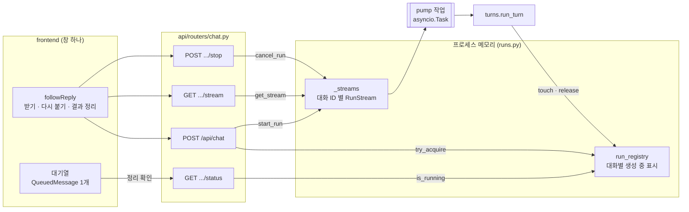
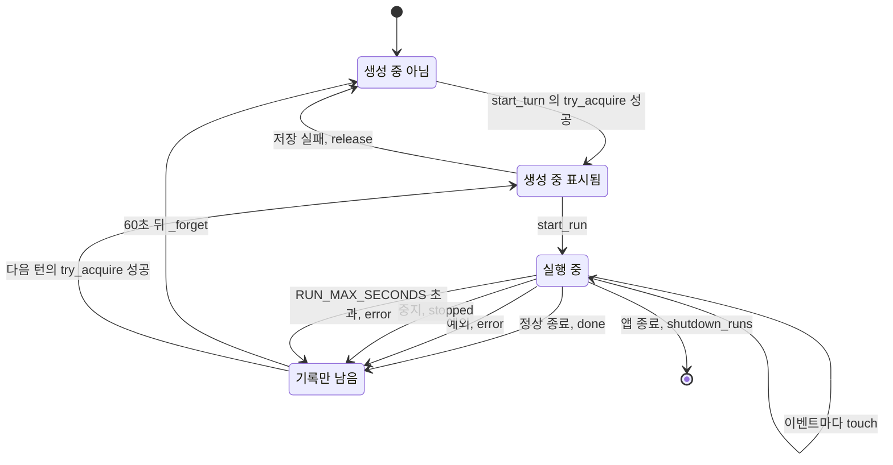
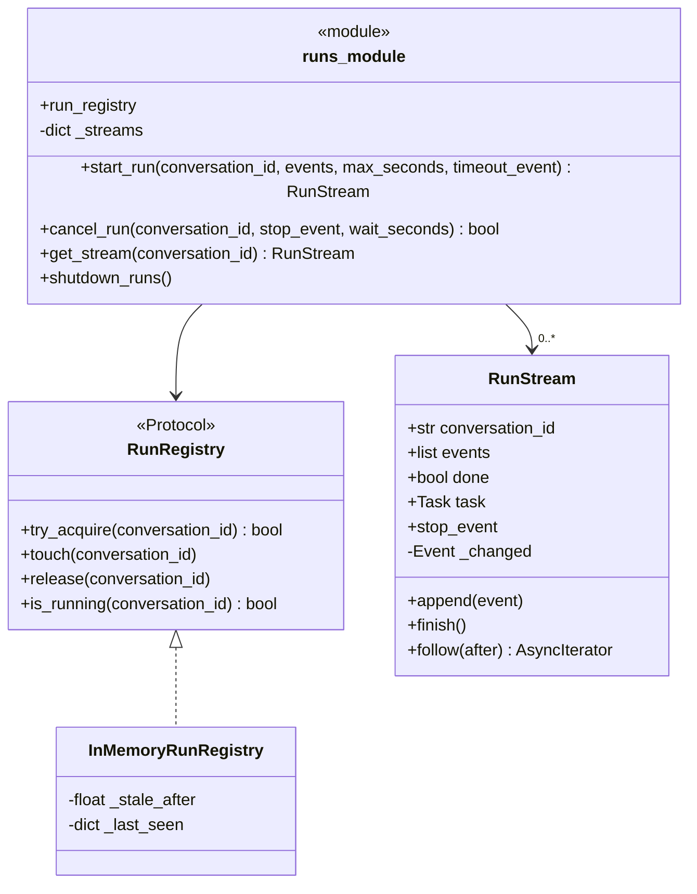
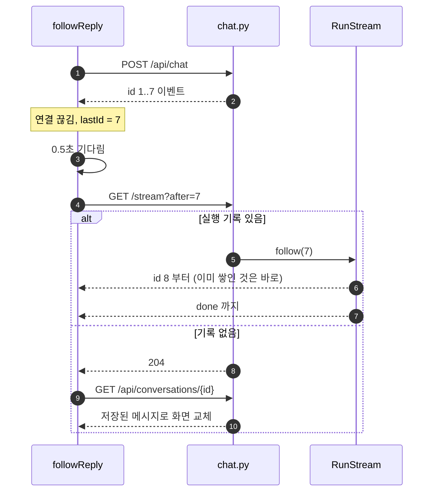
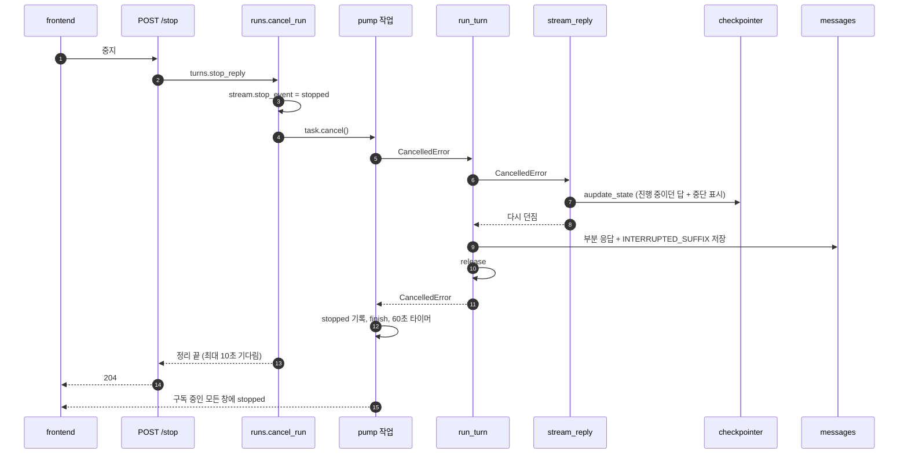

# 백그라운드 실행과 재연결

> 응답은 HTTP 요청과 떨어진 백그라운드 작업에서 만들어집니다. 화면은 번호가 붙은 이벤트 기록을 구독하고, 끊기면 다시 붙고, 중지 API 로 멈춥니다.
> 관련 코드: `backend/app/conversations/runs.py`, `backend/app/conversations/turns.py`, `backend/app/api/routers/chat.py`,
> `backend/app/orchestration/runtime.py`, `backend/app/main.py`, `frontend/src/app/page.tsx`, `frontend/src/lib/api.ts`

한 턴이 무엇을 저장하고 어떤 이벤트를 보내는지는 [chat-turn.md](chat-turn.md)에 있습니다. 이 문서는 실행의 생명주기만 다룹니다.

## 사용자 관점

| 상황 | 동작 |
|---|---|
| 응답 중 새로고침, 탭 닫기, 다른 창이나 기기에서 열기 | 응답은 서버에서 계속 만들어진다. 대화를 열면 `running` 이 `true` 라서 처음 이벤트부터 다시 받는다 |
| 응답을 받다가 연결이 끊김 | 받은 마지막 번호 다음부터 다시 붙는다. 0.5초부터 두 배씩 기다리며 최대 5번 |
| 다시 붙을 실행이 없음 | 서버가 저장한 메시지를 다시 읽어 화면을 바꾼다 |
| 응답 중 다른 대화로 이동 | 허용한다. 이 창의 연결만 끊고 응답은 끝까지 만들어진다 |
| 중지 버튼 | `POST /api/conversations/{id}/stop`. 서버가 부분 응답을 저장한 뒤 돌려준다 |
| 같은 창에서 응답 중 입력 | 대기열에 1개까지 넣는다. 두 번째는 알림으로 거절한다 |
| 다른 창에서 같은 대화에 입력 | 서버가 409 로 거절한다. 입력은 입력창으로 돌아오고, 진행 중인 응답을 이어서 보여 준다 |
| 생성 중인 대화나, 그런 대화가 있는 프로젝트 삭제 | 409 |
| 대기 메시지가 있을 때 다른 대화로 이동 | 막는다 |

서로 다른 대화는 동시에 생성할 수 있습니다. 제한은 대화 하나 단위입니다.

## 구조

프로세스 메모리에는 두 가지가 따로 있습니다.

| 이름 | 답하는 질문 | 쓰는 곳 | 지워지는 때 |
|---|---|---|---|
| `run_registry` | 이 대화에 새 턴을 시작해도 되나 | `start_turn` (409), 삭제 (409), `running`, `/status` | `run_turn` 이 `release` 할 때, 또는 `RUN_STALE_SECONDS` 동안 `touch` 가 없을 때 |
| `_streams` | 이 대화의 이벤트 기록은 어디 있나 | `/stream`, `/stop` | 실행이 끝나고 60초 뒤 (`RETAIN_SECONDS`) |

백엔드 프로세스가 하나라는 가정입니다. 재시작하면 둘 다 사라집니다.

## 상태

대화 하나의 실행 상태입니다.

- `Running` 에서 `Retained` 로 갈 때 생성 중 표시는 이벤트를 기록하기 **전에** 해제합니다. 그래서 `done` 을 받은 화면이 바로 보낸 다음 메시지가 409 를 받지 않습니다.
- `Retained` 에서 새 턴이 시작되면 `_streams` 의 기록을 새 `RunStream` 으로 바꿉니다. 60초 뒤의 `_forget` 은 기록이 자기 것일 때만 지웁니다.
- `touch` 는 그래프 이벤트가 올 때만 부릅니다. `RUN_STALE_SECONDS`(기본 600초) 동안 이벤트가 없으면 `run_registry` 는 작업이 살아 있어도 생성 중이 아니라고 답합니다.
  응답 시작 직전에 연결이 끊겨 `release` 가 빠지는 경우를 위한 장치입니다(`InMemoryRunRegistry` docstring).

## 주요 타입

- `RunRegistry` 는 Protocol 입니다. 프로세스를 늘리면 같은 인터페이스로 Redis 구현(`SET NX` + TTL)을 만들어 바꿔 끼운다고 모듈 설명에 적혀 있습니다.
  `_streams` 와 `RunStream` 은 Protocol 뒤에 있지 않아서, 그것까지 옮기는 방법은 코드에 정해져 있지 않습니다.
- `try_acquire` 는 확인과 표시 사이에 `await` 가 없어서 같은 이벤트 루프 안에서 원자적입니다.
- `RunStream._changed` 는 변화가 생길 때마다 새 `asyncio.Event` 로 바뀝니다. `follow` 는 기록을 확인하기 전에 지금 Event 를 잡아 두어서 그 사이의 변화를 놓치지 않습니다.

## 이벤트 번호와 다시 붙기

- `RunStream.events[i - 1]` 이 `i` 번 이벤트입니다. 번호는 1부터 시작하고 실행마다 새로 셉니다.
- `follow(after)` 는 `after + 1` 번부터 보냅니다. 이미 쌓인 이벤트는 바로 보내고, 그 뒤는 `append` 를 기다립니다.
- 구독자가 여럿이어도 같은 기록을 읽습니다. 구독을 끊어도 실행은 멈추지 않습니다(`sse_numbered` 가 구독만 닫음).
- `GET /api/conversations/{id}/stream` 은 `after` 쿼리와 `Last-Event-ID` 헤더 중 큰 값을 씁니다. 화면(`resumeStream`)은 `?after=` 만 보냅니다.
  `Last-Event-ID` 는 브라우저 `EventSource` 를 위한 것입니다.
- 실행 기록이 없으면 204 입니다. 실행한 적이 없거나, 끝난 지 60초가 지났거나, 서버가 재시작한 경우입니다.

- 다시 붙기는 `lastId` 가 0보다 크고 대화 ID 를 알 때만 합니다. 첫 이벤트도 받지 못하고 실패하면 오류로 처리합니다.
- 5번 모두 실패해도 저장된 메시지를 다시 읽습니다.
- 대화를 열 때 `running` 이 `true` 면 `attachRun` 이 `after=0` 으로 붙어 처음부터 받습니다.

## 중지

- 연결을 끊는 것으로는 멈추지 않습니다. 실행이 요청과 떨어져 있기 때문입니다.
- `cancel_run` 은 정리가 끝날 때까지 최대 10초 기다린 뒤 돌려줍니다. 그래서 화면은 204 를 받자마자 대기 메시지를 보낼 수 있습니다.
- 새 대화에서 `meta` 를 받기 전에 중지를 누르면, 화면이 표시만 해 두고 `meta` 를 받는 즉시 중지 API 를 부릅니다.
- 중지 API 가 실패하면 화면은 알림을 띄우고 이 창의 연결만 끊습니다. 서버의 실행은 계속됩니다.
- 생성 중이 아니면 아무 일도 하지 않고 204 입니다.

### 끊긴 답을 checkpoint 에 넣기

LangGraph 는 노드가 끝나야 checkpoint 를 씁니다. 답을 쓰는 도중에 끊기면 그 답은 checkpoint 에 없습니다. 그러면 모델은 다음 턴에 자기가 한 말을 모르고, checkpoint 에는 사용자 메시지만 연달아 남습니다.

- `stream_reply` 는 아직 checkpoint 에 들어가지 않은 답 글자(`pending`)와 그 노드를 모읍니다. 답 노드가 끝나 `updates` 에 `AIMessage` 가 오면 비웁니다.
- 중지, 시간 초과, 앱 종료, 구독 종료, 오류로 끊기면 `pending` 에 `INTERRUPTED_NOTE`(`[This reply was cut off before it was finished.]`)를 붙여 `aupdate_state(as_node=그 노드)` 로 넣습니다.
  도구 호출 없는 답으로 들어가므로 다음 턴은 평소처럼 시작됩니다.
- 넣는 동안은 취소에서 보호하고, 실패하면 로그만 남기고 원래 예외를 그대로 던집니다.
- 이미 checkpoint 에 들어간 앞 단계의 답과 추론 과정은 넣지 않습니다.
- 도구를 실행하던 중에 끊기면 넣을 글자가 없고, checkpoint 에 결과 없는 도구 호출이 남습니다. 다음 턴에 `context.close_dangling_tool_calls` 가 메웁니다.

## 시간 상한과 앱 종료

| 경우 | 동작 | 화면이 받는 것 |
|---|---|---|
| `RUN_MAX_SECONDS` 초과 (기본 600초) | `pump` 의 `asyncio.timeout` 이 `run_turn` 을 취소한다. 부분 응답은 중단으로 저장된다 | 시간 초과 `error` (`transient: false`) |
| 앱 종료 | lifespan 이 `runs.shutdown_runs()` 로 모든 실행을 취소하고 기다린 뒤 `runtime.shutdown()` 을 부른다 | 끝 이벤트 없이 스트림이 닫힘. 다시 붙기가 204 를 받으면 저장된 메시지를 읽는다 |

`shutdown_runs` 를 `runtime.shutdown` 보다 먼저 부르는 것은 checkpointer 연결 풀이 열려 있을 때 끊긴 답을 넣기 위해서입니다(`main.py` 주석).

## 대기열 (frontend)

생성 중에 입력한 메시지는 서버로 보내지 않고 화면이 `QueuedMessage` 1개로 들고 있습니다. 앞 응답이 끝나면 결과에 따라 처리합니다.

| 앞 응답의 결과 (`Outcome`) | 대기 메시지 |
|---|---|
| `done` | 바로 보낸다. 서버가 `done` 전에 해제했으므로 기다리지 않는다 |
| `aborted` (중지), `ended`, `gone` | `GET /status` 를 150ms 마다 최대 10초 확인하고, 생성 중이 아니면 보낸다. 10초가 지나면 멈추고 안내한다 |
| `error`, `busy` | 자동 전송을 멈추고 "지금 보내기" 버튼을 보여 준다 |

정리 전에 보내면 다른 창의 요청처럼 409 로 거절되고 저장 순서도 뒤바뀝니다(`waitUntilIdle` 주석). 대기 메시지가 있으면 다른 대화로 옮길 수 없습니다. 보낼 대화가 사라지기 때문입니다.

## 데이터

이 기능은 DB 에 새로 쓰는 것이 없습니다. 실행 상태와 이벤트 기록은 [프로세스 메모리](../data/storage-map.md#프로세스-메모리에-있는-것)에만 있습니다.
중단된 답은 `messages` 와 checkpointer 에 각각 저장됩니다. 저장 내용은 [chat-turn.md](chat-turn.md#끝나는-방식)에 있습니다.

## 설계 결정

- **대화당 실행은 하나.** 같은 대화에 응답이 두 개 동시에 생성되면 checkpointer 상태가 갈라져 한쪽 대화가 모델의 기억에서 사라집니다(`runs.py` 모듈 설명).
- **같은 창의 추가 질문은 서버가 아니라 화면이 줄 세운다.** 서버는 거절만 하고, 대기열은 프론트엔드가 맡습니다(`runs.py` 모듈 설명, 커밋 `a08d7a9`). 대기열을 1개로 정한 이유는 적혀 있지 않습니다.
- **실행 상태는 메모리에, Protocol 뒤에.** 지금은 백엔드 프로세스가 하나라서 메모리로 충분하고, 늘리면 Redis 로 바꿉니다(`runs.py` 모듈 설명).
- **응답은 백그라운드 작업에서 만든다.** 요청 안에서 돌면 새로고침이나 탭 닫기로 생성이 멈췄습니다(커밋 `9ff8d57`).
- **끝난 기록을 60초 남긴다.** 늦게 붙은 화면도 끝부분을 받게 하기 위해서입니다(`RETAIN_SECONDS` docstring). 60이라는 값의 근거는 적혀 있지 않습니다.
- **실행 시간 상한.** 아무도 보지 않는 실행이 끝없이 비용을 쓰지 않게 하는 안전장치입니다. 모델이 토큰 사이에 기다릴 수 있는 시간(`ollama_timeout_seconds`)보다 길어야 합니다(`Settings` docstring).
- **중지는 명시적인 API.** 실행이 요청과 떨어지면서 연결 끊기로는 멈출 수 없게 됐습니다(커밋 `1dd44de`, `5616ba3`).
- **끊긴 답을 checkpoint 에 넣는다.** 넣지 않으면 "이어서 해 줘" 에 모델이 무엇을 이어야 할지 몰랐습니다(커밋 `fbbed0c`). 표시 문구는 모델이 읽으므로 영어입니다.
