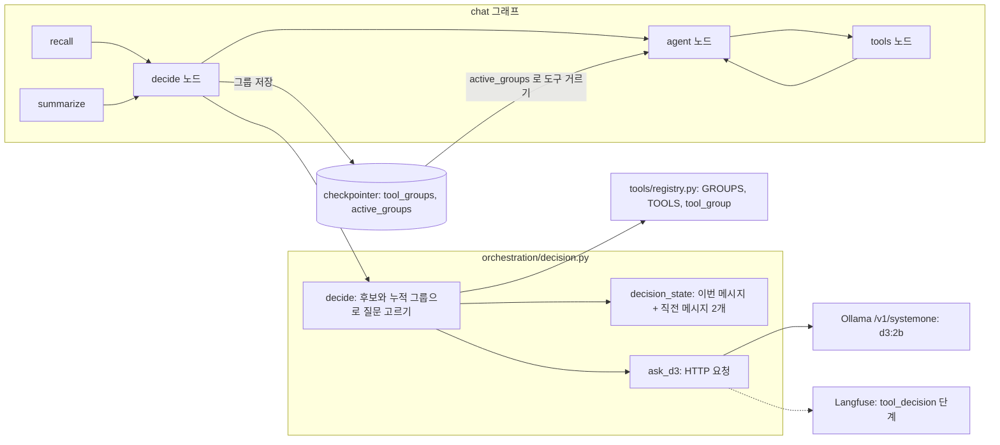
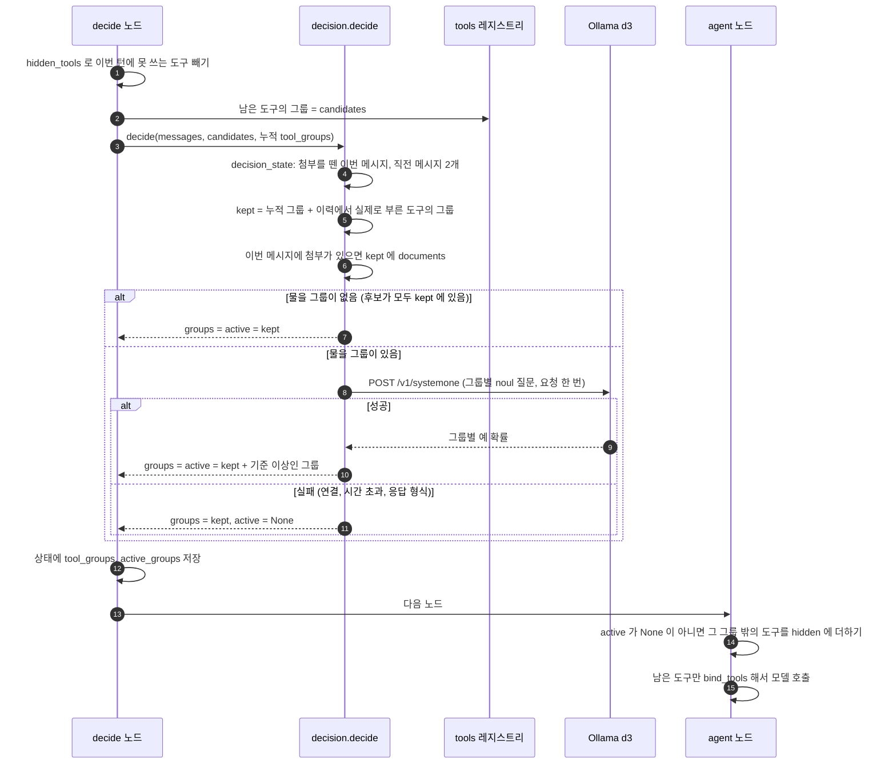
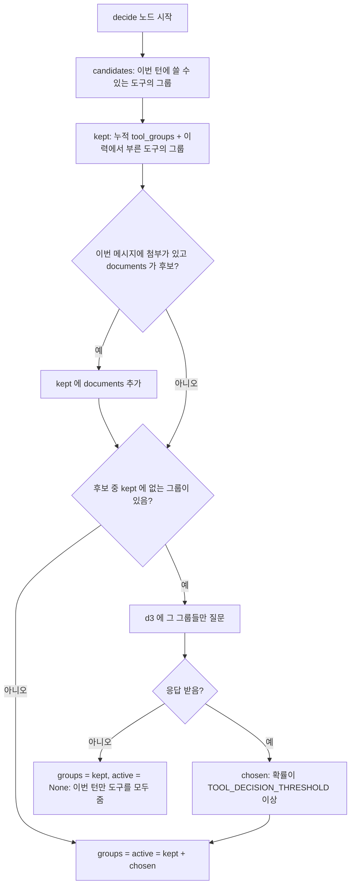
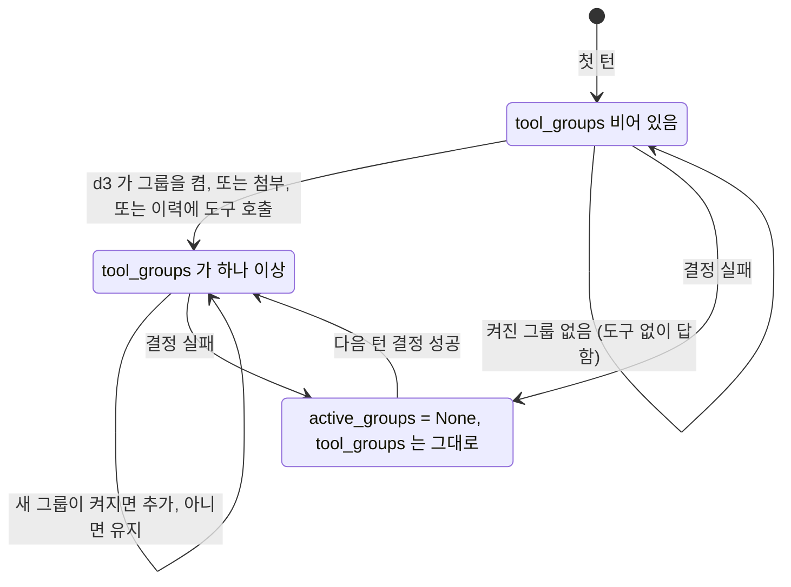
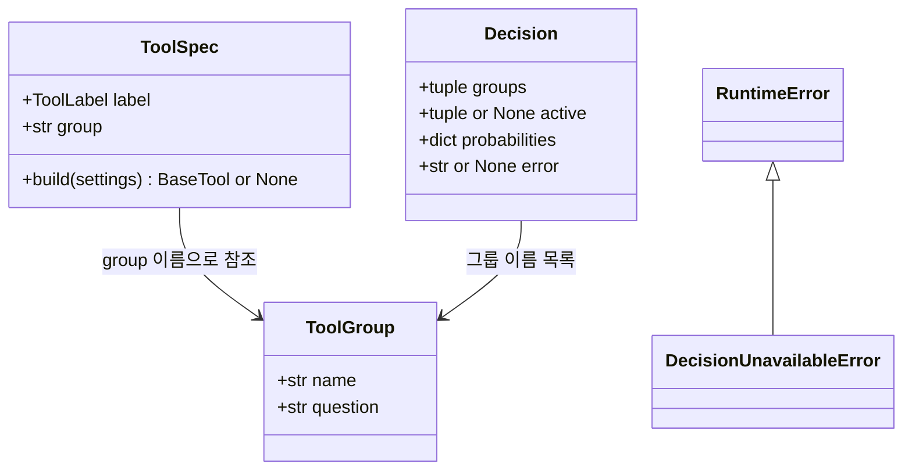

# 도구 결정

> 본 모델을 부르기 전에 결정 모델(d3)이 이번 메시지에 필요한 도구 그룹을 고르고, 본 모델에게는 그 그룹의 도구만 줍니다.
> 관련 코드: `backend/app/orchestration/decision.py`, `backend/app/tools/registry.py`, `backend/app/agents/chat/graph.py`, `backend/app/core/config.py`

도구 정의는 매 요청 프롬프트에 들어갑니다. 쓸 일이 없는 도구까지 주면 토큰을 쓰고, 모델이 도구를 헛되이 부를 수 있습니다.
이 기능은 기본으로 꺼져 있습니다(`ENABLE_TOOL_DECISION=false`). 끄면 쓸 수 있는 도구를 모두 줍니다.

한 턴의 전체 흐름은 [한 턴의 흐름](chat-turn.md)에 있습니다. 이 문서는 그래프의 `decide` 노드만 다룹니다.

## 구조

- `decide` 노드는 `ENABLE_TOOL_DECISION` 이 켜져 있고 쓸 수 있는 도구가 하나라도 있을 때만 그래프에 들어갑니다.
- 턴마다 한 번만 실행됩니다. `tools` 노드가 끝나면 `agent` 로 바로 돌아가고 `decide` 를 다시 거치지 않습니다.
- `ask_d3` 호출은 `RunnableLambda(name="tool_decision")` 로 감싸서, Langfuse 트레이스에 보낸 상태와 질문, 그룹별 확률이 한 단계로 남습니다.

## 도구 그룹

그룹과 질문은 `tools/registry.py` 의 `GROUPS` 에 있습니다. 도구마다 `ToolSpec.group` 으로 그룹 하나에 속합니다.
질문은 결정 모델이 읽으므로 영어입니다.

| 그룹 | 도구 | 질문의 뜻 |
|---|---|---|
| `time` | `get_current_time` | 현재 날짜나 시간이 필요한가 |
| `web` | `web_search`, `fetch_url` | 웹 검색이나 페이지 읽기가 필요한가 (뉴스, 바뀌는 사실, 가격, URL) |
| `documents` | `read_document`, `search_project` | 첨부 파일이나 프로젝트 문서에 대한 질문인가 |
| `memory` | `remember`, `forget`, `update_profile`, `search_memories` | 사용자에 대한 메모를 저장, 수정, 삭제해야 하는가 |

새 그룹을 만들면 질문도 같이 씁니다. 질문은 상태의 필드를 백틱으로 가리킵니다(`latest_message`, `previous_turns`).

## 흐름

### 결정 모델에게 보내는 것

`decision_state` 가 만듭니다.

| 필드 | 내용 |
|---|---|
| `latest_message` | 이번 사용자 메시지에서 첨부 목록을 뗀 글. 500자(`MAX_MESSAGE_CHARS`)까지. 글 없이 첨부만 있으면 `(no text, only attachments)` |
| `previous_turns` | 그 앞의 사용자 메시지와 답변 텍스트 중 마지막 2개(`PREVIOUS_MESSAGES`). 각각 500자까지 |

도구 호출과 결과, 첨부 문서 본문은 보내지 않습니다. 직전 메시지는 "두 번째 기사 더 자세히" 같은 이어지는 질문을 판단하게 합니다.

요청 본문은 `{"model", "state", "questions": {그룹: {"type": "noul", "instructions": 질문}}, "keep_alive"}` 입니다.
응답의 `answers[그룹]["noul"]` 을 "예" 확률(0~1)로 읽습니다.

## 그룹을 고르는 규칙

- **후보 거르기.** 이번 턴에 쓸 수 없는 도구의 그룹은 묻지 않습니다. 기억을 끈 사용자는 `memory`, 프로젝트 밖의 대화는
  `search_project` 가 빠집니다(`hidden_tools`). `documents` 그룹은 `read_document` 가 남아 있으면 후보입니다.
- **누적.** 한 번 켜진 그룹은 그 대화에서 계속 켜져 있고, 다시 묻지 않습니다.
- **이전에 쓴 도구.** 이력에 있는 도구 호출의 그룹은 켜진 것으로 봅니다(`used_groups`). 도구 결정을 켜기 전에 시작한 대화나
  결정이 실패해 모든 도구를 줬던 턴의 호출도 여기에 들어갑니다.
- **첨부 문서.** 이번 메시지에 첨부가 있으면 `documents` 를 묻지 않고 켭니다.
- **모두 기준 아래.** 켜진 그룹이 없으면 `active` 가 빈 목록이고, 모델은 도구 없이 답합니다.
- **순서.** 그룹 목록은 항상 `GROUPS` 에 정의한 순서로 저장합니다(`_ordered`).

## 상태

`tool_groups` 는 대화가 이어지는 동안 늘어나기만 합니다. `active_groups` 는 매 턴 새로 씁니다.

| 필드 | 저장 위치 | 뜻 |
|---|---|---|
| `tool_groups` | checkpointer | 이 대화에서 지금까지 켜진 그룹 (누적) |
| `active_groups` | checkpointer | 이번 턴에 줄 그룹. `None` 이면 도구를 모두 줌 |

결정이 실패한 턴의 `AllTools` 에서 모델이 새 그룹의 도구를 부르면, 다음 턴에 `used_groups` 가 그 그룹을 누적에 넣습니다.

## 실패하면

`ask_d3` 는 연결 실패, 200 이 아닌 응답, 예상과 다른 응답 형식을 `DecisionUnavailableError` 로 바꿉니다. `decide` 는 이 예외와
시간 초과(`asyncio.timeout(TOOL_DECISION_TIMEOUT_SECONDS)`)를 잡아 경고 로그를 남기고, 이번 턴만 도구를 모두 줍니다.
누적 목록에는 새 그룹을 넣지 않습니다. 결정 모델이 없어도 답변은 실패하지 않습니다.

## 주요 타입

`Decision.probabilities` 와 `error` 는 그래프가 상태에 저장하지 않고, 지금은 테스트에서만 읽습니다. 확률은 Langfuse 트레이스의
`tool_decision` 단계에서 볼 수 있습니다.

## 설정

| 설정 | 기본값 | 뜻 |
|---|---|---|
| `ENABLE_TOOL_DECISION` | `false` | 도구 결정 켜기 |
| `TOOL_DECISION_MODEL` | `d3:2b` | 결정 모델 (`ollama pull d3:2b`) |
| `TOOL_DECISION_URL` | 비움 | 결정 모델을 서빙하는 Ollama 주소. 비우면 `OLLAMA_BASE_URL` |
| `TOOL_DECISION_THRESHOLD` | `0.5` | 그룹을 켜는 확률 기준 |
| `TOOL_DECISION_TIMEOUT_SECONDS` | `3.0` | httpx 요청과 전체 결정 양쪽에 거는 시간 제한 |
| `TOOL_DECISION_KEEP_ALIVE` | `30m` | 결정 모델을 메모리에 남겨 둘 시간 |

결정 모델은 채팅에 고른 모델과 상관없이 항상 Ollama 에서 부릅니다. 채팅을 Claude 로 해도 도구 결정을 켜면 Ollama 가 필요합니다.
`config.py` 의 실측 메모에 따르면 M5 Pro 에서 d3:2b 첫 요청은 약 0.8초, 그 뒤는 약 0.2초입니다.

## 데이터

| 저장소 | 키 | 내용 |
|---|---|---|
| checkpointer | `tool_groups`, `active_groups` | 위 "상태" 표 |
| Langfuse | `tool_decision` 단계 | 보낸 상태, 질문, 그룹별 확률 |

자세한 위치는 [데이터 저장 위치](../data/storage-map.md#checkpointer-에-있는-것)에 있습니다.

## 설계 결정

- **결정 모델은 생성이 아니라 분류를 쓴다.** d3 는 질문마다 확률만 돌려줘서 빠르고 형식 오류가 없습니다(`decision.py` 모듈 docstring).
  본 모델에게 JSON 으로 고르게 하는 방식과 비교한 기록은 없습니다.
- **그룹마다 예/아니오 질문 하나, 요청은 한 번.** 그룹 수만큼 요청하지 않고 한 번에 묻습니다. 여러 그룹이 동시에 켜질 수 있습니다.
- **켜진 그룹은 누적한다.** 도구 정의는 프롬프트 맨 앞에 있어서, 목록이 바뀌면 그 뒤의 대화 이력 전체가 프롬프트 캐시에서 빠집니다
  (커밋 `c546e89`). 누적하면 목록은 대화마다 몇 번만 바뀝니다. 대신 한 번 켜진 도구는 필요 없는 턴에도 들어갑니다.
- **이력에서 부른 도구의 그룹을 켠다.** 이력에 도구 호출이 있는데 그 도구 정의가 없으면 모델이 이력을 이해하지 못하거나 provider 가
  요청을 거절할 수 있습니다(`decision.py` 모듈 docstring).
- **첨부가 있으면 documents 를 강제로 켠다.** 긴 첨부는 `read_document` 로만 읽을 수 있기 때문으로 보입니다. 코드와 커밋에는 규칙만
  있고 이유는 적혀 있지 않습니다.
- **실패하면 모든 도구를 준다.** 결정은 최적화일 뿐이라, 실패해도 기능은 결정을 끈 상태와 같아야 합니다. 누적 목록을 바꾸지 않아서
  다음 턴은 실패 전 상태에서 다시 시작합니다.
- **기본은 꺼짐.** 켜면 로컬 Ollama 와 3.1GB 모델이 필요합니다.
