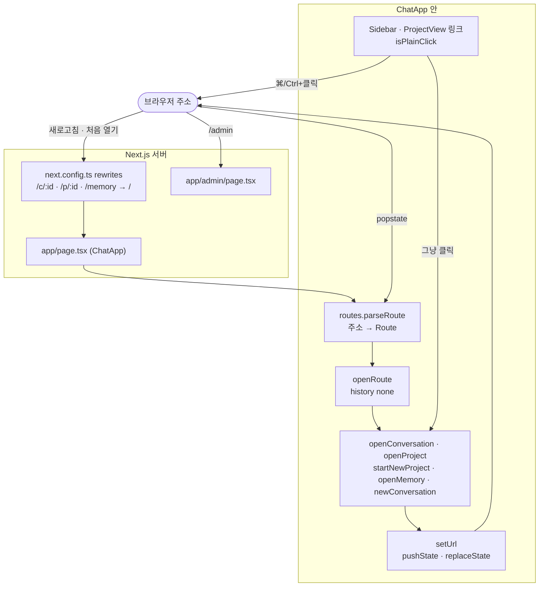
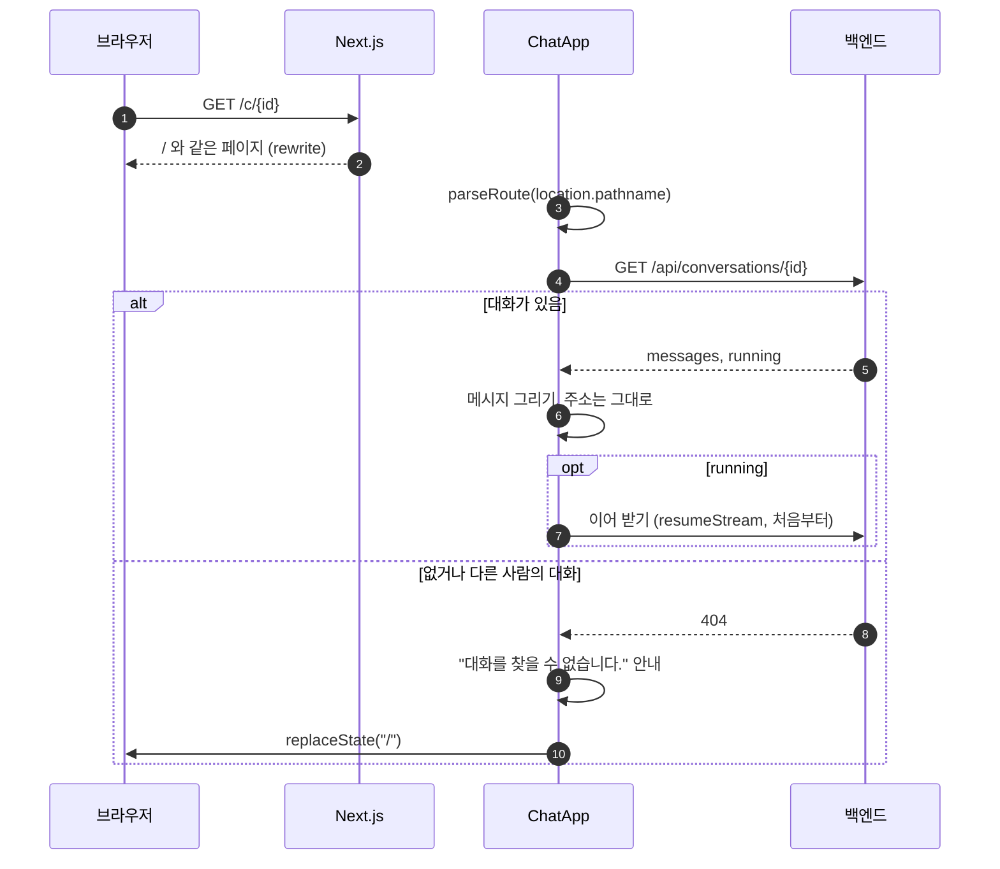
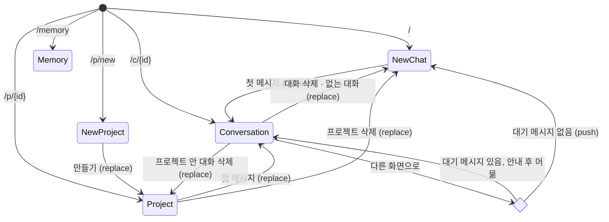

# 화면 주소 (URL 라우팅)

> 채팅 앱은 페이지 하나로 두고 History API 로 주소만 바꿉니다. 새로고침, 뒤로 가기, 새 탭, 북마크가 주소대로 그 화면을 엽니다.
> 관련 코드: `frontend/src/lib/routes.ts`, `frontend/src/app/page.tsx`, `frontend/next.config.ts`,
> `frontend/src/components/{Sidebar,ProjectView}.tsx`, `frontend/src/app/admin/page.tsx`

## 사용자 관점

| 주소 | 화면 |
|---|---|
| `/` | 새 대화 |
| `/c/{대화 ID}` | 대화 (프로젝트 안의 대화도 같은 주소) |
| `/p/{프로젝트 ID}` | 프로젝트 화면 |
| `/p/new` | 새 프로젝트 만들기 |
| `/memory` | 기억 관리 (사이드바 아래 사용자 메뉴의 "기억") |
| `/admin` | 가입 승인 관리 (관리자에게만 "관리" 링크가 보임) |

- 대화·프로젝트를 옮기면 기록이 쌓여 브라우저 뒤로·앞으로 가기가 됩니다.
- 사이드바의 대화·프로젝트 목록, "기억" 링크, 프로젝트 화면의 대화 목록은 진짜 링크(`<a href>`)입니다. ⌘/Ctrl+클릭이나 가운데 클릭은 새 탭에서 열립니다.
- 탭 제목은 `대화 제목 - Apogee Deck` 이나 `프로젝트 이름 - Apogee Deck` 입니다. 새 프로젝트는 "새 프로젝트", 기억 관리는 "기억", 새 대화는 `Apogee Deck` 입니다.
- 응답을 만드는 중에 다른 화면으로 옮기거나 새로고침해도 응답은 서버에서 계속 만들어집니다. 그 대화를 다시 열면 이어서 보입니다.
- 대기 메시지가 있으면 다른 화면으로 옮기지 못합니다. "대기 메시지가 전송된 뒤에 이동할 수 있습니다." 안내가 뜹니다.

## 구조

- `Route` 는 `new`, `conversation`, `project`, `newProject`, `memory` 다섯 가지입니다. `routePath` 가 반대로 주소를 만듭니다.
- `/admin` 은 별도 Next.js 페이지입니다. History API 라우팅에 들어가지 않고, 사이드바의 "관리" 링크는 페이지를 새로 불러옵니다.
  관리 화면은 [Google 로그인과 승인제](auth-approval.md)에 있습니다.

## 흐름

### 처음 열기와 새로고침

- 주소로 연 화면은 기록을 더 쌓지 않습니다(`history: "none"`). 뒤로·앞으로 가기(`popstate`)도 같은 길로 엽니다.
- 응답을 만드는 중에 새로고침하면 `running` 이 참이라 `attachRun` 이 진행 중인 응답에 다시 붙습니다.
  이어 받는 방식은 [백그라운드 실행](streaming-runs.md#이벤트-번호와-다시-붙기)에 있습니다.

### 주소 바꾸기

`setUrl(path, mode)` 가 주소를 바꿉니다. 지금 주소와 같으면 기록을 남기지 않습니다.

| 상황 | 방식 | 결과 |
|---|---|---|
| 목록에서 대화·프로젝트 열기, 새 대화, 새 프로젝트, 기억 | `push` | 기록이 하나 쌓임 |
| 첫 메시지로 대화가 만들어짐 (`meta` 이벤트) | `replace` | `/` 또는 `/p/{id}` 가 `/c/{id}` 로 바뀜. 뒤로 가기에 빈 화면이 끼지 않음 |
| 프로젝트를 만듦 | `replace` | `/p/new` 가 `/p/{id}` 로 바뀜 |
| 보던 대화를 지움 | `replace` | 프로젝트 안의 대화면 `/p/{id}`, 아니면 `/` |
| 보던 프로젝트를 지움 | `replace` | `/` |
| 주소로 연 대화가 없음 | `replace` | `/` |
| 처음 열기, 뒤로·앞으로 가기 | `none` | 주소는 브라우저가 이미 바꿈 |

## 상태

화면 사이의 이동입니다. 모든 화면은 사이드바에서 서로 옮길 수 있고, 아래 그림은 주소가 바뀌는 특별한 경우만 표시합니다.

- 대기 메시지는 응답을 만드는 동안 보낸 다음 메시지입니다. 옮기면 보낼 곳이 사라져서 막습니다([대기열](streaming-runs.md#대기열-frontend)).
- 응답을 만드는 중이기만 하면 옮길 수 있습니다. 이 창의 스트림만 끊고(`detachStream`) 서버의 응답은 계속됩니다.
- 브라우저 뒤로 가기는 막을 수 없습니다. 대기 메시지가 있으면 `popstate` 에서 원래 주소를 다시 `pushState` 하고 안내합니다.
- 응답 생성 중이거나 대기 메시지가 있으면 보던 대화를 지울 수 없습니다.

## 예외와 한계

- **없는 프로젝트.** `/p/{id}` 는 존재를 먼저 확인하지 않습니다. 프로젝트 화면이 불러오지 못하면 그 자리에 오류 글을 보여 주고 주소는 그대로입니다.
- **잘못된 ID.** `/c/` 나 `/p/` 뒤가 UUID 가 아니면 `parseRoute` 가 새 대화로 엽니다. 안내 없이 주소만 `/` 와 다른 채로 남습니다.
- **모르는 주소.** rewrite 는 `/c/:id`, `/p/:id`, `/memory` 만 같은 페이지로 돌립니다. `/foo` 나 `/c/a/b` 를 새로고침하면 Next.js 의 404 페이지가 나옵니다.
  `parseRoute` 의 "모르는 주소는 새 대화" 규칙은 앱 안의 이동에만 쓰입니다.
- **탭 제목.** 대화 목록과 프로젝트 목록을 읽은 뒤에 정해집니다. 목록을 받기 전에는 `Apogee Deck` 입니다.

## 설계 결정

- **페이지 하나에 History API.** 페이지를 다시 불러오지 않아서 대화를 옮겨도 사이드바, 모델 선택 같은 상태가 그대로입니다(a92ea55).
- **새로고침은 rewrite 로.** 화면별 Next.js 라우트를 만들지 않고 같은 페이지를 돌려준 뒤 화면이 주소를 읽습니다(a92ea55).
- **주소부터 만들었다.** 응답 생성을 HTTP 연결에서 떼어 새로고침 뒤 다시 붙으려면 새로고침 뒤에도 어느 대화였는지 알아야 했습니다(a92ea55).
  그 뒤 진행 중인 응답에 다시 붙는 기능이 들어왔습니다(68d2357).
- **첫 메시지는 replace.** push 로 쌓으면 뒤로 가기가 빈 새 대화 화면으로 갑니다.
- **목록은 진짜 링크.** 버튼으로 두면 ⌘/Ctrl+클릭으로 새 탭을 열 수 없습니다. 그냥 클릭만 가로채고 나머지는 브라우저에 맡깁니다(`isPlainClick`).
- **대기 메시지만 이동을 막는다.** 처음에는 응답 생성 중의 뒤로 가기도 막았습니다(a92ea55). 응답이 서버의 백그라운드 작업이 된 뒤로는 옮겨도 잃는 것이 없어서,
  보낼 곳이 사라지는 대기 메시지만 막습니다(`navigationBlocked`).
